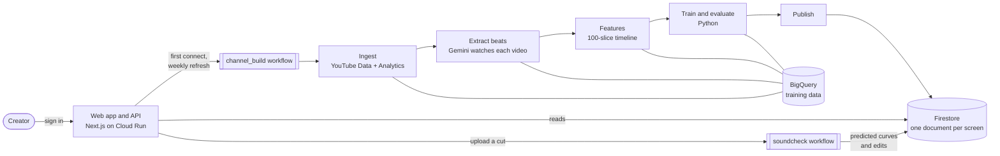

# Soundcheck

**See how each of your audiences will watch a new cut before you publish it.**

Soundcheck learns how a YouTube creator's audiences actually watch, from the creator's own back catalogue. It then predicts the retention curve of a new cut for each audience, with an uncertainty band, and suggests edits with their measured effect. It also publishes its own error against simple baselines, so a creator can see how far to trust it.

> **Status: working prototype.** The full product runs end to end on Google Cloud: sign-in, channel build, the audiences and video screens, soundchecks of new cuts, and suggested edits. The model does not yet beat the simplest baseline (see [Benchmark](#benchmark)), so treat its findings as leads to test, not answers.

## Contents

- [What it does](#what-it-does)
- [How it works](#how-it-works)
- [Benchmark](#benchmark)
- [Tech stack](#tech-stack)
- [Repository layout](#repository-layout)
- [Getting started](#getting-started)
- [Deployment](#deployment)
- [Configuration](#configuration)
- [Security and privacy](#security-and-privacy)
- [Known limitations](#known-limitations)
- [Documentation](#documentation)
- [License](#license)

## What it does

| Screen            | What the creator gets                                                                                                                                               |
| ----------------- | ------------------------------------------------------------------------------------------------------------------------------------------------------------------- |
| **Audiences**     | Who watches (subscribers, newcomers), how long each audience stays, and what keeps each one watching, in plain words with effect sizes                              |
| **Videos**        | Every analysed video with its biggest drop-off, searchable and sortable                                                                                             |
| **Video autopsy** | One video's retention curve per audience, lined up with the beats Gemini found (hook, story, sponsor read, recap…)                                                  |
| **Soundcheck**    | Upload a cut (or paste an unlisted YouTube link) and get each audience's predicted curve, with an 80% range                                                         |
| **Edits**         | Suggested cuts and moves, each with its predicted effect. Toggle them on and off and the curve updates in about a third of a second. Export a cut list and chapters |

**Measured and estimated audiences.** YouTube reports a separate retention curve only for subscribers and non-subscribers. So those two audiences are measured. Search, suggested and browse viewers are estimated from each video's traffic mix, and they are shown only when the data can tell them apart.

**Honest by default.** A channel with too little data still gets its screens, labelled "not a result yet". Each model is scored on videos it never saw, against the channel's own average curve and a generic Gemini guess.

## How it works



1. **Connect.** The creator signs in with Google and grants read-only YouTube access. The refresh token is encrypted with Cloud KMS, and the channel build starts.
2. **Channel build** (about 1.5 hours the first time, unattended). Eight Cloud Run jobs, chained by Cloud Workflows:
   - ingest the catalogue and retention curves;
   - have Gemini split every video into typed beats;
   - align the beats to the curve on a 100-slice timeline;
   - fit one model per audience, then test it on held-out videos;
   - publish the screens to Firestore.
3. **Read a screen.** Each screen is a single Firestore document. No screen queries BigQuery.
4. **Soundcheck a new cut** (minutes). An upload to Cloud Storage starts a workflow. One job watches the cut with Gemini, predicts each audience and searches for the best edits. Toggling an edit re-predicts in the API from cached coefficients.

**The model.** It is a discrete-time hazard model: for each audience, a penalised logistic regression of the share of viewers who leave in each 1% of a video.

- **Weights:** within a video by viewers still watching. Each video counts log(1 + views), so one viral video cannot dominate.
- **Evaluation:** on held-out videos, against three baselines:
  - B0, the channel's average curve;
  - B1, a generic Gemini guess;
  - B2, the same model without content features.

**Design rules that keep it honest:**

- **TypeScript computes every feature,** for training and prediction alike. Python only fits and evaluates, and a cross-language parity test proves both sides predict identically.
- **No outcome data as a feature.** Views and watch time are labels or weights, never inputs.
- **Every value that crosses a boundary has a zod schema.** That covers API responses, Firestore documents, BigQuery rows, Gemini output and model artifacts. Python validates artifacts against the exported JSON Schema.
- **Every pipeline step is idempotent,** keyed by channel, video, step and version. Raw API responses are archived before parsing, so features can be rebuilt without fetching again.

## Benchmark

Measured on one full build of a real creator channel (about 130 uploads) in October 2026. That build's last step, publish, hit a rounding bug that was fixed the same day. Its time comes from the rerun.

| What                                    | Result                                                     |
| --------------------------------------- | ---------------------------------------------------------- |
| First channel build                     | ~85 min, no manual steps                                   |
| Rebuild with cached work                | 23 min                                                     |
| Gemini cost per first build             | $9.44 ($0.0062 per minute of video; 85 videos, 22.9 hours) |
| Gemini cost per rebuild                 | $0.17                                                      |
| Extraction consistency gate             | Passed: beat boundary F1 0.80, beat type κ 0.69            |
| Soundcheck of a 67 s cut                | 2 min 38 s, $0.014                                         |
| Edit search (30 beats, 61 single edits) | ~390 ms, run in the job                                    |
| Toggling an edit                        | 315 to 333 ms round trip (local)                           |
| Model vs the channel's average curve    | 0.9 to 2.6 points worse, within noise (16 held-out videos) |
| 80% uncertainty ranges                  | Caught 8 to 12% of real points, far too narrow             |

The pipeline is fast and cheap enough to run for many channels. The model is the bottleneck: on this channel the content features added more noise than signal, and the ranges need each video's own variation added. These are the next pieces of work.

## Tech stack

| Layer               | Choice                                                                                         |
| ------------------- | ---------------------------------------------------------------------------------------------- |
| Monorepo            | Turborepo, pnpm workspaces; the Python package joins through a `package.json` that wraps `uv`  |
| Web and API         | Next.js 16 (App Router) on Cloud Run; route handlers are the API                               |
| UI                  | React, Tailwind CSS v4, shadcn/ui; charts are D3 scales with hand-drawn SVG                    |
| Auth                | Auth.js v5, Google provider, read-only YouTube scopes, offline access                          |
| Contracts           | zod v4 in `packages/core`, exported as JSON Schema for Gemini and Python                       |
| Batch               | TypeScript CLI on Node 24 as Cloud Run Jobs, chained by Cloud Workflows; Eventarc for uploads  |
| Modeling            | Python 3.12 with numpy and scipy, managed by uv                                                |
| Video understanding | Gemini on Vertex AI (`@google/genai`), structured output                                       |
| Data                | BigQuery (training warehouse), Firestore (serving), Cloud Storage (raw responses, uploads)     |
| Secrets             | Cloud KMS for refresh tokens, Secret Manager for app secrets                                   |
| Quality             | TypeScript strict, ESLint, Prettier, Vitest, fast-check, Playwright; ruff, mypy strict, pytest |

## Repository layout

```text
apps/
  web/              Next.js UI and API route handlers (Cloud Run service)
  pipeline/         TypeScript CLI run as Cloud Run Jobs: ingest, extract, features, publish, soundcheck…
packages/
  core/             Shared TypeScript: env, schemas, API clients, features, prediction runtime
  ui/               Shared React components (shadcn/ui primitives)
  eslint-config/    Shared lint, TypeScript and Vitest configs
  typescript-config/
  vitest-config/
services/
  modeling/         Python: fit and evaluate models only; never computes a feature
infra/              gcloud and bq scripts, BigQuery DDL, workflow YAML, Firestore rules
scripts/            Probes, EDA and fixture export (run with tsx)
tests/fixtures/     Recorded, anonymised API responses
docs/               Spec, phase notes, architecture, model card
```

Feature building and the prediction runtime live only in `packages/core`. The pipeline and the web app import the same code, so training data and live predictions cannot drift apart.

## Getting started

### Prerequisites

- **Node.js 24** and **pnpm 12.6** (`corepack enable` picks up the pinned version)
- **Python 3.12** and **[uv](https://docs.astral.sh/uv/)**, for the modeling service
- **Google Cloud CLI**, only for collaborators working against the cloud project (see [Deployment](#deployment))

### Run the app without Google Cloud

Fixtures mode serves saved screen documents from `apps/web/fixtures/` and signs you in as a stand-in user. It needs no cloud account, and it refuses every write.

```sh
pnpm install
NEXT_PUBLIC_USE_FIXTURES=true pnpm --filter @soundcheck/web dev
```

Open http://localhost:3000. Fixtures mode only works in development. In a production build the flag throws an error rather than skipping sign-in.

### Checks

```sh
pnpm check                                     # lint, typecheck and unit tests, TypeScript and Python
pnpm --filter @soundcheck/web test:e2e         # Playwright smoke tests (fixtures mode)
pnpm turbo run test:integration                # tests tagged as integration
cd services/modeling && uv run pytest          # Python tests only
```

Other root scripts: `pnpm build`, `pnpm fmt` (Prettier) and `pnpm gen:schemas` (JSON Schema from the zod contracts).

## Deployment

Soundcheck runs on Google Cloud: Cloud Run, Cloud Workflows, BigQuery, Firestore, Cloud Storage and Vertex AI. Collaborators with access to the project will find the setup and deploy steps in [`infra/README.md`](infra/README.md).

## Configuration

All configuration goes through [`packages/core/src/env.ts`](packages/core/src/env.ts): one zod-parsed schema, and no `process.env` reads anywhere else. [`.env.example`](.env.example) lists every key. Secrets (`AUTH_SECRET` and the OAuth client) live in Secret Manager in the cloud and are never committed.

| Setting                              | Default  | Meaning                                                                         |
| ------------------------------------ | -------- | ------------------------------------------------------------------------------- |
| `GEMINI_MODEL`, `GEMINI_FLASH_MODEL` | none     | Gemini model IDs; never hard-coded                                              |
| `MIN_TRAIN_VIDEOS`                   | 20       | Videos a model needs before its results count as usable                         |
| `MIN_VIEWS`                          | 0        | Lifetime views a video needs to count (0 leaves it to YouTube's own curve rule) |
| `GEMINI_VIDEO_MODE`                  | `static` | How Gemini reads a video                                                        |
| `NEXT_PUBLIC_USE_FIXTURES`           | `false`  | Serve saved documents instead of Firestore (development only)                   |

A channel uses its newest 100 eligible videos: long-form, at least 7 days old, 1 minute to 3 hours, with a complete retention curve.

## Security and privacy

- **Read-only access.** Sign-in asks only for `youtube.readonly` and `yt-analytics.readonly`, never upload, manage or monetary scopes.
- **Encrypted tokens.** Refresh tokens are encrypted with Cloud KMS before they are stored. They never appear in sessions, cookies, logs or URLs, and logs redact any key ending in `token`, `secret` or `authorization`.
- **Server-only data access.** Firestore rules deny all client access, and the storage buckets block public access. Every API route checks that the signed-in user owns the channel. Someone else's channel gets the same 404 as one that doesn't exist.
- **Delete on disconnect.** Disconnecting a channel deletes everything Soundcheck stored about it.

Please report security issues privately through GitHub's private vulnerability reporting, not in a public issue.

## Known limitations

- **Accuracy:** the model does not yet beat the channel's average curve on held-out videos, and its uncertainty ranges are too narrow (see [Benchmark](#benchmark)).
- **Usable means enough videos, not accurate enough:** "usable" checks the video count only.
- **Private videos** count as eligible, though Gemini cannot watch them.
- **One channel per Google account:** picking a brand-account channel at sign-in is out of scope.
- **Testing mode:** sign-in is limited to listed test users (at most 100), and Google expires their refresh tokens after 7 days.
- **Model screen:** it is still marked "Soon".

## Documentation

| Document                                                 | What it covers                                                                   |
| -------------------------------------------------------- | -------------------------------------------------------------------------------- |
| [Spec overview](docs/plan/overview.md)                   | What Soundcheck is, what the data allows, architecture and repo layout           |
| [Architecture](docs/architecture/README.md)              | C4 views, the main flows, deployment and trust boundaries, use cases, wireframes |
| [Phase plans](docs/plan/) and [phase notes](docs/notes/) | The 16 build phases (00 to 15): what each set out to do and what was verified    |
| [Status log](docs/notes/STATUS.md)                       | Newest decisions and changes first                                               |
| [Model card](docs/model-card.md)                         | What the model predicts, its data, method and evaluation                         |
| [Extraction quality](docs/extraction-quality.md)         | How Gemini's beat extraction is checked                                          |
| [Design system](docs/plan/design-system.md)              | The visual rules every screen follows                                            |
| [Infra](infra/README.md)                                 | Building the Google Cloud environment, step by step                              |

## License

No license has been chosen yet, so all rights are reserved by default.
