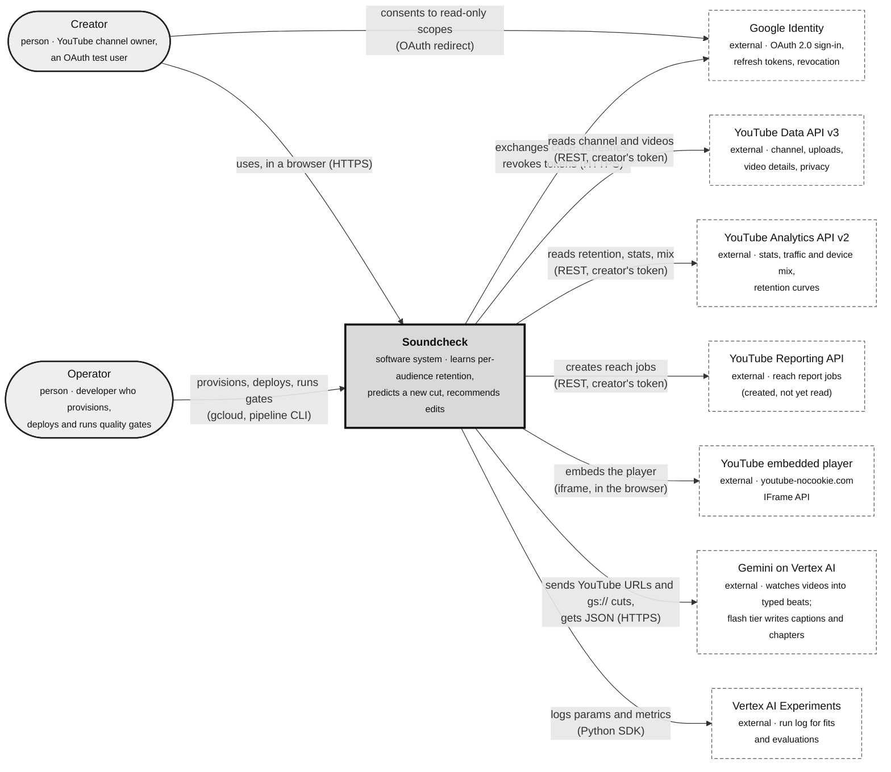

# 01 · System context (C4 level 1)

Part of the [architecture set](README.md). Next: [02 · Containers](02-containers.md).

Soundcheck learns how each of a creator's audiences watches, from the creator's own YouTube back catalogue. It then predicts how a new cut will hold each audience before it is published, and recommends edits with measured effect sizes and ranges. This page shows the system as one box and everything outside it.

## The system and its neighbours

**What it shows.** Soundcheck as a single software system, the two kinds of people who use it, and the external systems it calls. Google Cloud's managed services (Firestore, BigQuery, Cloud Storage, Workflows, KMS and others) count as part of Soundcheck here. They appear in [02 · Containers](02-containers.md).

**Who it's for.** Anyone new to the project, including product, security and data-protection reviewers, before reading any code.

**Three takeaways.**

1. **Read-only on YouTube.** Soundcheck reads YouTube only, with each creator's own OAuth refresh token (`youtube.readonly` and `yt-analytics.readonly`). It never posts or edits anything on YouTube.
2. **Gemini is the only AI dependency.** It watches every video to mark its beats, and its flash tier writes captions and chapter titles. No other external model or data vendor is involved.
3. **No admin screen.** The operator works entirely through `infra/*.sh` scripts and the pipeline CLI, and the web app serves creators only.

## Actors at this level

| Actor             | What they do                                                                                                                                                                 | Where it starts                                                                                                            |
| ----------------- | ---------------------------------------------------------------------------------------------------------------------------------------------------------------------------- | -------------------------------------------------------------------------------------------------------------------------- |
| Creator           | Signs in with Google, which connects the channel and starts the first build. Reads the audiences and video screens, runs soundchecks, tries edits, exports, and disconnects. | [apps/web/src/app/page.tsx](../../apps/web/src/app/page.tsx), [apps/web/src/auth.ts](../../apps/web/src/auth.ts)           |
| Anonymous visitor | Reads the landing page. Every `/app` page and `/api/v1` route needs a session.                                                                                               | [apps/web/src/lib/access.ts](../../apps/web/src/lib/access.ts)                                                             |
| Operator          | Runs `infra/up.sh` and the deploy scripts, adds OAuth test users, runs `soundcheck consistency …` and `soundcheck-modeling model-card`.                                      | [infra/README.md](../../infra/README.md), [apps/pipeline/src/commands/index.ts](../../apps/pipeline/src/commands/index.ts) |

## External systems

| System                   | Used for                                                                                                                                | Called from                                                                                                                              | Credentials                                                  |
| ------------------------ | --------------------------------------------------------------------------------------------------------------------------------------- | ---------------------------------------------------------------------------------------------------------------------------------------- | ------------------------------------------------------------ |
| Google Identity          | Sign-in, offline consent, refresh-token refresh and revocation                                                                          | Auth.js in the web app; `credentialsForChannel` in jobs; `deleteChannel` revokes                                                         | OAuth client from Secret Manager                             |
| YouTube Data API v3      | `channels.list` at connect; the uploads playlist and `videos.list` in ingest; a linked cut's length and privacy                         | [packages/core/src/youtube/client.ts](../../packages/core/src/youtube/client.ts), [videos.ts](../../packages/core/src/youtube/videos.ts) | The creator's access token (connect) or refresh token (jobs) |
| YouTube Analytics API v2 | Lifetime stats, traffic-source and device mix, retention curves (subscribed, unsubscribed, organic)                                     | [packages/core/src/youtube/analytics.ts](../../packages/core/src/youtube/analytics.ts)                                                   | The creator's refresh token                                  |
| YouTube Reporting API    | Starts the `channel_reach_*` report jobs, so the reports accrue for a later phase                                                       | [packages/core/src/youtube/reporting.ts](../../packages/core/src/youtube/reporting.ts)                                                   | The creator's refresh token                                  |
| YouTube embedded player  | Plays the video on the video autopsy and soundcheck pages, seeking to a drop-off                                                        | [apps/web/src/components/youtube-player.tsx](../../apps/web/src/components/youtube-player.tsx)                                           | None (public embed)                                          |
| Gemini on Vertex AI      | Beat extraction and the B1 baseline guess, both watching the video (`GEMINI_MODEL`); captions and chapter titles (`GEMINI_FLASH_MODEL`) | [packages/core/src/gemini/](../../packages/core/src/gemini/)                                                                             | `sa-pipeline` via Application Default Credentials            |
| Vertex AI Experiments    | One run per fit and per evaluation                                                                                                      | [services/modeling/src/soundcheck_modeling/experiments.py](../../services/modeling/src/soundcheck_modeling/experiments.py)               | `sa-pipeline`                                                |

Out of scope by design ([overview](../plan/overview.md)): Video Intelligence and Speech-to-Text. Back-catalogue videos cannot be downloaded, so those features would exist at prediction time but never at training time. Imagen is listed in the stack as a stretch goal, and no code calls it yet (see [13 · Findings](13-findings.md)).
