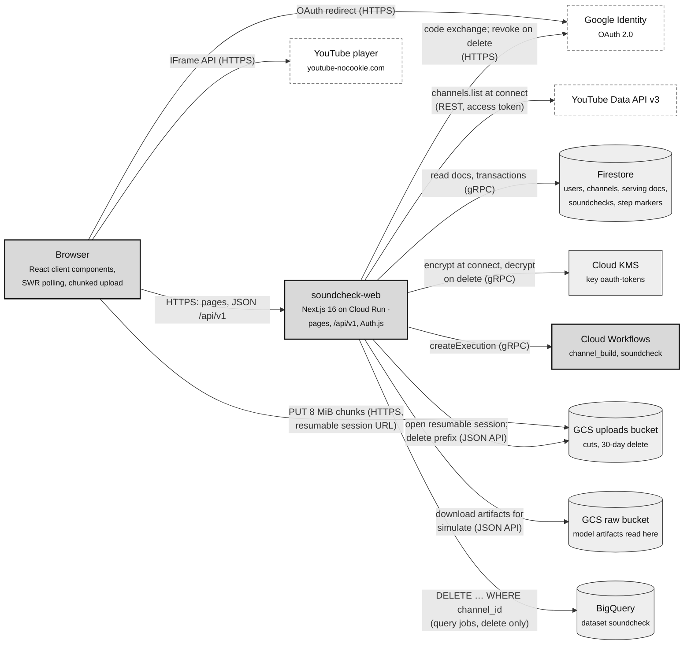
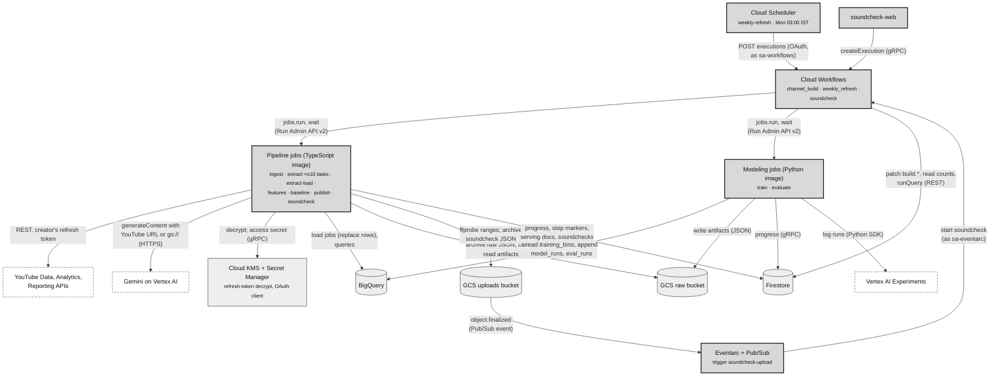

# 02 · Containers (C4 level 2)

Part of the [architecture set](README.md). Previous: [01 · System context](01-system-context.md). Next: [03 · Components](03-components.md).

Soundcheck runs entirely in one Google Cloud project. It has one public web service, nine batch jobs in two images, three workflows, and Google-managed stores. Drawn on one canvas that is about 25 boxes, so this page splits it into two planes that share the same stores:

- **2.1 Request plane:** what runs while a creator waits for a page or an API answer.
- **2.2 Batch plane:** what runs unattended, from minutes (a soundcheck) to hours (a channel build).

The rule that separates them ([CLAUDE.md](../../CLAUDE.md) rule 11; [overview](../plan/overview.md)): screens read Firestore documents that the batch plane wrote. No Gemini call happens on a request path, and the only BigQuery work on one is channel deletion (see [13 · Findings](13-findings.md#b-doc-vs-code-drift)).

## 2.1 Request plane

**What it shows.** The browser, the Next.js service that is both UI and API, and every store or Google API it touches while a request is open. Each arrow is labelled with its protocol and points in the direction of the call.

**Who it's for.** Engineers changing the web app or its API, and reviewers checking what a request can reach.

**Three takeaways.**

1. **One precomputed document per screen.** A page reads a whole document that publish already computed, never BigQuery. Around it sit the user and channel lookups: the layout and the page each call `getMe`, so a one-channel user costs about 6 small Firestore reads per page ([08 · Read path](08-flow-read-and-simulate.md)). The API read routes measured p95 55 ms in Phase 11.
2. **Upload bytes skip the web service.** The browser PUTs a cut in 8 MiB chunks straight to a Cloud Storage resumable session that the server opened for exactly that object and size.
3. **Starting work is fire-and-forget.** The web app only creates a Workflows execution, and the browser then polls Firestore-backed routes: every 3 s for a build, every 2 s for a soundcheck.

Not drawn: the secrets. Cloud Run injects `AUTH_SECRET` and the OAuth client from Secret Manager as environment variables at deploy time ([infra/deploy-web.sh](../../infra/deploy-web.sh)), so the running service never calls Secret Manager. The `-raw` and `-media` buckets are also touched by deletion, which removes every `{channel_id}/` object in all three buckets.

## 2.2 Batch plane

**What it shows.** The triggers (Cloud Scheduler, Eventarc, the web app), the three workflows, the two job images, and what each job reads and writes. Arrow labels give the protocol or the API.

**Who it's for.** Engineers working on the pipeline, the modeling service or the infrastructure, and anyone tracing where a number on a screen came from.

**Three takeaways.**

1. **Workflows orchestrate; jobs do the work.** A workflow only runs Cloud Run jobs and patches `channels/{id}.build`. Every job is idempotent (rule 7), which is what makes the workflow's blanket retries safe.
2. **TypeScript computes every feature, and Python only fits.** The Python image reads `training_bins` and writes model artifacts (JSON, validated against a JSON Schema exported from zod) and run rows. The TypeScript publish and soundcheck jobs read those artifacts back.
3. **Raw before parsed.** Every YouTube and Gemini response lands in the raw bucket first (`{channel}/{source}/{key}/{yyyymmdd}.json`), so features can be rebuilt without fetching again. Soundcheck responses are archived in the uploads bucket instead, so they expire with the cut.

Interactive version, with guided views for the channel build, a soundcheck run and the weekly refresh, and with every box linked to the code it cites: [interactive/batch-plane/batch-plane.html](interactive/batch-plane/batch-plane.html), from [candidate.json](interactive/batch-plane/candidate.json). Download the file and open it in a browser; GitHub shows the HTML as source.

Gemini reads an uploaded cut directly from its `gs://` URI. The upload never passes through a job's memory, and ffprobe reads only the container index over HTTPS range requests ([probe.ts](../../apps/pipeline/src/commands/soundcheck/probe.ts)).

## Container catalogue

| Container                                                                                                                        | Technology                                                            | Runs as                | Scale and limits                                                                                                                | Entry point                                                                                                                |
| -------------------------------------------------------------------------------------------------------------------------------- | --------------------------------------------------------------------- | ---------------------- | ------------------------------------------------------------------------------------------------------------------------------- | -------------------------------------------------------------------------------------------------------------------------- |
| `soundcheck-web`                                                                                                                 | Next.js 16 App Router, standalone output, Node 24                     | `sa-web`               | Public (`--allow-unauthenticated`; sign-in is the gate), 0 to 3 instances, 1 vCPU / 1 GiB, concurrency 80, 60 s request timeout | [apps/web/](../../apps/web/), [deploy-web.sh](../../infra/deploy-web.sh)                                                   |
| Pipeline image: `job-ingest`, `job-extract`, `job-extract-load`, `job-features`, `job-baseline`, `job-publish`, `job-soundcheck` | TypeScript CLI (commander) bundled with tsup, ffprobe                 | `sa-pipeline`          | Task timeouts 900 s to 3600 s; `job-extract` up to 10 parallel tasks sharded by `CLOUD_RUN_TASK_INDEX`                          | [apps/pipeline/src/main.ts](../../apps/pipeline/src/main.ts), [deploy-pipeline.sh](../../infra/deploy-pipeline.sh)         |
| Modeling image: `job-train`, `job-evaluate`                                                                                      | Python 3.12, numpy, scipy, Typer (uv)                                 | `sa-pipeline`          | 2 vCPU / 4 GiB, 3600 s                                                                                                          | [services/modeling/src/soundcheck_modeling/cli.py](../../services/modeling/src/soundcheck_modeling/cli.py)                 |
| `channel_build` workflow                                                                                                         | Cloud Workflows YAML                                                  | `sa-workflows`         | 8 stages, 3 attempts each, 7200 s wait per stage                                                                                | [infra/workflows/channel_build.yaml](../../infra/workflows/channel_build.yaml)                                             |
| `weekly_refresh` workflow                                                                                                        | Cloud Workflows YAML                                                  | `sa-workflows`         | Refits the pooled models, then starts `channel_build` (mode `refresh`) for every `ready` channel                                | [infra/workflows/weekly_refresh.yaml](../../infra/workflows/weekly_refresh.yaml)                                           |
| `soundcheck` workflow                                                                                                            | Cloud Workflows YAML                                                  | `sa-workflows`         | One `job-soundcheck` run, 3600 s wait                                                                                           | [infra/workflows/soundcheck.yaml](../../infra/workflows/soundcheck.yaml)                                                   |
| Firestore `(default)`                                                                                                            | Firestore Native, `us-central1`                                       | —                      | Deny-all client rules; server SDKs only                                                                                         | [infra/firestore.rules](../../infra/firestore.rules), [schemas/firestore.ts](../../packages/core/src/schemas/firestore.ts) |
| BigQuery `soundcheck`                                                                                                            | 17 tables, US multi-region                                            | —                      | Written with load jobs, never streaming                                                                                         | [infra/bigquery/](../../infra/bigquery/)                                                                                   |
| GCS `{project}-raw`, `-uploads`, `-media`                                                                                        | Cloud Storage, `us-central1`, uniform access, public access prevented | —                      | Uploads deleted after 30 days; `-media` is created but unused (see findings)                                                    | [infra/02-storage.sh](../../infra/02-storage.sh)                                                                           |
| Cloud KMS `soundcheck/oauth-tokens`                                                                                              | Symmetric key, 90-day rotation                                        | —                      | The user ID is bound as additional authenticated data                                                                           | [packages/core/src/crypto/tokens.ts](../../packages/core/src/crypto/tokens.ts)                                             |
| Secret Manager                                                                                                                   | `oauth-client-id`, `oauth-client-secret`, `auth-secret`               | —                      | Injected at deploy; jobs also read the OAuth client at run time                                                                 | [infra/08-secrets.sh](../../infra/08-secrets.sh), [packages/core/src/secrets.ts](../../packages/core/src/secrets.ts)       |
| Eventarc `soundcheck-upload`                                                                                                     | GCS `object.finalized` on `-uploads` to workflow `soundcheck`         | `sa-eventarc`          | Cannot filter by prefix, so the workflow ignores objects that are not `{channel}/{soundcheck}/source.{ext}`                     | [infra/10-soundcheck-trigger.sh](../../infra/10-soundcheck-trigger.sh)                                                     |
| Cloud Scheduler `weekly-refresh`                                                                                                 | HTTP job to the Workflows Executions API                              | `sa-workflows` (OAuth) | `0 3 * * 1`, `Asia/Kolkata`                                                                                                     | [infra/09-orchestration.sh](../../infra/09-orchestration.sh)                                                               |

### Where state lives

| Store                                                               | Holds                                                                                                                                                                                                                                                                                        | Written by                                                                             | Read by                                          |
| ------------------------------------------------------------------- | -------------------------------------------------------------------------------------------------------------------------------------------------------------------------------------------------------------------------------------------------------------------------------------------- | -------------------------------------------------------------------------------------- | ------------------------------------------------ |
| Firestore `users/{googleSub}`                                       | Email, `channelIds`                                                                                                                                                                                                                                                                          | Connect                                                                                | Session, `getMe`                                 |
| Firestore `channels/{id}`                                           | Profile, KMS ciphertext, `status`, `build` (state, stage, attempt, progress, counts)                                                                                                                                                                                                         | Connect, `startChannelBuild`, workflows, every job's progress writer                   | Every screen, build polling                      |
| `channels/{id}/summary/current`, `index/videos`, `videos/{videoId}` | Precomputed screens                                                                                                                                                                                                                                                                          | `job-publish`                                                                          | Audiences, videos, video pages                   |
| `channels/{id}/soundchecks/{sid}` and `…/inputs/current`            | A soundcheck's status, progress, prediction and edits; the cut as the model reads it                                                                                                                                                                                                         | Create route, `job-soundcheck`, the `soundcheck` workflow (marks a crashed run failed) | Soundcheck pages; the simulate route             |
| `channels/{id}/steps/{step}`                                        | Idempotency markers (`asOf`, version, input fingerprint)                                                                                                                                                                                                                                     | Each pipeline step                                                                     | The same step on re-run                          |
| `extractionGates/{version}`                                         | Whether an extraction version passed the quality gate                                                                                                                                                                                                                                        | `soundcheck consistency gate`                                                          | `soundcheck features` (refuses ungated versions) |
| BigQuery                                                            | `videos`, `video_stats`, `video_traffic_mix`, `video_device_mix`, `retention_curves`, `retention_coverage`, `beats`, `beat_videos`, `extraction_runs`, `feature_specs`, `feature_contexts`, `training_bins`, `model_runs`, `eval_runs`, `baseline_llm_curves`, `quality_reports`, `channels` | Pipeline and modeling jobs                                                             | Pipeline and modeling jobs; channel deletion     |
| GCS raw                                                             | Raw API JSON, the extraction cache, model artifacts `{channel or pooled}/models/{run}/{audience}.json`, evaluation JSON                                                                                                                                                                      | Jobs                                                                                   | Jobs; the web app (artifacts for simulate)       |
| GCS uploads                                                         | Uploaded cuts `{channel}/{soundcheck}/source.{ext}`, soundcheck raw archives                                                                                                                                                                                                                 | Browser (via session), `job-soundcheck`                                                | `job-soundcheck`, Gemini                         |
