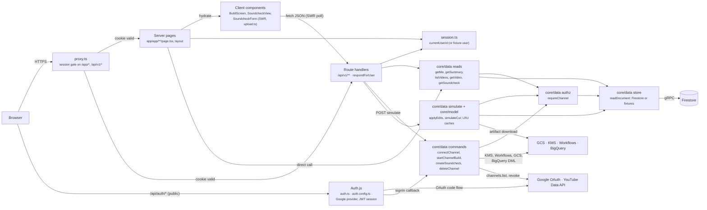
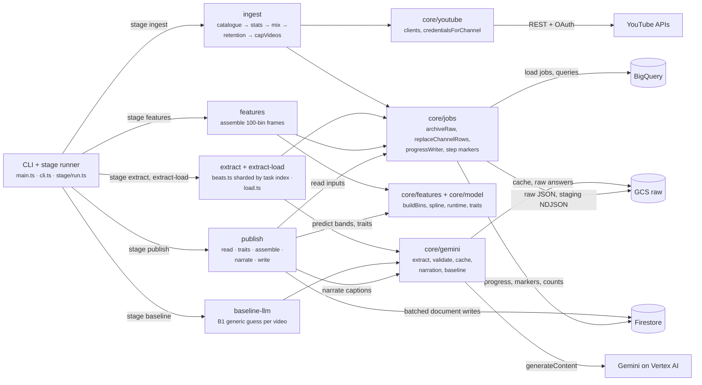
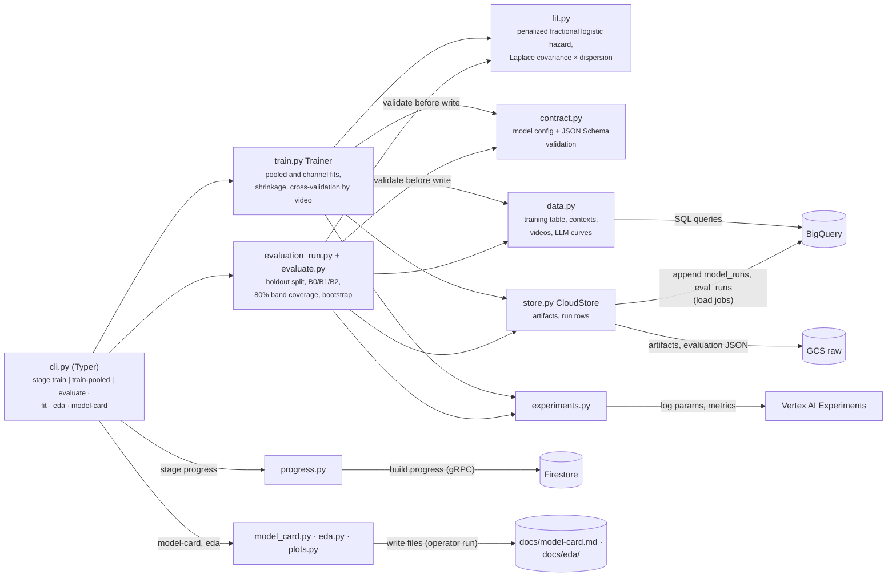

# 03 · Components

Part of the [architecture set](README.md). Previous: [02 · Containers](02-containers.md). Next: [04 · Deployment](04-deployment.md).

Three containers are opened up here because they hold nearly all of the logic:

- **3.1 `soundcheck-web`**, the only thing on the internet.
- **3.2 The TypeScript pipeline image**, which computes every feature and writes every screen.
- **3.3 The Python modeling image**, which fits and evaluates the models.

The workflows are YAML with no internal structure worth a diagram; their logic is in [06 · Channel build flow](06-flow-channel-build.md).

One library sits under two of these containers. `packages/core` holds the data functions, the YouTube and Gemini clients, featurization and the prediction runtime. The web app and the pipeline both import it, so training rows and live predictions come from the same code ([overview](../plan/overview.md#repository-layout)). In the diagrams below, boxes named `core/…` are modules of that package running inside the container being described.

## 3.1 `soundcheck-web` (Next.js)

**What it shows.** How a request passes through the web service: the session proxy, Auth.js, server-rendered pages and client components, the `/api/v1` route handlers, and the `core/data` functions that do the work.

**Who it's for.** Engineers adding a screen or a route, and reviewers checking authorization.

**Three takeaways.**

1. **Authorization has two layers.** The proxy rejects any `/app` or `/api/v1` request without a session cookie. Then every data function calls `requireChannel(userId, channelId)`, which returns the same 404 for a malformed ID, a missing channel and someone else's channel, so channel IDs cannot be probed.
2. **Pages and routes share one set of functions.** Server components call `core/data` directly. Client components reach the same functions through route handlers, and `respondForUser` maps `NotFoundError` to 404 and a missing document to `404 not_published`.
3. **Only one route computes.** `POST …/simulate` runs the prediction runtime in-process, from the soundcheck's stored inputs and model artifacts held in an LRU cache (32 artifacts, 64 prepared soundchecks per instance). Every other route reads one document or starts a workflow.

| Component         | Responsibility                                                                                                                                                                           | Source                                                                                                                                                                                          |
| ----------------- | ---------------------------------------------------------------------------------------------------------------------------------------------------------------------------------------- | ----------------------------------------------------------------------------------------------------------------------------------------------------------------------------------------------- |
| `proxy.ts`        | Next 16's replacement for middleware. It reads only the session cookie: anonymous `/api/v1` requests get 401 and anonymous pages redirect to `/`. In fixtures mode every request passes. | [proxy.ts](../../apps/web/src/proxy.ts), [lib/access.ts](../../apps/web/src/lib/access.ts)                                                                                                      |
| Auth.js           | Google sign-in with `access_type=offline` and `prompt=consent`, so every sign-in returns a refresh token. The JWT holds only `userId` and `channelIds`; tokens never reach the browser.  | [auth.ts](../../apps/web/src/auth.ts), [auth.config.ts](../../apps/web/src/auth.config.ts)                                                                                                      |
| Server pages      | Each page resolves the current channel (`currentChannel`: `getMe` plus a `soundcheck-channel` cookie), redirects by build state and status (`appHome`), and reads its one document.      | [lib/channel.ts](../../apps/web/src/lib/channel.ts), [lib/app-home.ts](../../apps/web/src/lib/app-home.ts)                                                                                      |
| Client components | Poll with SWR: the channel every 3 s while a build is `queued` or `running`, a soundcheck every 2 s while it is active. They upload cuts in chunks and debounce edit toggles by 250 ms.  | [build-screen.tsx](../../apps/web/src/components/build-screen.tsx), [soundcheck-view.tsx](../../apps/web/src/components/soundcheck-view.tsx), [lib/upload.ts](../../apps/web/src/lib/upload.ts) |
| Route handlers    | Thin adapters. They parse the request with zod, call one data function, and map domain errors to statuses (401, 404, 409, 413, 415, 400, 503).                                           | [app/api/v1/](../../apps/web/src/app/api/v1/), [lib/respond.ts](../../apps/web/src/lib/respond.ts)                                                                                              |
| `core/data`       | Every function takes the acting user's ID explicitly. Writes refuse in fixtures mode (`refuseInFixturesMode`).                                                                           | [packages/core/src/data/](../../packages/core/src/data/)                                                                                                                                        |
| `core/model`      | The prediction runtime: seeded coefficient draws (seed 1, 200 draws) shared by the job and the route, so the page's numbers match the job's.                                             | [packages/core/src/model/](../../packages/core/src/model/), [data/simulate.ts](../../packages/core/src/data/simulate.ts)                                                                        |

## 3.2 Pipeline image: channel-build stages (TypeScript)

**What it shows.** What happens inside a pipeline job when the `channel_build` workflow runs `stage <name>`: the stage runner, the five stage families, the `core` modules they lean on, and the stores they reach. The soundcheck job runs from the same image, and [07 · Soundcheck flow](07-flow-soundcheck.md) covers it.

**Who it's for.** Engineers changing ingestion, extraction, featurization or publishing.

**Three takeaways.**

1. **Every step follows one pattern.** It archives the raw response, parses it with a pure function, replaces the channel's rows with a load job (staged NDJSON, then one DML transaction), and records a step marker keyed by data date, version and input fingerprint. A re-run skips finished work.
2. **Ingest decides what the build costs.** `capVideos` keeps only the newest 100 eligible videos with a complete curve, so Gemini never watches the rest. The counts it records are what the workflow reads to stop with `insufficient_data`.
3. **Publish is the only writer of screens.** It reads everything from BigQuery and GCS, predicts each video's bands, attributes drop-offs, gets captions from the flash model (each one digit-checked, with a template fallback), and writes the documents in batches of at most 500. It writes nothing when the fingerprint is unchanged.

| Stage (job)                               | Reads                                                                                   | Writes                                                                                                                                                      | Notes                                                                                                                                                                                     |
| ----------------------------------------- | --------------------------------------------------------------------------------------- | ----------------------------------------------------------------------------------------------------------------------------------------------------------- | ----------------------------------------------------------------------------------------------------------------------------------------------------------------------------------------- |
| `ingest` (`job-ingest`)                   | YouTube Data, Analytics and Reporting APIs                                              | `videos`, `video_stats`, `video_traffic_mix`, `video_device_mix`, `retention_curves`, `retention_coverage`; `build.eligibleVideos` and `build.usableVideos` | `refresh` mode re-reads the catalogue and refetches stats and retention for videos from the last 60 days, without the mix ([stage/run.ts](../../apps/pipeline/src/commands/stage/run.ts)) |
| `extract` (`job-extract`, up to 10 tasks) | Eligible, capped videos; extraction cache                                               | Raw Gemini answers, cache objects                                                                                                                           | Validated against the zod schema, repaired, and retried once with the exact errors. Static video mode by default ([gemini/extract.ts](../../packages/core/src/gemini/extract.ts))         |
| `extract-load`                            | Cache objects                                                                           | `beats`, `beat_videos`, `extraction_runs`                                                                                                                   | —                                                                                                                                                                                         |
| `features`                                | Curves, beats, mix; `extractionGates/{version}`                                         | `training_bins`, `feature_specs`, `feature_contexts`                                                                                                        | Refuses an extraction version without a passing gate. `FEATURE_VERSION` is the spec's hash ([features/run.ts](../../apps/pipeline/src/commands/features/run.ts))                          |
| `baseline`                                | Videos                                                                                  | `baseline_llm_curves`                                                                                                                                       | B1 for the evaluation: `GEMINI_MODEL` watches each video and guesses a generic curve                                                                                                      |
| `publish`                                 | All of the above, `model_runs` (latest fitted), artifacts, `eval_runs` (latest holdout) | `summary/current`, `index/videos`, `videos/{id}`; deletes pages of videos no longer published                                                               | `PUBLISH_VERSION` plus the document fingerprint make the step idempotent ([publish/run.ts](../../apps/pipeline/src/commands/publish/run.ts))                                              |

## 3.3 Modeling image (Python)

**What it shows.** The Typer CLI, the trainer and evaluator, the contract that keeps Python honest about the TypeScript schemas, and the adapters to BigQuery, Cloud Storage, Firestore and Vertex AI Experiments.

**Who it's for.** Whoever changes the model, its evaluation or the model card.

**Three takeaways.**

1. **Python never computes a feature.** `data.py` reads `training_bins` and `feature_contexts` exactly as TypeScript wrote them, and `contract.py` validates every artifact and row against JSON Schemas exported from zod (`pnpm gen:schemas`) before writing.
2. **Two levels of model.** `train_pooled` fits one model per audience across all channels with a small penalty. `train_channel` shrinks each channel's fit toward the pooled coefficients when the pooled model is usable, and toward zero otherwise. A fit on fewer than `MIN_TRAIN_VIDEOS` (20) is written but marked `usable: false`.
3. **Evaluation can't leak into production.** Holdout refits are scored against B0 (channel average), B1 (Gemini's guess) and B2 (no content features), and recorded in `eval_runs`, never in `model_runs`. Publish therefore cannot serve an evaluation model. It only applies the holdout's band-inflation factor.

| Command              | Runs where                                  | What it does                                                                         | Source                                                                         |
| -------------------- | ------------------------------------------- | ------------------------------------------------------------------------------------ | ------------------------------------------------------------------------------ |
| `stage train`        | `job-train` in `channel_build`              | Fits the channel's `all`, `subscribed` and `unsubscribed` models with build progress | [cli.py](../../services/modeling/src/soundcheck_modeling/cli.py)               |
| `stage train-pooled` | `job-train`, overridden by `weekly_refresh` | Refits the pooled prior across every channel                                         | [weekly_refresh.yaml](../../infra/workflows/weekly_refresh.yaml)               |
| `stage evaluate`     | `job-evaluate` in `channel_build`           | Holdout or check mode, plots off in the cloud                                        | [evaluate.py](../../services/modeling/src/soundcheck_modeling/evaluate.py)     |
| `model-card`, `eda`  | The operator's machine                      | Write [docs/model-card.md](../model-card.md) and [docs/eda/](../eda/)                | [model_card.py](../../services/modeling/src/soundcheck_modeling/model_card.py) |

Not in the diagram: the organic retention curve and the device mix are ingested into BigQuery, but no model or screen reads them yet. Python trains only `all`, `subscribed` and `unsubscribed` ([data.py](../../services/modeling/src/soundcheck_modeling/data.py)). See [13 · Findings](13-findings.md).
