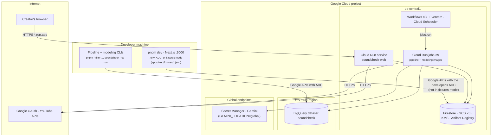
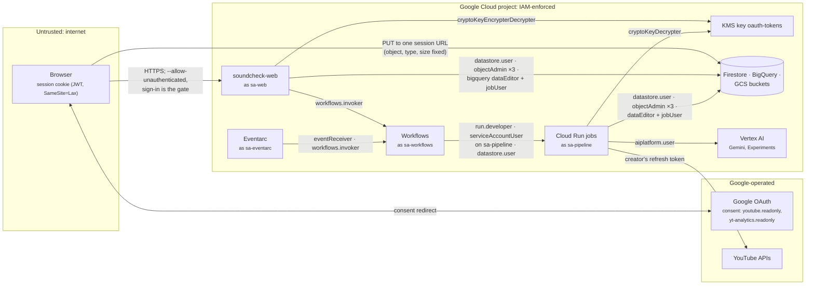
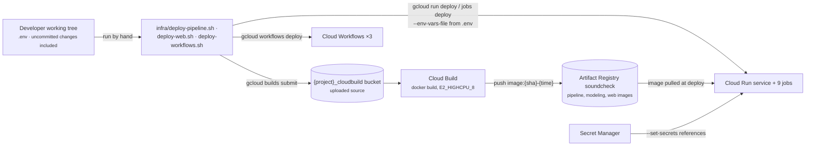

# 04 · Deployment and trust boundaries

Part of the [architecture set](README.md). Previous: [03 · Components](03-components.md). Next: [05 · Connect and disconnect](05-flow-connect.md).

Soundcheck has **one cloud environment**: a single Google Cloud project built by the idempotent scripts in [infra/](../../infra/README.md). Alongside it, developers run the web app locally, either against that project or with no cloud at all (fixtures mode). The project has no VPC, no private networking and no ingress restriction beyond Cloud Run's defaults. Every boundary is drawn by **identity** (four service accounts and their IAM roles), not by network.

## 4.1 Environments and runtime placement

**What it shows.** Where each runtime piece lives: the developer machine, the Google Cloud project split by location, and the outside world.

**Who it's for.** Operators and anyone deploying, debugging latency, or answering "where is the data stored?".

**Three takeaways.**

1. **Compute and most storage live in `us-central1`.** BigQuery is in the `US` multi-region, and Gemini is called through `GEMINI_LOCATION` (default `global`). The Firestore location can never change ([infra/README.md](../../infra/README.md#permanent-choices)).
2. **Fixtures mode is a full second environment with no cloud.** `NEXT_PUBLIC_USE_FIXTURES=true` makes the data functions read JSON files exported from Firestore, and a fixed user replaces sign-in. The flag throws in a production build, and every image is built with it off.
3. **There is no staging.** Deploy scripts target whatever `gcloud config get-value project` returns, so the only path to the cloud is production.

| Environment              | How it runs                                                                                               | Data                                                                                              | Identity                                                                                                                    | Notes                                                                                                                               |
| ------------------------ | --------------------------------------------------------------------------------------------------------- | ------------------------------------------------------------------------------------------------- | --------------------------------------------------------------------------------------------------------------------------- | ----------------------------------------------------------------------------------------------------------------------------------- |
| Local, fixtures mode     | `pnpm dev` with `NEXT_PUBLIC_USE_FIXTURES=true`                                                           | `apps/web/fixtures/` (exported by [scripts/export-fixtures.ts](../../scripts/export-fixtures.ts)) | Fixture user `fixture-user`; no sign-in                                                                                     | Reads only: builds, soundchecks and deletes answer 503 `fixtures_mode`. Simulate works when artifacts are under `fixtures/storage/` |
| Local, against the cloud | `pnpm dev`; CLIs via `pnpm --filter @soundcheck/pipeline soundcheck …` and `uv run soundcheck-modeling …` | The real project                                                                                  | The developer's Application Default Credentials; local OAuth client from [local-auth-env.sh](../../infra/local-auth-env.sh) | Uploads need `http://localhost:3000` in the bucket's CORS (set by default)                                                          |
| Cloud (the only one)     | Cloud Run service and jobs, Workflows, Eventarc, Scheduler                                                | The real project                                                                                  | `sa-web`, `sa-pipeline`, `sa-workflows`, `sa-eventarc`                                                                      | OAuth consent screen in **Testing**: at most 100 test users, refresh tokens expire after 7 days                                     |

## 4.2 Trust boundaries and identities

**What it shows.** The trust zones, which identity each runtime acts as, and the IAM grant on every crossing. It is drawn from [01-service-accounts.sh](../../infra/01-service-accounts.sh), [02-storage.sh](../../infra/02-storage.sh), [03-bigquery.sh](../../infra/03-bigquery.sh), [05-kms.sh](../../infra/05-kms.sh), [08-secrets.sh](../../infra/08-secrets.sh) and [09-orchestration.sh](../../infra/09-orchestration.sh).

**Who it's for.** Security reviewers, and anyone adding a resource or a role.

**Three takeaways.**

1. **The internet-facing identity holds broad data rights.** `sa-web` has `storage.objectAdmin` on all three buckets and `bigquery.dataEditor` on the whole dataset, which deleting a channel needs. Encrypt and decrypt on the token key let it re-encrypt at connect and decrypt for revocation. A compromised web container could therefore read and change every channel's data, so the application-level `requireChannel` check is the real tenant boundary.
2. **Tokens are bound to their owner.** Refresh tokens are encrypted with KMS using the user ID as additional authenticated data, so a ciphertext copied onto another channel will not decrypt. `sa-pipeline` can only decrypt.
3. **Firestore is closed to clients.** The rules deny everything, so only server SDKs, which bypass rules, can read or write. The browser never talks to Firestore, BigQuery or KMS. It talks only to the web app, to a single pre-authorized GCS upload session, and to YouTube's player.

Interactive version with boundary frames per zone and service account, and every box linked to the IAM script or code that grants it: [interactive/trust-boundaries/trust-boundaries.html](interactive/trust-boundaries/trust-boundaries.html), from [candidate.json](interactive/trust-boundaries/candidate.json).

### Service account matrix

| Identity                                   | Used by                                                                             | Project roles                                                                | Resource roles                                                                                                                                                                                                                                                                             |
| ------------------------------------------ | ----------------------------------------------------------------------------------- | ---------------------------------------------------------------------------- | ------------------------------------------------------------------------------------------------------------------------------------------------------------------------------------------------------------------------------------------------------------------------------------------ |
| `sa-web`                                   | `soundcheck-web`                                                                    | `datastore.user`, `workflows.invoker`, `bigquery.jobUser`                    | `storage.objectAdmin` on raw, uploads and media; `bigquery.dataEditor` on dataset `soundcheck`; `cloudkms.cryptoKeyEncrypterDecrypter` on `oauth-tokens`; `secretmanager.secretAccessor` on all three secrets; `iam.serviceAccountTokenCreator` on itself (see [findings](13-findings.md)) |
| `sa-pipeline`                              | All nine Cloud Run jobs                                                             | `bigquery.jobUser`, `datastore.user`, `aiplatform.user`, `logging.logWriter` | `storage.objectAdmin` on all three buckets; `bigquery.dataEditor` on the dataset; `cloudkms.cryptoKeyDecrypter`; `secretAccessor` on the OAuth client ID and secret                                                                                                                        |
| `sa-workflows`                             | `channel_build`, `weekly_refresh`, `soundcheck`; the Scheduler job's OAuth identity | `run.developer`, `logging.logWriter`, `datastore.user`, `workflows.invoker`  | `iam.serviceAccountUser` on `sa-pipeline`, so it can run jobs that act as `sa-pipeline`                                                                                                                                                                                                    |
| `sa-eventarc`                              | Trigger `soundcheck-upload`                                                         | `eventarc.eventReceiver`, `workflows.invoker`                                | —                                                                                                                                                                                                                                                                                          |
| Cloud Storage service agent                | Publishes object events                                                             | `pubsub.publisher`                                                           | —                                                                                                                                                                                                                                                                                          |
| `{number}-compute@developer` (Cloud Build) | `gcloud builds submit`                                                              | `logging.logWriter`                                                          | `artifactregistry.writer` on repo `soundcheck`; `objectViewer` on `{project}_cloudbuild`                                                                                                                                                                                                   |

## 4.3 Release path

**What it shows.** How code reaches the cloud today: from a developer's working tree, through Cloud Build, to Cloud Run and Workflows.

**Who it's for.** Whoever ships a change, and reviewers asking what guards production.

**Three takeaways.**

1. **No CI gate exists.** CI was deferred in Phase 00 and there is no `.github/` directory. `pnpm check` is run by hand, and a deploy builds whatever is in the working tree, uncommitted changes included. The image tag records `git rev-parse --short HEAD` plus a timestamp.
2. **Order matters when a document schema changes.** Deploy the pipeline before the web app ([STATUS](../notes/STATUS.md), Phase 12): the jobs must write the new shape before the web app parses it.
3. **Configuration comes from the operator's `.env`.** Its non-secret keys become Cloud Run environment variables, and the secrets come from Secret Manager references. Workflows read only their own deploy-time variables.

| Script                                                           | Deploys                                                                                                         | Reads                                    | Safe to re-run |
| ---------------------------------------------------------------- | --------------------------------------------------------------------------------------------------------------- | ---------------------------------------- | -------------- |
| [deploy-pipeline.sh](../../infra/deploy-pipeline.sh)             | Both job images, and nine jobs with their timeouts, retries and sizes; `--no-build` reuses `infra/.last-images` | `.env` (non-secret keys), Secret Manager | Yes            |
| [deploy-web.sh](../../infra/deploy-web.sh)                       | `soundcheck-web`; prints the OAuth redirect URI to add once                                                     | `.env`, Secret Manager                   | Yes            |
| [deploy-workflows.sh](../../infra/deploy-workflows.sh)           | `channel_build`, `weekly_refresh` (with `CHANNEL_BUILD_WORKFLOW`), `soundcheck`                                 | —                                        | Yes            |
| [10-soundcheck-trigger.sh](../../infra/10-soundcheck-trigger.sh) | The Eventarc trigger; run after `deploy-workflows.sh`                                                           | —                                        | Yes            |
