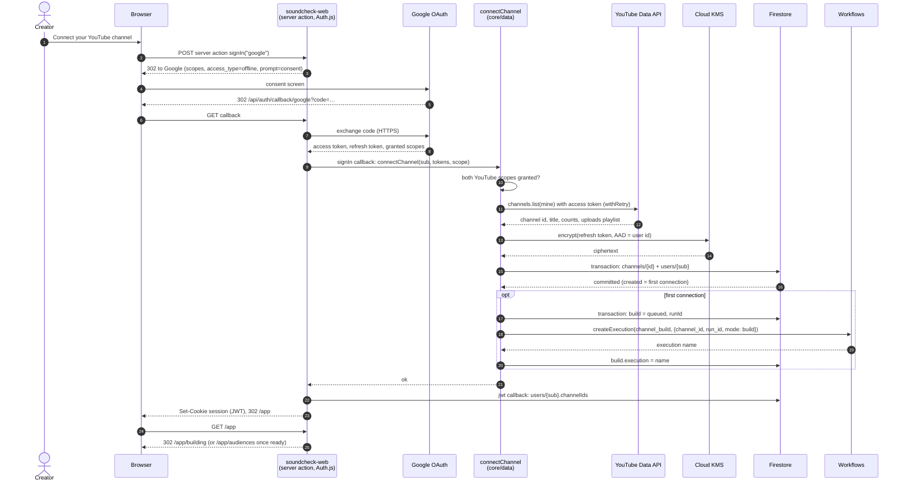
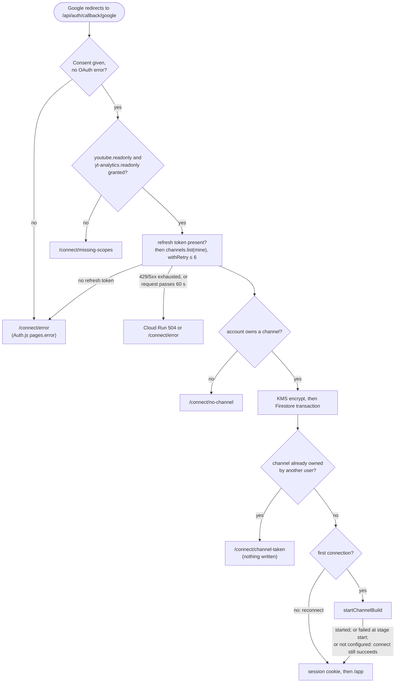
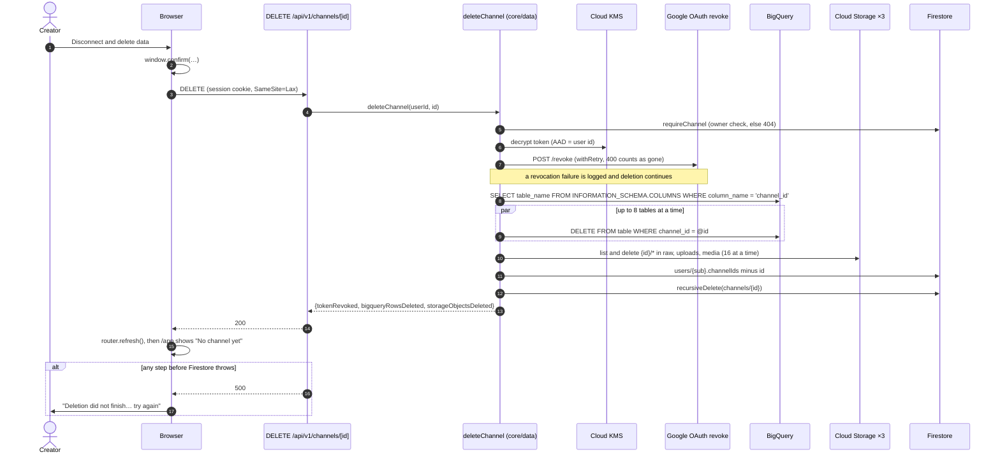

# 05 · Flow: connect and disconnect

Part of the [architecture set](README.md). Previous: [04 · Deployment](04-deployment.md). Next: [06 · Channel build](06-flow-channel-build.md).

Connecting is signing in. One Google consent gives Soundcheck a session and a refresh token. The server encrypts the token, stores the channel, and starts its first build, all inside Auth.js's `signIn` callback. Disconnecting reverses every step and deletes every trace of the channel. This page covers both, because together they are the creator's whole relationship with their data.

## 5.1 Connect: sequence

**What it shows.** Every hop from clicking "Connect your YouTube channel" to landing on the build screen, including the failure branches that redirect to an explanation page.

**Who it's for.** Engineers touching sign-in, OAuth scopes or the first build, and security reviewers.

**Three takeaways.**

1. **One callback does all the work.** Inside Auth.js's `signIn` callback the server checks scopes, reads the channel, encrypts the token, writes Firestore in one transaction, and starts the build. If anything before the transaction fails, nothing is saved.
2. **The build start can fail on its own.** If the workflow cannot start, the channel is still connected, `build.state` is marked `failed` at stage `start`, and the creator sees **Try again** on the build screen.
3. **The JWT is minimal.** It holds `userId` (the Google `sub`) and `channelIds`. Access tokens are used once and never stored, and refresh tokens exist only as KMS ciphertext.

## 5.2 Connect: decision logic and error paths

**What it shows.** Each check in the callback and where each failure sends the creator, plus the timeout risk on the request.

**Who it's for.** Anyone debugging "why did I land on this page?" or changing an error page.

**Three takeaways.**

1. **Every known failure has its own page.** Missing scopes, an account with no channel, and a channel owned by another Google account each get an explanation. Everything else is logged and goes to `/connect/error`.
2. **A reconnect only refreshes.** It replaces the token and profile, keeps `connectedAt` and the build, and sets `status` back to `connected`, which clears `reauth_required`.
3. **The callback can hit the 60 s request timeout.** `channels.list` runs through `withRetry` (up to 6 attempts, delays of 1–30 s with jitter). A persistently failing YouTube call can therefore outlast Cloud Run's 60 s request timeout, and the creator then sees a platform error, not `/connect/error`.

Sources: [auth.ts](../../apps/web/src/auth.ts), [auth.config.ts](../../apps/web/src/auth.config.ts), [lib/sign-in-errors.ts](../../apps/web/src/lib/sign-in-errors.ts), [data/channels.ts](../../packages/core/src/data/channels.ts), [data/build.ts](../../packages/core/src/data/build.ts), [crypto/tokens.ts](../../packages/core/src/crypto/tokens.ts), [lib/app-home.ts](../../apps/web/src/lib/app-home.ts).

## 5.3 Disconnect and delete

**What it shows.** The deletion that **Channel → Disconnect and delete data** triggers, in the order the code runs it.

**Who it's for.** Data-protection reviewers, and anyone adding a new table, bucket path or Firestore collection, since each must fit the conventions that make deletion complete.

**Three takeaways.**

1. **Completeness relies on conventions.** The code finds tables, objects and documents by convention: every BigQuery table with a `channel_id` column, every object under `{channel_id}/` in the three buckets, and everything under `channels/{id}` in Firestore. New data must follow the same conventions or it will survive a deletion.
2. **Firestore goes last, so a failure is repeatable.** If BigQuery or Cloud Storage fails part-way, the channel document remains and the creator can press the button again. Token revocation is best effort: a failure is logged and deletion continues.
3. **This is the one BigQuery call on a request path.** The route runs an `INFORMATION_SCHEMA` query and then a DML `DELETE` per table (8 at a time) inside a 60 s Cloud Run request. Two kinds of data are left behind: pooled models trained on the channel, and Vertex AI Experiments runs ([13 · Findings](13-findings.md#a-open-questions)).

Sources: [api/v1/channels/[id]/route.ts](../../apps/web/src/app/api/v1/channels/[id]/route.ts), [data/delete-channel.ts](../../packages/core/src/data/delete-channel.ts), [components/delete-channel-button.tsx](../../apps/web/src/components/delete-channel-button.tsx).
