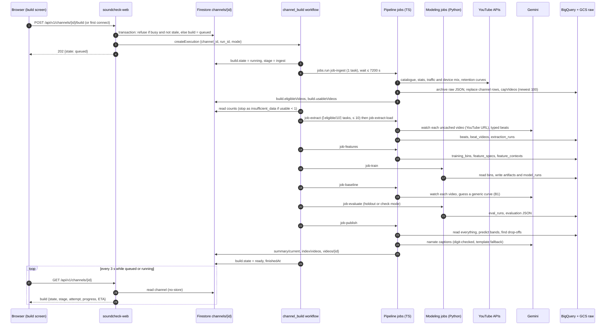
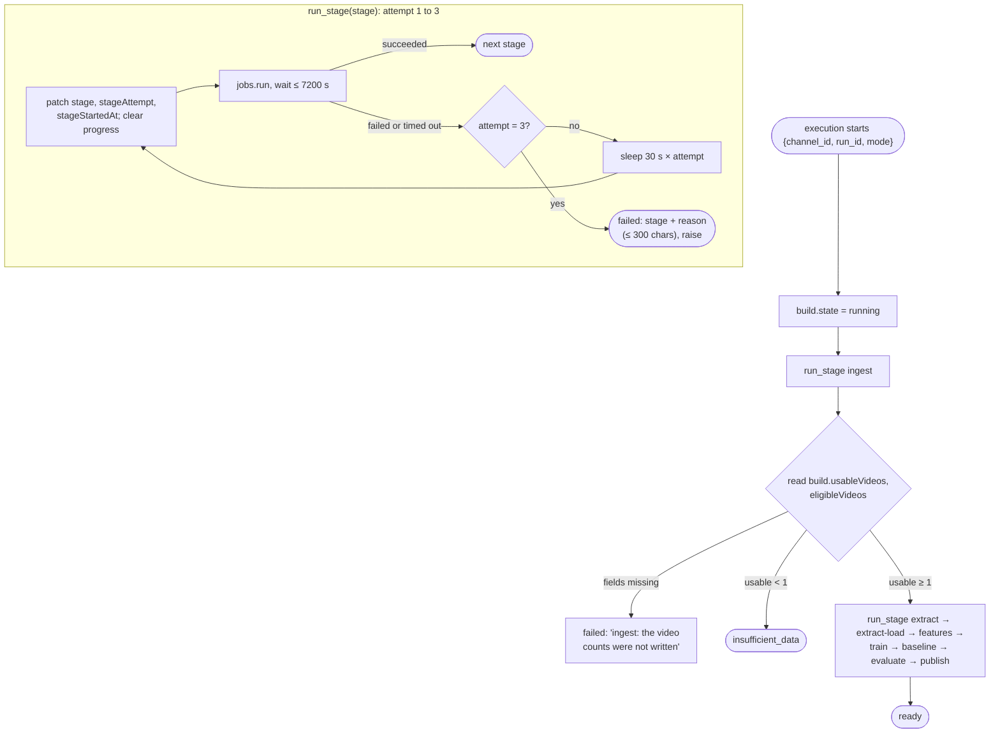
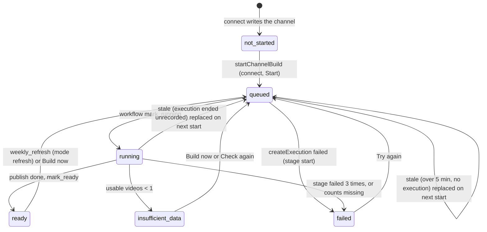
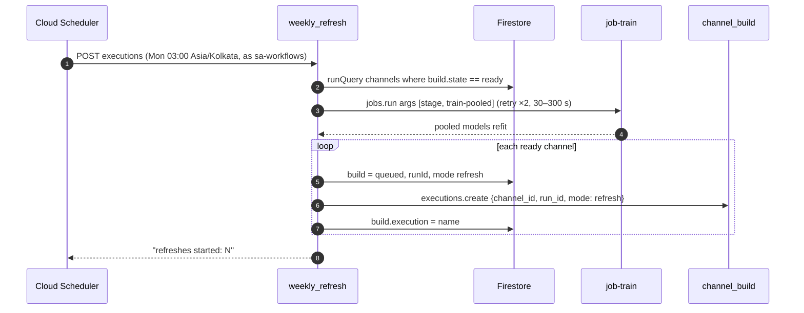

# 06 · Flow: channel build and weekly refresh

Part of the [architecture set](README.md). Previous: [05 · Connect and disconnect](05-flow-connect.md). Next: [07 · Soundcheck a new cut](07-flow-soundcheck.md).

A channel build turns a creator's back catalogue into fitted models and published screens. It runs unattended, from about 20 minutes for a tiny channel (mostly container start-up) to hours for a large one, as eight Cloud Run job stages driven by the `channel_build` workflow. A weekly refresh reruns it for every ready channel.

## 6.1 Build: sequence across stages

**What it shows.** One build from start to `ready`: who starts it, each stage's job and what it talks to, and how the browser follows along.

**Who it's for.** Engineers working on any stage, and anyone explaining why a build is slow or what a build costs.

**Three takeaways.**

1. **The workflow holds no data.** It runs one job per stage, passes `CHANNEL_ID`, `RUN_ID` and `BUILD_MODE` as environment overrides, and patches `channels/{id}.build`. The jobs write all progress and data.
2. **Gemini costs come in two stages.** Both use `GEMINI_MODEL` watching the videos: `extract` turns each new video into beats (cached, so a re-run costs 0 tokens), and `baseline` guesses a generic curve per video for the evaluation's B1. Publish captions use `GEMINI_FLASH_MODEL`, behind a narration cache.
3. **The screen is a poll, not a push.** While the build is `queued` or `running`, the build screen reads `GET /api/v1/channels/{id}` every 3 s. Progress writes are throttled and carry an ETA.

## 6.2 Build: stage loop, stop rules and failures

**What it shows.** The branching inside `channel_build`: the per-stage retry loop, the one data-driven stop, and how a failure is recorded.

**Who it's for.** Whoever is on call for a stuck or failed build, and anyone changing a stage's timeout or retries.

**Three takeaways.**

1. **Three attempts per stage, with no judgement about the cause.** Every failure is retried (every stage is idempotent), 30 s and then 60 s apart. After the third, the build is `failed` with the stage and up to 300 characters of the job's own error.
2. **Timeouts stack.** Each attempt waits up to 7200 s for the job execution. The job's task timeout (900 to 3600 s) and its Cloud Run retries (1, or 2 for extract) apply inside that wait.
3. **Only an empty channel stops the build.** It stops as `insufficient_data` only when no eligible video has a complete curve. A channel with fewer than 20 usable videos still builds, but its models are marked not usable and every screen says "Not a result yet".

## 6.3 Build state machine

**What it shows.** Every value of `channels/{id}.build.state`, and what moves a channel between them: the web app, the workflows, or time.

**Who it's for.** Engineers writing UI that reacts to a build, and anyone reading the `/app` routing rules.

**Three takeaways.**

1. **`queued` and `running` are the only busy states.** A new start is refused with 409 unless the current run is stale: queued for over 5 minutes with no execution, or an execution that Workflows no longer reports as active.
2. **Every ending can restart.** `ready`, `failed` and `insufficient_data` all lead back to `queued`, through **Build now**, **Try again**, **Check again**, or the weekly refresh for `ready`.
3. **A refresh keeps the screens.** While a ready channel refreshes, `/app/audiences` keeps showing the last published documents. A build that ends without publishing still leaves a preview behind.

Sources: [channel_build.yaml](../../infra/workflows/channel_build.yaml), [data/build.ts](../../packages/core/src/data/build.ts), [stage/run.ts](../../apps/pipeline/src/commands/stage/run.ts), [jobs/progress.ts](../../packages/core/src/jobs/progress.ts), [lib/build-steps.ts](../../apps/web/src/lib/build-steps.ts), [components/build-screen.tsx](../../apps/web/src/components/build-screen.tsx), [deploy-pipeline.sh](../../infra/deploy-pipeline.sh).

## 6.4 Weekly refresh

**What it shows.** The Monday job that keeps every ready channel current.

**Who it's for.** Operators planning quota and cost, and anyone wondering why a channel's numbers changed on a Monday.

**Three takeaways.**

1. **The pooled prior goes first.** `job-train stage train-pooled` refits the cross-channel models once, retried up to 2 more times with 30 to 300 s backoff. If it still fails, no channel is refreshed that week.
2. **All ready channels refresh at once.** Executions are started one after another but run in parallel, with no concurrency cap in the workflow. Quota pressure lands on YouTube Analytics and Gemini together.
3. **A refresh is cheaper than a build.** It re-reads the catalogue, and refetches stats and retention only for videos published in the last 60 days. It skips the traffic and device mix, and extracts beats only for new videos.

Sources: [weekly_refresh.yaml](../../infra/workflows/weekly_refresh.yaml), [09-orchestration.sh](../../infra/09-orchestration.sh), [cli.py](../../services/modeling/src/soundcheck_modeling/cli.py).
