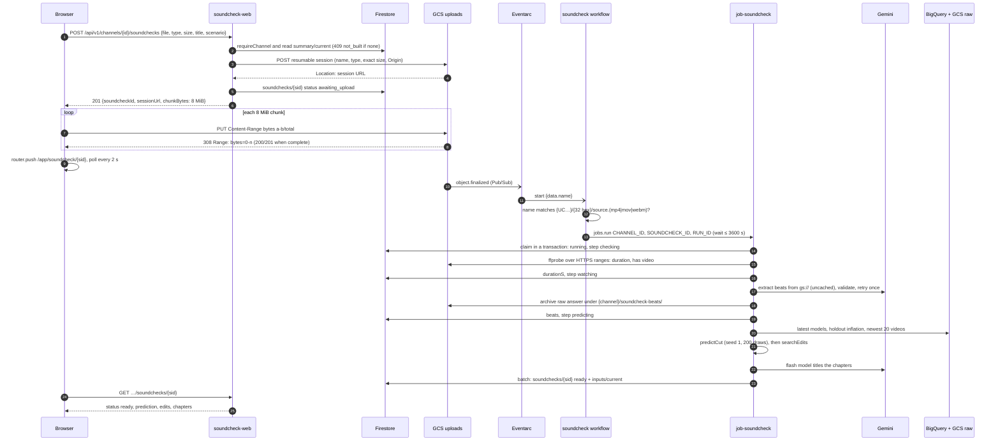
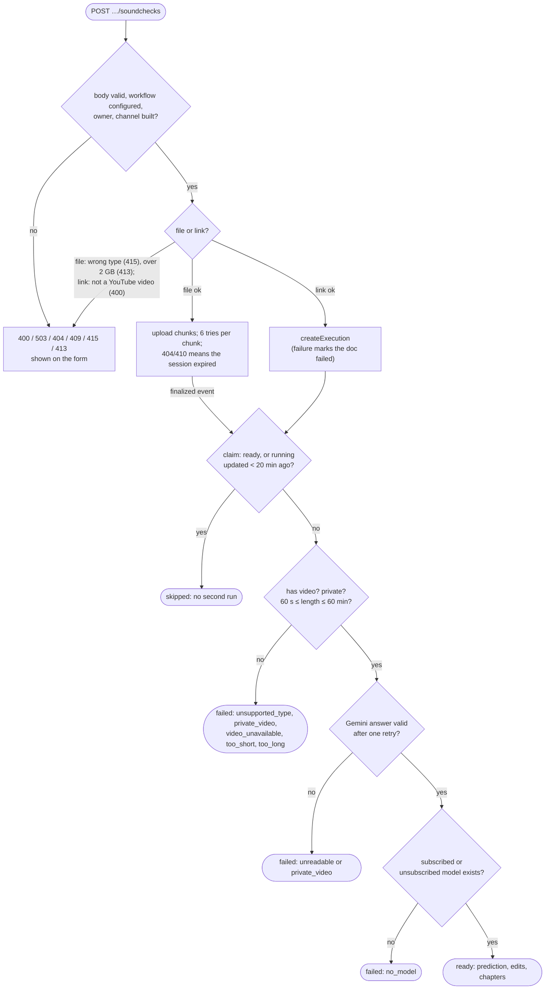
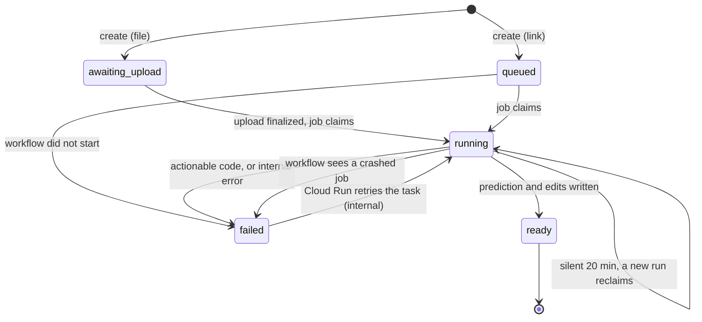

# 07 · Flow: soundcheck a new cut

Part of the [architecture set](README.md). Previous: [06 · Channel build](06-flow-channel-build.md). Next: [08 · Read a screen and simulate edits](08-flow-read-and-simulate.md).

This is the product's core transaction. A creator gives Soundcheck an unpublished cut, either an uploaded file or a public or unlisted YouTube link, and a few minutes later sees how long each audience is predicted to watch it, with ranges, plus a list of edits to try. A 67 s upload went from upload to result in 2 min 38 s when measured live (Phase 14), most of it the job starting.

## 7.1 File upload: sequence

**What it shows.** Every hop for an uploaded file: the create request, the browser's direct chunked upload, the storage event that starts the work, the job's five steps, and the page polling for the result.

**Who it's for.** Engineers working on uploads, the soundcheck job or its page, and anyone tracing a soundcheck that never finished.

**Three takeaways.**

1. **The web app never sees the bytes.** It opens a resumable session for exactly one object name, type and size (`ifGenerationMatch=0`, so the object cannot already exist), and returns the session URL. The browser then PUTs 8 MiB chunks straight to Cloud Storage.
2. **The upload's completion starts the work.** Cloud Storage's `object.finalized` event reaches the `soundcheck` workflow through Eventarc. The workflow recovers the channel and soundcheck IDs from the object name `{channel}/{soundcheck}/source.{ext}`.
3. **The job checks the cut before spending on Gemini.** It reads the duration over HTTP range requests (ffprobe never downloads the file), then Gemini reads the `gs://` URI directly. The finished prediction and the inputs the simulate route needs are written in one Firestore batch.

Interactive versions, split at the trigger so each fits a desktop screen, with every participant linked to its code: [upload and trigger](interactive/soundcheck-upload/soundcheck-upload.html) and [the job run](interactive/soundcheck-job/soundcheck-job.html).

For a **YouTube link**, the create request writes the document as `queued` and starts the `soundcheck` workflow itself with `{channel_id, soundcheck_id}`. In the checking step the job calls `videos.list` with the channel's own credentials: a private video fails fast, and Gemini then reads the YouTube URL instead of a `gs://` object ([data/soundchecks.ts](../../packages/core/src/data/soundchecks.ts), [soundcheck/run.ts](../../apps/pipeline/src/commands/soundcheck/run.ts)).

## 7.2 Branches, refusals and failures

**What it shows.** Every decision between the creator's click and a result, and where each failure surfaces: as an HTTP status on the form, or as a plain message on the soundcheck page.

**Who it's for.** Support, and engineers mapping an error message back to its cause.

**Three takeaways.**

1. **The form refuses early.** Type, size and link format are checked in the browser and again on the server (415, 413, 400). A channel with no published build gets 409, because there is no model to predict with.
2. **The job fails with plain messages.** Each failure the creator can fix ends the soundcheck as `failed` with a message from `FAILURE_MESSAGES`: private video, unavailable, too short, too long, no picture, no model, unreadable.
3. **Crashes are handled in two places.** An unexpected error saves `failed (internal)` and rethrows, so Cloud Run retries the task once. If the job dies without saving (out of memory, a timeout), the workflow marks a soundcheck still `running` as failed, so the page stops waiting.

Any other exception leaves the soundcheck `failed (internal)` and rethrows. Cloud Run (`--max-retries 1`) runs the task again, the claim succeeds because the status is not `ready`, and the run starts over.

## 7.3 Soundcheck status

**What it shows.** The values of `soundchecks/{sid}.status` and what moves between them.

**Who it's for.** UI engineers (the page polls while the status is active) and anyone cleaning up stuck soundchecks.

**Three takeaways.**

1. **A file waits; a link queues.** A file starts in `awaiting_upload` and moves only when the finished upload's event arrives. A link starts `queued` because its workflow starts at once.
2. **The claim keeps runs single.** Two events or a retry cannot run a soundcheck twice at the same time: `running` blocks a new claim until it has been silent for 20 minutes.
3. **Nothing cleans up an abandoned upload.** If the creator closes the tab mid-upload, the document stays `awaiting_upload` with no expiry. The page tells them to start a new soundcheck ([13 · Findings](13-findings.md#c-under-documented-and-worth-attention)).

Sources: [soundchecks/route.ts](../../apps/web/src/app/api/v1/channels/[id]/soundchecks/route.ts), [data/soundchecks.ts](../../packages/core/src/data/soundchecks.ts), [lib/upload.ts](../../apps/web/src/lib/upload.ts), [soundcheck.yaml](../../infra/workflows/soundcheck.yaml), [soundcheck/run.ts](../../apps/pipeline/src/commands/soundcheck/run.ts), [soundcheck/probe.ts](../../apps/pipeline/src/commands/soundcheck/probe.ts), [soundcheck/channel.ts](../../apps/pipeline/src/commands/soundcheck/channel.ts), [schemas/soundchecks.ts](../../packages/core/src/schemas/soundchecks.ts).
