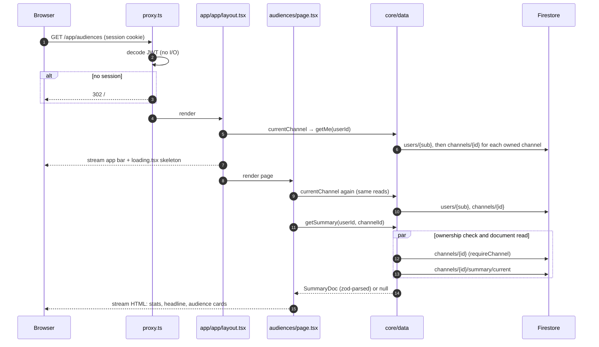
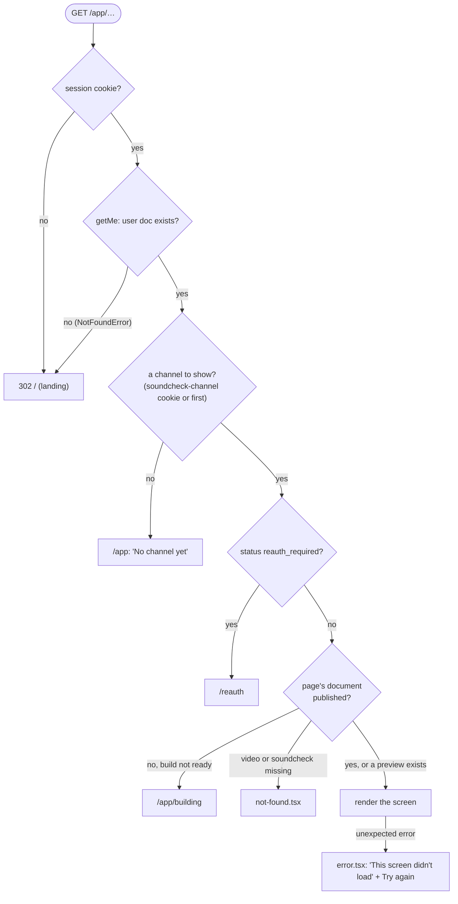
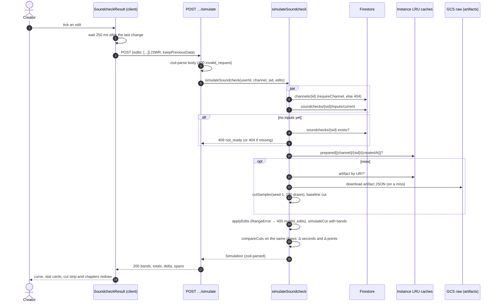

# 08 · Flow: read a screen and simulate edits

Part of the [architecture set](README.md). Previous: [07 · Soundcheck a new cut](07-flow-soundcheck.md). Next: [09 · Failure and retry](09-flow-failure-retry.md).

These are the two paths a creator waits on. Every screen is a read of documents the batch plane already computed. The one exception is ticking an edit on a soundcheck, which runs the prediction runtime inside the request. Both must stay fast and free of BigQuery and Gemini ([CLAUDE.md](../../CLAUDE.md) rule 11; Phase 15 "Do not").

## 8.1 Read a screen: sequence

**What it shows.** A signed-in page load, using `/app/audiences` as the example, from the session check through the layout's and the page's lookups to the rendered HTML.

**Who it's for.** Engineers adding a page, and anyone chasing page latency.

**Three takeaways.**

1. **Pages are server components.** They call `core/data` directly with no API hop and stream a `loading.tsx` skeleton while they wait. Client components exist only where something polls, uploads or toggles.
2. **Lookups are repeated.** Both `app/app/layout.tsx` (for the app bar) and the page call `currentChannel`, which is `getMe`: the user document plus each channel document in turn. Nothing caches it per request.
3. **Ownership is checked next to the read.** `getSummary` runs `requireChannel` and the document read in parallel. Another user's document can be fetched, but it is never returned.

## 8.2 Which screen a request ends on

**What it shows.** The guards every signed-in page runs before it renders: the same order in each `page.tsx`, plus `/app`'s own redirect by build state.

**Who it's for.** Anyone adding a screen (copy the guards) or debugging an unexpected redirect.

**Three takeaways.**

1. **One order everywhere.** Session, then channel lookup, then reconnect status, then the document. The guards are repeated in each page rather than shared, so a new page must copy them.
2. **`/app` is a router.** It sends the creator to `/reauth`, `/app/audiences` (build `ready`) or `/app/building` (every other state).
3. **A previous publish is still shown.** If the summary exists but the build is not `ready` (refreshing, failed, insufficient), the audiences screen shows the old summary with a "preview from your last build" note.

## 8.3 Simulate edits: sequence

**What it shows.** What happens between ticking an edit on a soundcheck result and the curve, totals and chapters changing.

**Who it's for.** Engineers working on the edit panel or the prediction runtime, and anyone deciding the web service's minimum instances.

**Three takeaways.**

1. **No model calls on this path.** The route reads the soundcheck's `inputs/current` (the cut as the model reads it, the scenario mix and weights, and model references) and simulates from model artifacts in the instance's LRU caches.
2. **The same draws make comparisons honest.** The route rebuilds the job's sampler with seed 1 and 200 draws, and judges the edited cut against the cut as it is on those same draws (common random numbers). That makes the change's range about 3 times narrower than independent draws.
3. **Speed depends on a warm instance.** Measured locally, the round trip is 315 to 333 ms from click to new numbers, of which 250 ms is the debounce and 34 to 60 ms the route. With `--min-instances=0`, the first toggle after idle pays a cold start plus artifact downloads. Phase 15 left that decision pending.

Sources: [app/app/layout.tsx](../../apps/web/src/app/app/layout.tsx), [app/app/audiences/page.tsx](../../apps/web/src/app/app/audiences/page.tsx), [lib/channel.ts](../../apps/web/src/lib/channel.ts), [lib/app-home.ts](../../apps/web/src/lib/app-home.ts), [data/screens.ts](../../packages/core/src/data/screens.ts), [data/users.ts](../../packages/core/src/data/users.ts), [simulate/route.ts](../../apps/web/src/app/api/v1/channels/[id]/soundchecks/[soundcheckId]/simulate/route.ts), [data/simulate.ts](../../packages/core/src/data/simulate.ts), [components/soundcheck-view.tsx](../../apps/web/src/components/soundcheck-view.tsx), [phase-15 notes](../notes/phase-15.md).
