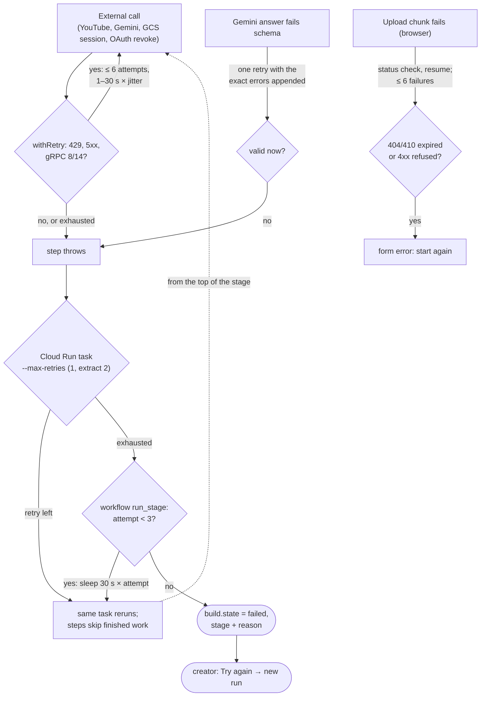
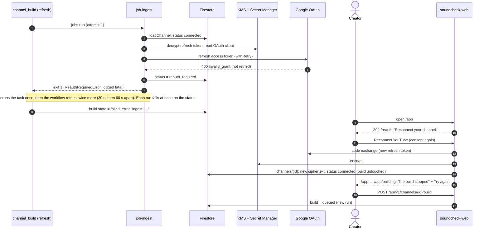

# 09 · Flow: failure, retry and recovery

Part of the [architecture set](README.md). Previous: [08 · Read and simulate](08-flow-read-and-simulate.md). Next: [10 · Use cases](10-use-cases.md).

Soundcheck retries at five levels: each external call, each upload chunk, each Gemini answer, each Cloud Run task, and each workflow stage. Above them is the creator, who can press **Try again**. The levels don't share information about why something failed, so one non-retryable failure can be retried at three layers. This page maps the layers and walks through the case most likely to hit production: a creator's YouTube access expiring.

## 9.1 The retry layers

**What it shows.** Each place a failure is caught and retried, how many times, how long it waits, and what happens once it gives up.

**Who it's for.** On-call engineers, and anyone changing a timeout or a retry count.

**Three takeaways.**

1. **Only `withRetry` looks at the error.** It retries HTTP 429 and 5xx and gRPC `RESOURCE_EXHAUSTED` and `UNAVAILABLE`, at most 6 attempts with 1–30 s jittered backoff. Socket errors such as `ECONNRESET` are not retried (rule 5).
2. **Above `withRetry`, nothing checks the cause.** Cloud Run task retries and the workflow's three stage attempts rerun any failure, including ones that cannot succeed, such as `ReauthRequiredError`. Idempotency (rule 7) makes this safe but not cheap: every attempt pays a container start.
3. **Every give-up leaves a message the creator can see.** A build ends `failed` with its stage and error. A soundcheck ends `failed` with a plain message. A deletion leaves the channel in place to try again. Sign-in sends the creator to an error page.

## 9.2 Expired YouTube access: sequence

**What it shows.** A weekly refresh meeting a refresh token that Google no longer accepts: how the job fails, what the creator sees, and how reconnecting recovers.

**Who it's for.** Operators running the OAuth app in **Testing** mode, where Google expires refresh tokens after 7 days ([infra/README.md](../../infra/README.md#oauth-consent-screen)), so this path runs every week for any creator who has not signed in since.

**Three takeaways.**

1. **The first failure flags the channel.** `credentialsForChannel` forces a token refresh. A `400 invalid_grant` sets `channels/{id}.status = reauth_required`, and every later attempt fails at once on that status without calling Google.
2. **Retries are still spent.** Cloud Run reruns the task once and the workflow tries the stage three times, so about 6 container starts and 90 s of deliberate waiting go to a failure that only the creator can fix.
3. **Recovery takes two clicks.** Every app page redirects to `/reauth`. Reconnecting runs `connectChannel`, which replaces the token and sets `status` back to `connected` but does not restart the build. The creator then presses **Try again** on the build screen.

## 9.3 Timeouts and limits in one place

| Where               | Limit                                                               | Set in                                                                                                                      | What happens at the limit                                                   |
| ------------------- | ------------------------------------------------------------------- | --------------------------------------------------------------------------------------------------------------------------- | --------------------------------------------------------------------------- |
| Web request         | 60 s, concurrency 80, 0 to 3 instances                              | [deploy-web.sh](../../infra/deploy-web.sh)                                                                                  | Cloud Run returns 504; a sign-in callback or deletion can get here (see 05) |
| External call       | 6 attempts, 1 s → 30 s backoff, ×1–2 jitter                         | [retry.ts](../../packages/core/src/retry.ts)                                                                                | The last error is rethrown                                                  |
| Gemini HTTP         | 15 min header and body timeout (undici `Agent`)                     | [gemini/fetch.ts](../../packages/core/src/gemini/fetch.ts)                                                                  | Treated as a failed call                                                    |
| Gemini answer       | 1 retry with validation errors                                      | [gemini/extract.ts](../../packages/core/src/gemini/extract.ts)                                                              | Extraction `invalid`; the soundcheck fails `unreadable`                     |
| Upload chunk        | 8 MiB, 6 failures, 30-day object lifecycle                          | [lib/upload.ts](../../apps/web/src/lib/upload.ts), [schemas/soundchecks.ts](../../packages/core/src/schemas/soundchecks.ts) | Form error; an expired session must restart                                 |
| Cloud Run task      | 900–3600 s; retries 1 (extract 2)                                   | [deploy-pipeline.sh](../../infra/deploy-pipeline.sh)                                                                        | The execution fails                                                         |
| Build stage wait    | 7200 s per attempt, 3 attempts                                      | [channel_build.yaml](../../infra/workflows/channel_build.yaml)                                                              | `build.state = failed`                                                      |
| Soundcheck job wait | 3600 s                                                              | [soundcheck.yaml](../../infra/workflows/soundcheck.yaml)                                                                    | A soundcheck left `running` is marked `failed (internal)`                   |
| Stale build         | queued > 5 min with no execution, or the execution no longer active | [data/build.ts](../../packages/core/src/data/build.ts)                                                                      | The next start replaces it                                                  |
| Stale soundcheck    | `running` and silent for 20 min                                     | [soundcheck/run.ts](../../apps/pipeline/src/commands/soundcheck/run.ts)                                                     | A new run may reclaim it                                                    |
| Build progress      | Throttled writes, best effort                                       | [jobs/progress.ts](../../packages/core/src/jobs/progress.ts)                                                                | A failed progress write is logged and never fails the job                   |
| Weekly pooled refit | 2 extra tries, 30 → 300 s                                           | [weekly_refresh.yaml](../../infra/workflows/weekly_refresh.yaml)                                                            | That week's refresh stops; no channel is refreshed                          |

Sources: [packages/core/src/youtube/auth.ts](../../packages/core/src/youtube/auth.ts), [apps/pipeline/src/main.ts](../../apps/pipeline/src/main.ts), [apps/web/src/app/reauth/page.tsx](../../apps/web/src/app/reauth/page.tsx), [packages/core/src/data/channels.ts](../../packages/core/src/data/channels.ts).
