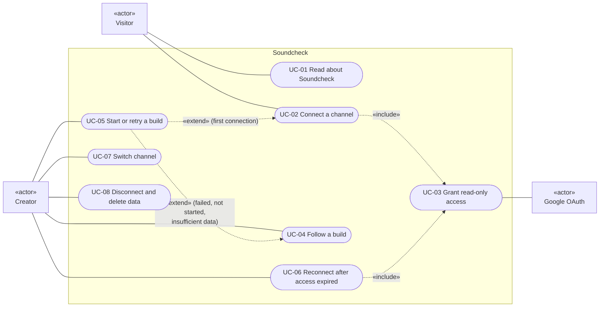
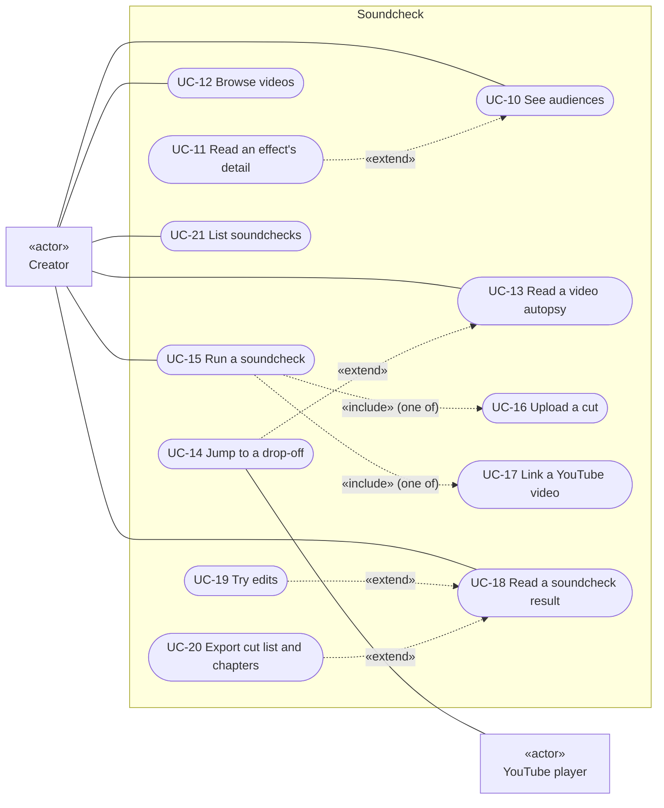
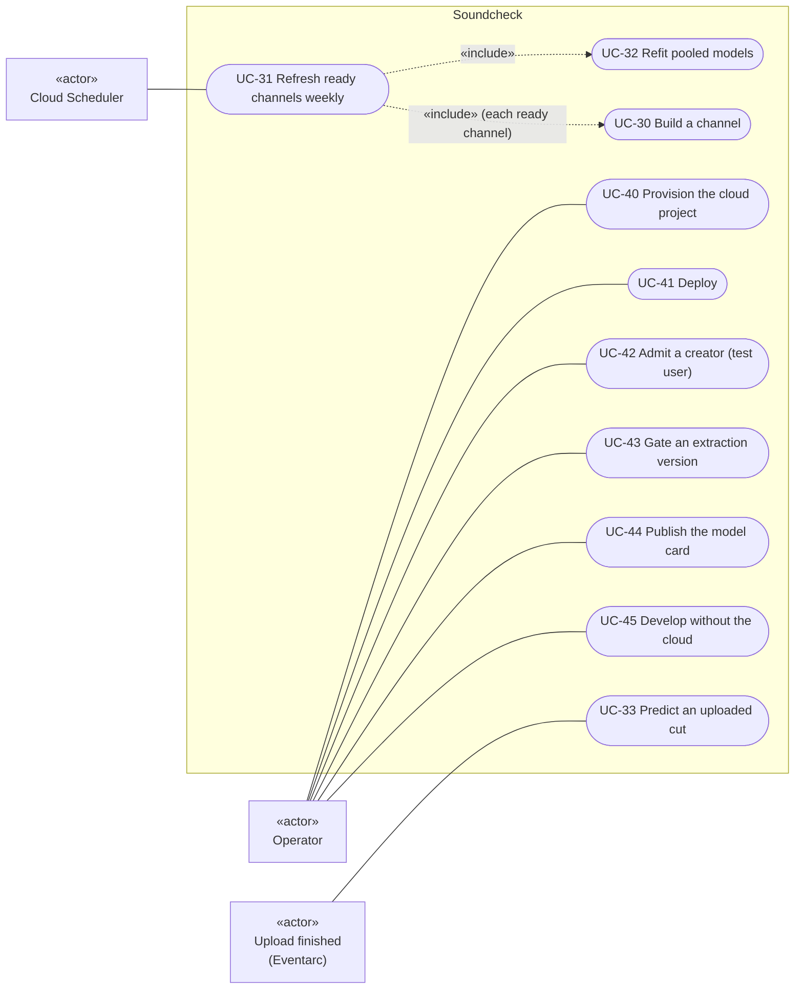

# 10 · Use cases

Part of the [architecture set](README.md). Previous: [09 · Failure and retry](09-flow-failure-retry.md). Next: [11 · Wireframes](11-wireframes.md).

Use cases are numbered so the [wireframes](11-wireframes.md) and the [screen-flow map](12-screen-flow.md) can refer to them: **UC-0x** for account and build, **UC-1x/2x** for insight and soundchecks, **UC-3x** for scheduled and event-driven work, **UC-4x** for the operator.

Mermaid has no use-case diagram type, so these use flowchart shapes in UML's style. Actors are rectangles marked «actor», use cases are rounded, and the system boundary is a box. Dotted arrows marked «include» run from a base use case to the one it always contains. Arrows marked «extend» run from an optional extension to its base.

## 10.1 Account and build (visitor, creator)

**What it shows.** How a visitor becomes a creator and how a creator manages the connection and the build.

**Who it's for.** Product and UX, and engineers working on sign-in, the build screen or settings.

**Three takeaways.**

1. **Connecting is signing in.** There is no separate sign-up: UC-02 always includes granting the two read-only scopes, and on a first connection it also starts the first build.
2. **Starting a build is one use case with several triggers.** The Start, Build now, Check again and Try again buttons, and the first connection, all call `startChannelBuild`.
3. **Disconnect is self-service and complete.** UC-08 needs no operator and deletes data by convention ([05](05-flow-connect.md#53-disconnect-and-delete)).

## 10.2 Insight and soundchecks (creator)

**What it shows.** What a creator does with a built channel: read their audiences and videos, and soundcheck new cuts.

**Who it's for.** Product and UX, and engineers working on the audiences, videos and soundcheck screens.

**Three takeaways.**

1. **Insight is read-only.** UC-10 to UC-14 only read documents the build published. When the models are not usable, each screen still opens and says "Not a result yet".
2. **A soundcheck takes a file or a link.** UC-15 includes exactly one of UC-16 (upload) or UC-17 (link). Both end in the same job and the same result screen.
3. **Edits and exports extend the result.** UC-19 (try edits) and UC-20 (export) need a `ready` soundcheck. Exports describe whichever edits are ticked.

## 10.3 Scheduled, event-driven and operator use cases

**What it shows.** The work no creator clicks for: the timer, the storage event, and the operator's tasks.

**Who it's for.** Operators and platform engineers.

**Three takeaways.**

1. **UC-30 is shared.** "Build a channel" is reached from the creator (UC-02, UC-05) and from the weekly timer (UC-31). It is the same `channel_build` workflow, in `build` or `refresh` mode.
2. **An upload finishing is an actor.** Eventarc starts UC-33 with no request from anyone. Starting a soundcheck from a link (UC-17) reaches the same job through the web app.
3. **The operator's work happens outside the app.** Provisioning, deploying, admitting test users, gating extraction quality and publishing the model card all happen in a terminal or the Cloud console. No admin role exists in the app.

## Use-case table

| ID    | Actor                                      | Use case                       | Entry point in code                                                                                                                                                                                                                  | Preconditions                                                                                        | Main success outcome                                                                                  |
| ----- | ------------------------------------------ | ------------------------------ | ------------------------------------------------------------------------------------------------------------------------------------------------------------------------------------------------------------------------------------ | ---------------------------------------------------------------------------------------------------- | ----------------------------------------------------------------------------------------------------- |
| UC-01 | Visitor                                    | Read about Soundcheck          | [app/page.tsx](../../apps/web/src/app/page.tsx)                                                                                                                                                                                      | None                                                                                                 | Learns what is read, the limits and how deletion works, then connects or opens the app                |
| UC-02 | Visitor                                    | Connect a channel              | `ConnectButton` → `signIn("google")` ([auth-buttons.tsx](../../apps/web/src/components/auth-buttons.tsx)) → `signIn` callback ([auth.ts](../../apps/web/src/auth.ts)) → [`connectChannel`](../../packages/core/src/data/channels.ts) | A Google account that owns a channel and is an OAuth test user; channel not owned by another account | Session cookie; `users/{sub}` and `channels/{id}` written with the KMS ciphertext; first build queued |
| UC-03 | Visitor, Google OAuth                      | Grant read-only access         | Google provider scopes and `access_type=offline` ([auth.config.ts](../../apps/web/src/auth.config.ts)); `missingYoutubeScopes`                                                                                                       | Consent screen shown                                                                                 | `youtube.readonly` and `yt-analytics.readonly` granted, and a refresh token returned                  |
| UC-04 | Creator                                    | Follow a build                 | [/app/building](../../apps/web/src/app/app/building/page.tsx), `BuildScreen` polling `GET /api/v1/channels/[id]`                                                                                                                     | Connected channel                                                                                    | Five steps with live stage, count, attempt and ETA; a link to audiences when `ready`                  |
| UC-05 | Creator                                    | Start or retry a build         | `POST /api/v1/channels/[id]/build` ([route](../../apps/web/src/app/api/v1/channels/[id]/build/route.ts)) → [`startChannelBuild`](../../packages/core/src/data/build.ts)                                                              | Owner; no live build (or a stale one); `WORKFLOW_CHANNEL_BUILD` set; not fixtures mode               | 202 with `state: queued`; workflow execution started                                                  |
| UC-06 | Creator                                    | Reconnect after access expired | [/reauth](../../apps/web/src/app/reauth/page.tsx) → `ConnectButton` → `connectChannel` (reconnect)                                                                                                                                   | `status = reauth_required`                                                                           | New ciphertext and `status = connected`; earlier results kept                                         |
| UC-07 | Creator                                    | Switch channel                 | `AppNav` form → `chooseChannel` server action ([lib/actions.ts](../../apps/web/src/lib/actions.ts))                                                                                                                                  | User owns more than one channel                                                                      | `soundcheck-channel` cookie set; `/app` shows the chosen channel                                      |
| UC-08 | Creator                                    | Disconnect and delete data     | [/app/settings](../../apps/web/src/app/app/settings/page.tsx) → `DeleteChannelButton` → `DELETE /api/v1/channels/[id]` → [`deleteChannel`](../../packages/core/src/data/delete-channel.ts)                                           | Owner; not fixtures mode                                                                             | Token revoked; BigQuery rows, GCS objects and Firestore documents deleted; counts returned            |
| UC-10 | Creator                                    | See audiences                  | [/app/audiences](../../apps/web/src/app/app/audiences/page.tsx) → `getSummary`                                                                                                                                                       | `summary/current` published (or build `ready`)                                                       | Stat cards, headline, audience cards; "Not a result yet" when not usable                              |
| UC-11 | Creator                                    | Read an effect's detail        | `EffectsSheet` in [audience-grid.tsx](../../apps/web/src/components/audience-grid.tsx); deep link `?audience=&effect=`                                                                                                               | An audience card with effects                                                                        | Sheet with every simulated effect, grouped by what it says                                            |
| UC-12 | Creator                                    | Browse videos                  | [/app/videos](../../apps/web/src/app/app/videos/page.tsx) → `listVideos`; [video-list.tsx](../../apps/web/src/components/video-list.tsx)                                                                                             | `index/videos` published                                                                             | Searchable list with five sorts and each video's biggest drop-off                                     |
| UC-13 | Creator                                    | Read a video autopsy           | [/app/videos/[videoId]](../../apps/web/src/app/app/videos/[videoId]/page.tsx) → `getVideo`; [video-autopsy.tsx](../../apps/web/src/components/video-autopsy.tsx)                                                                     | `videos/{id}` published                                                                              | Each audience's curve and band over the beat strip; drop panel with causes and "Unexplained"          |
| UC-14 | Creator, YouTube player                    | Jump to a drop-off             | [youtube-player.tsx](../../apps/web/src/components/youtube-player.tsx) `seekTo`                                                                                                                                                      | Video playable in an embed                                                                           | Player seeks to the drop-off; the playhead follows on the chart                                       |
| UC-15 | Creator                                    | Run a soundcheck               | [/app/soundcheck/new](../../apps/web/src/app/app/soundcheck/new/page.tsx) → `POST …/soundchecks` → [`createSoundcheck`](../../packages/core/src/data/soundchecks.ts)                                                                 | Summary published; `WORKFLOW_SOUNDCHECK` set; not fixtures mode                                      | 201; soundcheck document created; page polls the result                                               |
| UC-16 | Creator                                    | Upload a cut                   | `SoundcheckForm` + [`uploadFile`](../../apps/web/src/lib/upload.ts) to the resumable session                                                                                                                                         | MP4, MOV or WebM, at most 2 GB; CORS allows the origin                                               | Object finalized at `{channel}/{sid}/source.{ext}`                                                    |
| UC-17 | Creator                                    | Link a YouTube video           | `SoundcheckForm` (`kind: youtube`), `parseYouTubeLink`                                                                                                                                                                               | Public or unlisted video                                                                             | Soundcheck `queued`; workflow started by the web app                                                  |
| UC-18 | Creator                                    | Read a soundcheck result       | [/app/soundcheck/[id]](../../apps/web/src/app/app/soundcheck/[soundcheckId]/page.tsx) → `getSoundcheck`; [soundcheck-view.tsx](../../apps/web/src/components/soundcheck-view.tsx) polls every 2 s                                    | Soundcheck exists for the channel                                                                    | Progress, then the prediction with ranges, or a plain failure message                                 |
| UC-19 | Creator                                    | Try edits                      | [edit-panel.tsx](../../apps/web/src/components/edit-panel.tsx) → `POST …/simulate` → [`simulateSoundcheck`](../../packages/core/src/data/simulate.ts)                                                                                | Status `ready` (`inputs/current` exists)                                                             | Totals, curves, cut strip and chapters for the edited cut                                             |
| UC-20 | Creator                                    | Export cut list and chapters   | [cut-exports.tsx](../../apps/web/src/components/cut-exports.tsx)                                                                                                                                                                     | Status `ready`                                                                                       | CSV downloaded or copied; chapters copied for the YouTube description                                 |
| UC-21 | Creator                                    | List soundchecks               | [/app/soundcheck](../../apps/web/src/app/app/soundcheck/page.tsx) → `listSoundchecks`                                                                                                                                                | Owner                                                                                                | The newest 30 soundchecks with status, or the empty state                                             |
| UC-30 | Creator (via UC-02, UC-05), weekly_refresh | Build a channel                | [channel_build.yaml](../../infra/workflows/channel_build.yaml); jobs from [stage/run.ts](../../apps/pipeline/src/commands/stage/run.ts) and [cli.py](../../services/modeling/src/soundcheck_modeling/cli.py)                         | Channel `connected`; token valid; images deployed                                                    | Models fitted, evaluation run, screens published, `build.state = ready`                               |
| UC-31 | Cloud Scheduler                            | Refresh ready channels weekly  | [weekly_refresh.yaml](../../infra/workflows/weekly_refresh.yaml), scheduled by [09-orchestration.sh](../../infra/09-orchestration.sh)                                                                                                | Monday 03:00 IST; ready channels exist                                                               | Pooled refit, then a `refresh` build per ready channel                                                |
| UC-32 | weekly_refresh                             | Refit pooled models            | `job-train` `stage train-pooled` ([cli.py](../../services/modeling/src/soundcheck_modeling/cli.py))                                                                                                                                  | `training_bins` at the current feature version                                                       | Pooled artifacts and `model_runs` rows                                                                |
| UC-33 | Eventarc                                   | Predict an uploaded cut        | [soundcheck.yaml](../../infra/workflows/soundcheck.yaml) → `job-soundcheck` ([soundcheck/run.ts](../../apps/pipeline/src/commands/soundcheck/run.ts))                                                                                | Object name matches `{channel}/{32 hex}/source.{ext}`                                                | Soundcheck `ready` with prediction, edits and chapters, or `failed` with a code                       |
| UC-40 | Operator                                   | Provision the cloud project    | [infra/up.sh](../../infra/up.sh), [07-budget.sh](../../infra/07-budget.sh), manual OAuth steps ([infra/README.md](../../infra/README.md))                                                                                            | Owner on a billed project                                                                            | APIs, service accounts, buckets, dataset, Firestore, KMS, secrets, Scheduler                          |
| UC-41 | Operator                                   | Deploy                         | [deploy-pipeline.sh](../../infra/deploy-pipeline.sh), [deploy-workflows.sh](../../infra/deploy-workflows.sh), [deploy-web.sh](../../infra/deploy-web.sh), [10-soundcheck-trigger.sh](../../infra/10-soundcheck-trigger.sh)           | `.env` filled; `pnpm check` green (by convention)                                                    | New images and configuration live                                                                     |
| UC-42 | Operator                                   | Admit a creator                | Google Auth Platform console (manual)                                                                                                                                                                                                | Fewer than 100 test users                                                                            | Creator can sign in                                                                                   |
| UC-43 | Operator                                   | Gate an extraction version     | `soundcheck consistency runs \| human \| gate` ([consistency/](../../apps/pipeline/src/commands/consistency/))                                                                                                                       | Labelled six-video test set                                                                          | `quality_reports` row and `extractionGates/{version}` with `passed: true`                             |
| UC-44 | Operator                                   | Publish the model card         | `soundcheck-modeling model-card` ([model_card.py](../../services/modeling/src/soundcheck_modeling/model_card.py))                                                                                                                    | `eval_runs` at the current versions                                                                  | [docs/model-card.md](../model-card.md) rewritten                                                      |
| UC-45 | Operator                                   | Develop without the cloud      | `NEXT_PUBLIC_USE_FIXTURES=true`; [scripts/export-fixtures.ts](../../scripts/export-fixtures.ts)                                                                                                                                      | Fixtures exported                                                                                    | The full app read-only, as the fixture user                                                           |
