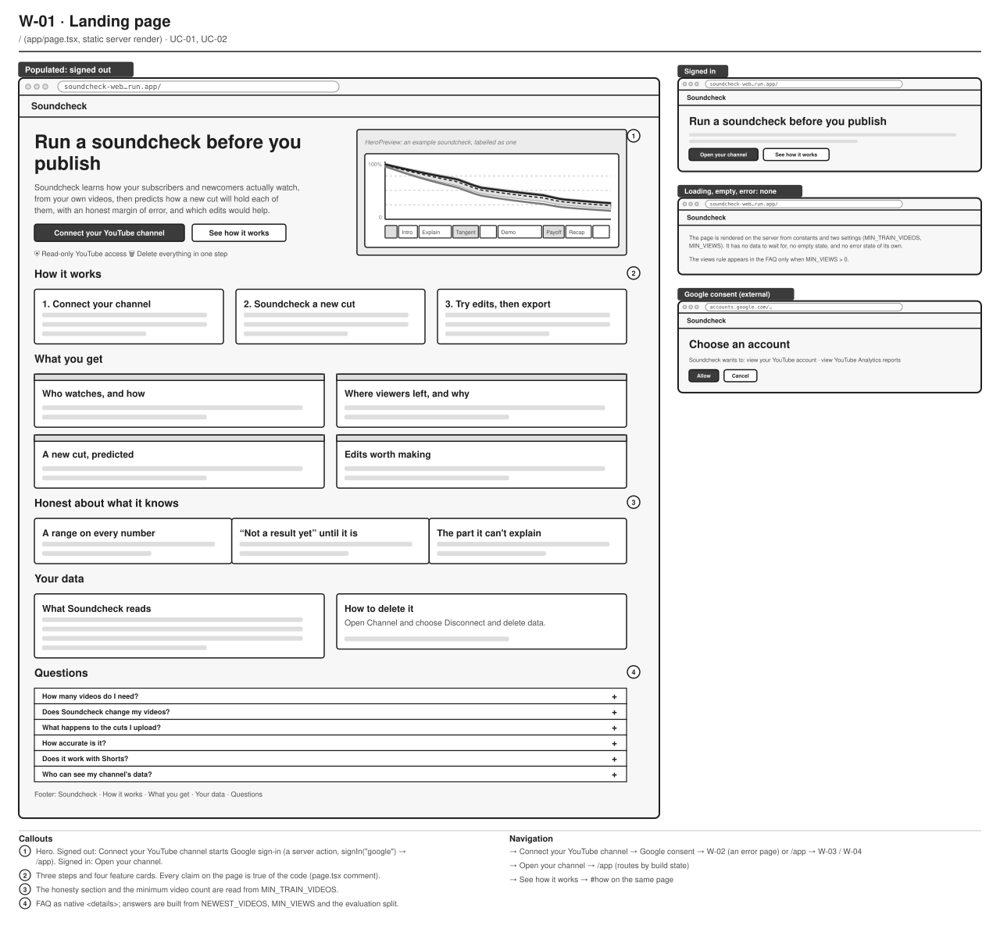
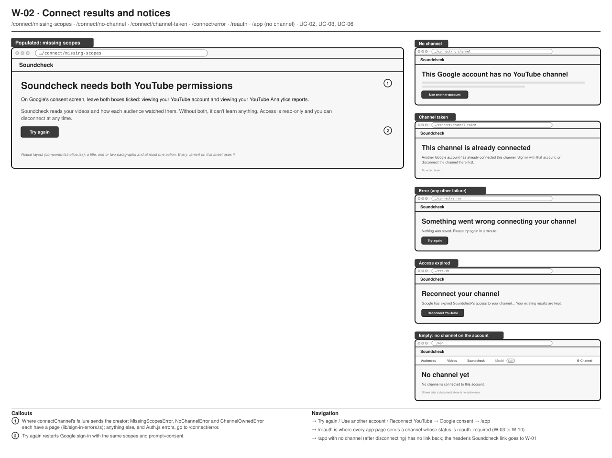
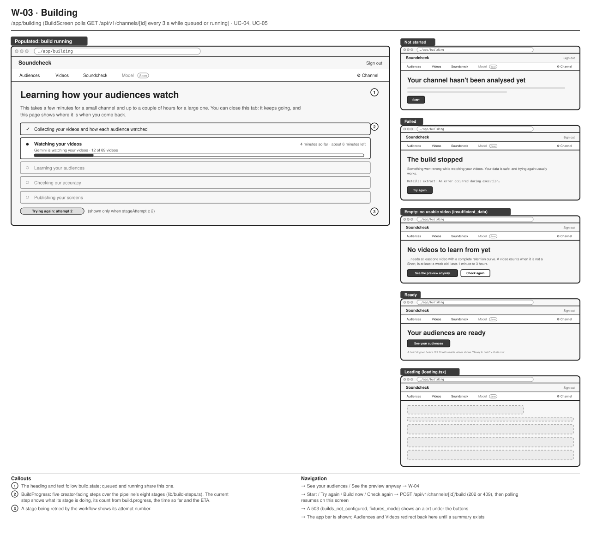
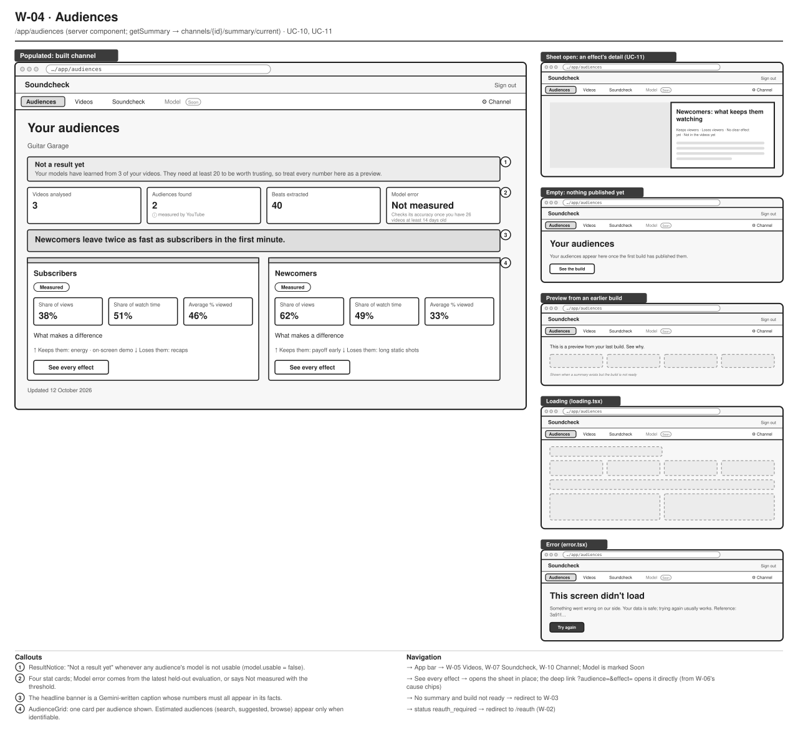
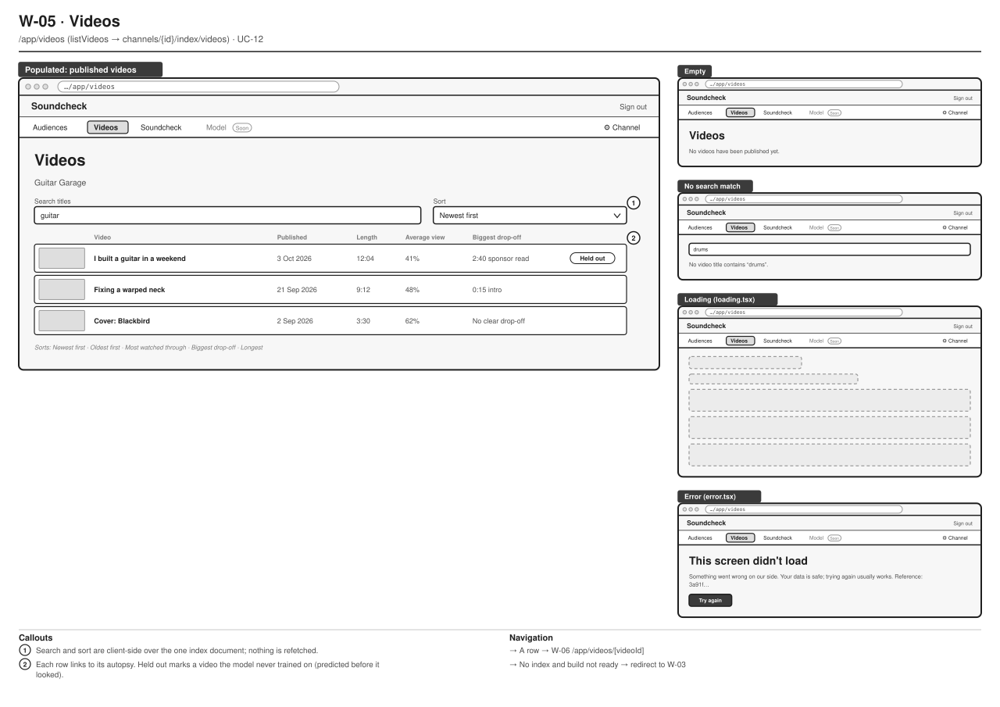
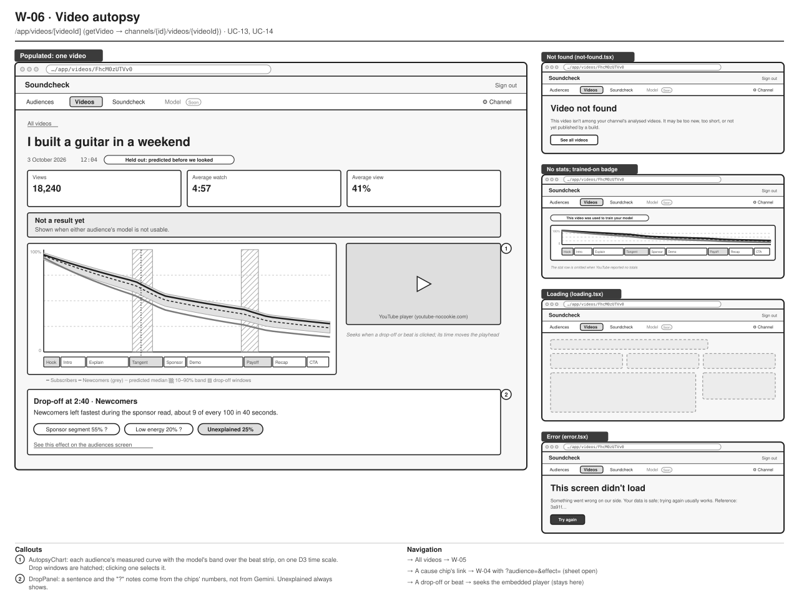
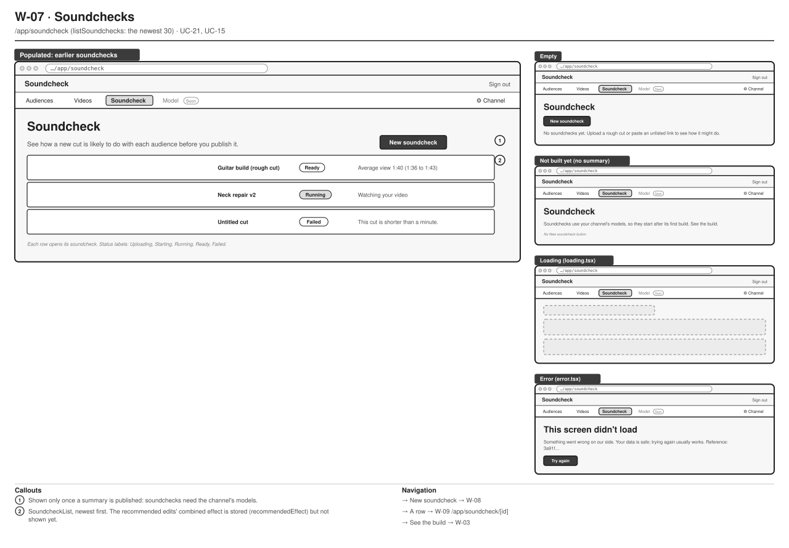
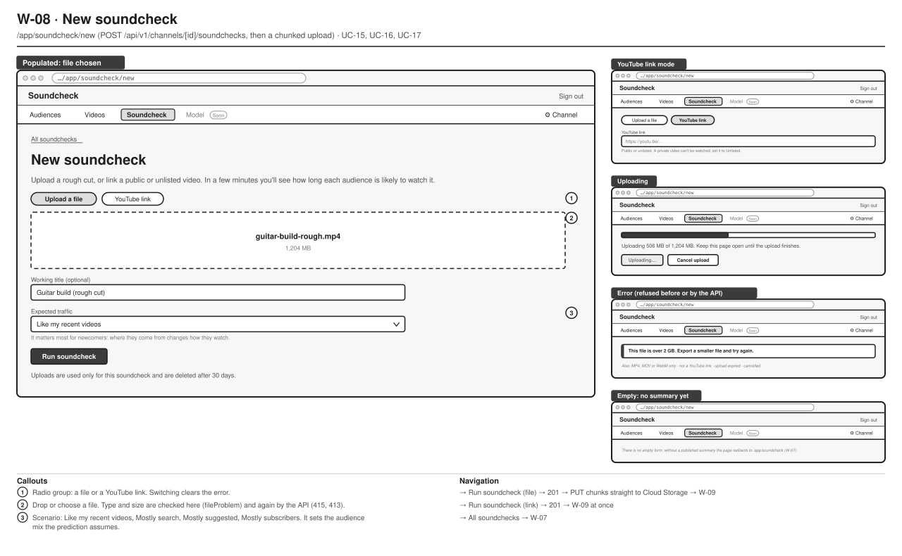
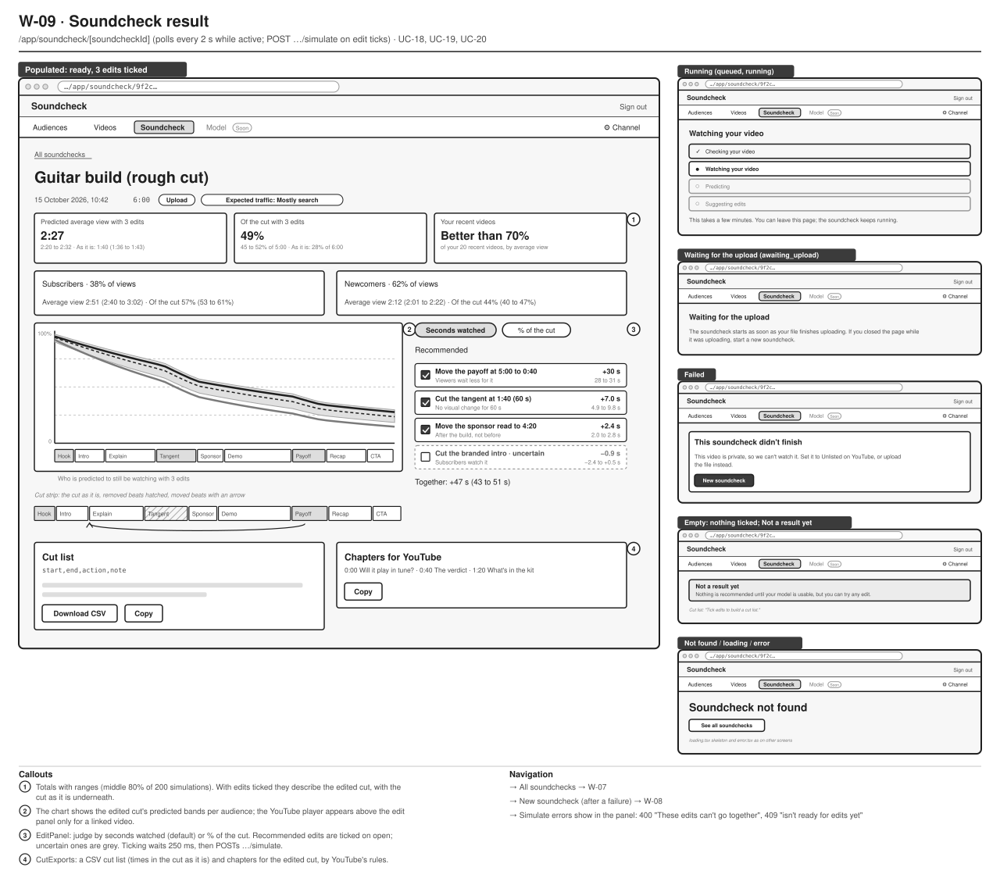
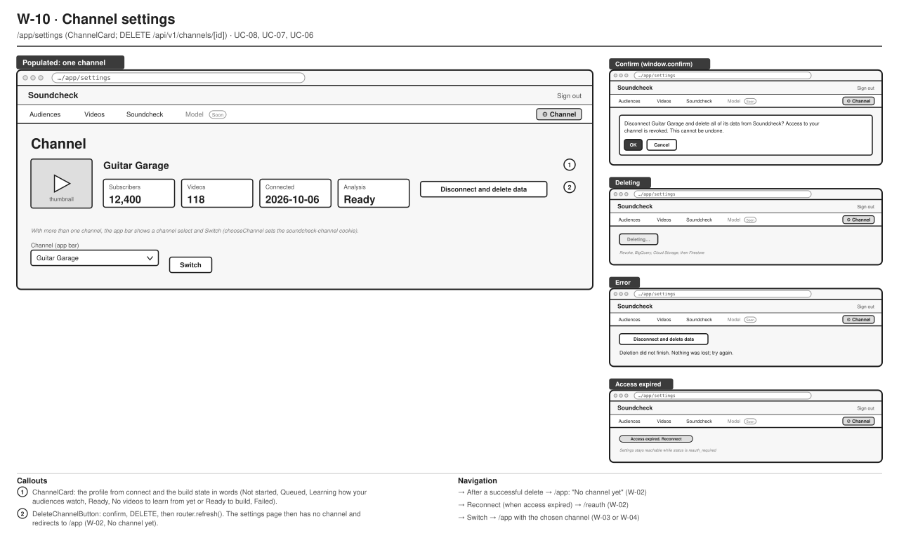

# 11 · Wireframes

Part of the [architecture set](README.md). Previous: [10 · Use cases](10-use-cases.md). Next: [12 · Screen-flow map](12-screen-flow.md).

Low-fidelity greyscale wireframes of every major screen, drawn from the code at `48d7346`. Each sheet has:

- **The main frame:** the populated state at desktop width, with numbered callouts.
- **Thumbnails on the right:** the other states, meaning empty, loading (`loading.tsx`), error (`error.tsx` or a domain error) and any screen-specific state.
- **Callouts and navigation along the bottom:** each "→" names a destination wireframe (W-xx).

They show layout, components, states and navigation only. Visual styling lives in [design-system.md](../plan/design-system.md), and screenshots of the real screens live in the phase notes ([12](../notes/phase-12.md), [13](../notes/phase-13.md), [14](../notes/phase-14.md), [15](../notes/phase-15.md)). Copy is the app's own, and the numbers are illustrative.

Every signed-in sheet (W-03 to W-10) shares the same chrome: a header with **Soundcheck** and **Sign out**, then the app bar with **Audiences · Videos · Soundcheck · Model (Soon) · Channel**, where the current screen is highlighted. A channel select appears only for a user with more than one channel.

## W-01 · Landing page

**What it shows.** The public home page in its signed-out state, plus the signed-in variant and Google's consent step that its main button leads to.

**Who it's for.** Product and marketing, and anyone changing what the page promises.

**Three takeaways.**

1. **One call to action.** **Connect your YouTube channel** starts Google sign-in. Signed-in visitors get **Open your channel** instead.
2. **The page states its limits.** Read-only access, a range on every number, "Not a result yet", the training minimum and deletion are all stated, and the numbers come from settings.
3. **No data, so few states.** It is static server-rendered HTML with no loading, empty or error state of its own.

## W-02 · Connect results and notices

**What it shows.** The single-purpose pages a creator can land on around connecting: four connect results, the reconnect page, and the empty `/app` after a disconnect.

**Who it's for.** Support, and anyone changing sign-in error handling.

**Three takeaways.**

1. **Every known failure has its own page.** Each one explains what to do, and a generic page covers the rest.
2. **They all share one layout.** `Notice` has a title, one or two paragraphs and at most one action, which always restarts Google sign-in.
3. **One dead end remains.** After a disconnect, `/app` says "No channel yet" with no way to connect again except the header link to the landing page.

## W-03 · Building

**What it shows.** The build screen while a build runs, with the four other states: not started, failed, no usable video, and ready.

**Who it's for.** Product and UX, and engineers changing build stages or their labels.

**Three takeaways.**

1. **Five steps over eight stages.** A creator sees five plain-language steps, and the current step names its stage's work, its count, the time so far and an ETA.
2. **Every ending has one next action.** The buttons are Start, Try again, Build now or Check again, and See your audiences.
3. **Polling stops by itself.** The page polls every 3 s only while the build is queued or running.

## W-04 · Audiences

**What it shows.** The home screen of a built channel: the trust notice, four stat cards, the headline, and one card per audience. Thumbnails show the effects sheet, the not-published state, a preview from an earlier build, loading and error.

**Who it's for.** Product, UX and data science, the people deciding how model results are presented.

**Three takeaways.**

1. **Trust comes first.** "Not a result yet" sits above every number whenever a model is not usable.
2. **Effects open in a sheet.** The card lists what makes a difference, and **See every effect** opens the full list grouped by what each effect says. The sheet is deep-linkable.
3. **An old summary stays visible.** A refreshing or failed build still shows the last summary, marked as a preview.

## W-05 · Videos

**What it shows.** The searchable, sortable list of published videos and its empty, no-match, loading and error states.

**Who it's for.** UX, and engineers changing the video index document.

**Three takeaways.**

1. **One document, no refetch.** Search and the five sorts run in the browser over `index/videos`.
2. **Each row leads with the drop-off.** It names the biggest drop-off and its cause, or "No clear drop-off".
3. **Held-out videos are marked.** A badge marks videos the model never trained on.

## W-06 · Video autopsy

**What it shows.** One video: totals, each audience's measured curve with the model's band over the beat strip, the embedded player, and the drop panel. Thumbnails show not found, no stats, loading and error.

**Who it's for.** UX and data science.

**Three takeaways.**

1. **One time axis.** Curves, band, drop windows and beat strip share one D3 scale, and the player and chart stay in sync both ways.
2. **Drop-offs are explained by numbers.** The panel's sentence and "?" notes come from attribution numbers, not from Gemini. "Unexplained" always shows.
3. **It links back to the audiences screen.** A cause chip opens W-04 with that effect's sheet already open.

## W-07 · Soundchecks

**What it shows.** The list of a channel's soundchecks, with the empty, not-built, loading and error states.

**Who it's for.** UX.

**Three takeaways.**

1. **Soundchecks wait for the first build.** Without a published summary, the page explains and hides **New soundcheck**.
2. **Statuses are words.** Uploading, Starting, Running, Ready and Failed, each with a one-line result or reason.
3. **Only the newest 30 show.** The list has no pagination yet.

## W-08 · New soundcheck

**What it shows.** The form for a new soundcheck in file mode, with link mode, uploading, error, and the redirect that replaces an empty state.

**Who it's for.** UX, and engineers working on uploads.

**Three takeaways.**

1. **A file or a link.** The two modes share the title and the expected-traffic scenario, which sets the audience mix the prediction assumes.
2. **Uploads go straight to storage, with progress.** After the 201, the browser PUTs 8 MiB chunks to Cloud Storage and offers **Cancel upload**. The page must stay open until the upload finishes.
3. **Errors are checked twice.** Type, size and link format are checked in the browser, and the API repeats the checks.

## W-09 · Soundcheck result

**What it shows.** A finished soundcheck with three edits ticked: totals with ranges, each audience, the predicted curves, the cut strip, the edit panel, and the exports. Thumbnails show running, waiting for upload, failed, nothing recommended, and not found.

**Who it's for.** Product, UX and data science, because this screen is the product's core decision surface.

**Three takeaways.**

1. **Every number has a range and a baseline.** The totals show the edited cut with the cut as it is underneath, each as the middle 80% of 200 simulations.
2. **Edits are honest about uncertainty.** Recommended edits are ticked on open, uncertain ones are grey, and nothing is recommended while the models are not usable.
3. **The exports follow the ticks.** The CSV cut list and the YouTube chapters always describe the ticked edits.

## W-10 · Channel settings

**What it shows.** The channel card with its disconnect button, the multi-channel switcher, and the confirm, deleting, error and access-expired states.

**Who it's for.** Product and data-protection reviewers.

**Three takeaways.**

1. **Deletion is one confirmed click.** The browser's own confirm dialog states that access is revoked and that it cannot be undone.
2. **A failure is safe to retry.** The deletion order means "try again" completes the job.
3. **Settings stays reachable while access is expired.** It is the only signed-in screen that does not redirect to `/reauth`, and it shows a **Reconnect** chip instead.

---

The sheets were generated as SVG by a small script, kept outside the repository, that draws each screen's layout from a JSON-like description. Edit the SVGs directly, or ask for the generator if a large redesign makes regeneration easier.
