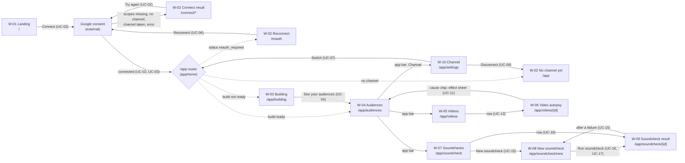

# 12 · Screen-flow map

Part of the [architecture set](README.md). Previous: [11 · Wireframes](11-wireframes.md). Next: [13 · Findings](13-findings.md).

**What it shows.** Every screen as a node labelled with its wireframe (W-xx), and every way between them as an arrow labelled with the action and the use case (UC-xx) it serves. Automatic redirects are dotted.

**Who it's for.** UX and product people planning a change to navigation, and engineers adding a screen, who need to know which guards and redirects to copy.

**Three takeaways.**

1. **`/app` decides where you land.** A creator never picks between Building and Audiences. The `/app` router sends them by `status` and `build.state`, and every app page repeats those guards ([08](08-flow-read-and-simulate.md#82-which-screen-a-request-ends-on)).
2. **Soundchecks form a loop of their own.** List → new → result, with **New soundcheck** offered again after a failure. All of it is gated on a published summary.
3. **Two places are dead ends.** "No channel yet" after a disconnect has no connect button. The **Model** tab is shown but disabled ("Soon"), and no plan in `docs/plan` describes it yet ([13 · Findings](13-findings.md)).

The app bar links every signed-in screen to Audiences, Videos, Soundcheck and Channel. To keep the map readable, those edges are drawn only from W-04. W-04 and W-05 redirect back to W-03 while nothing is published, and W-08 redirects to W-07.

## Screens, use cases and data

| Wireframe                                                  | Route                            | Use cases           | Reads                                        | Writes or starts                                       |
| ---------------------------------------------------------- | -------------------------------- | ------------------- | -------------------------------------------- | ------------------------------------------------------ |
| [W-01](11-wireframes.md#w-01--landing-page)                | `/`                              | UC-01, UC-02        | Settings only                                | Google sign-in (server action)                         |
| [W-02](11-wireframes.md#w-02--connect-results-and-notices) | `/connect/*`, `/reauth`, `/app`  | UC-02, UC-03, UC-06 | —                                            | Google sign-in                                         |
| [W-03](11-wireframes.md#w-03--building)                    | `/app/building`                  | UC-04, UC-05        | `channels/{id}` (polled), `summary/current`  | `POST …/build`                                         |
| [W-04](11-wireframes.md#w-04--audiences)                   | `/app/audiences`                 | UC-10, UC-11        | `summary/current`                            | —                                                      |
| [W-05](11-wireframes.md#w-05--videos)                      | `/app/videos`                    | UC-12               | `index/videos`                               | —                                                      |
| [W-06](11-wireframes.md#w-06--video-autopsy)               | `/app/videos/[videoId]`          | UC-13, UC-14        | `videos/{videoId}`                           | — (YouTube embed in the browser)                       |
| [W-07](11-wireframes.md#w-07--soundchecks)                 | `/app/soundcheck`                | UC-21, UC-15        | `soundchecks` (newest 30), `summary/current` | —                                                      |
| [W-08](11-wireframes.md#w-08--new-soundcheck)              | `/app/soundcheck/new`            | UC-15, UC-16, UC-17 | `summary/current`                            | `POST …/soundchecks`; chunked PUTs to Cloud Storage    |
| [W-09](11-wireframes.md#w-09--soundcheck-result)           | `/app/soundcheck/[soundcheckId]` | UC-18, UC-19, UC-20 | `soundchecks/{sid}` (polled)                 | `POST …/simulate` (computes; writes nothing)           |
| [W-10](11-wireframes.md#w-10--channel-settings)            | `/app/settings`                  | UC-08, UC-07, UC-06 | `users/{sub}`, `channels/{id}`               | `DELETE /api/v1/channels/[id]`; `chooseChannel` cookie |

Use cases with no screen: UC-30 to UC-33 (workflows and jobs) and UC-40 to UC-45 (the operator's terminal and console). See [10 · Use cases](10-use-cases.md#103-scheduled-event-driven-and-operator-use-cases).
