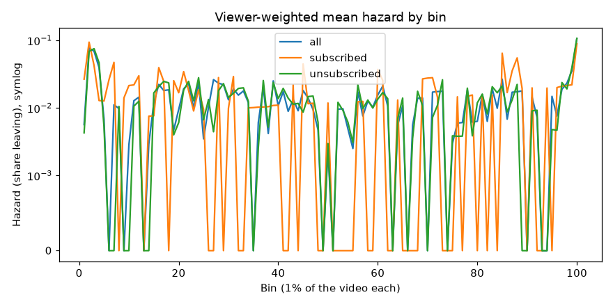
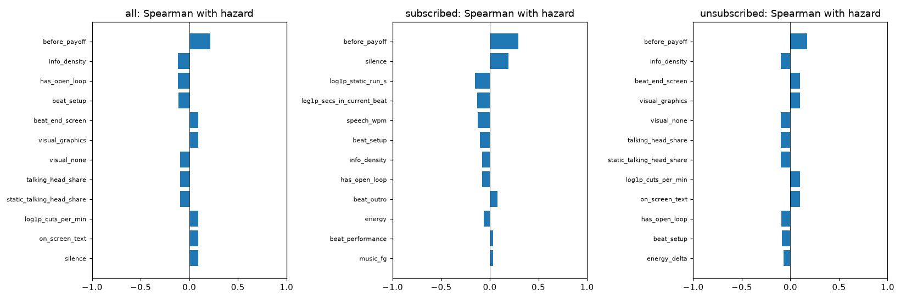
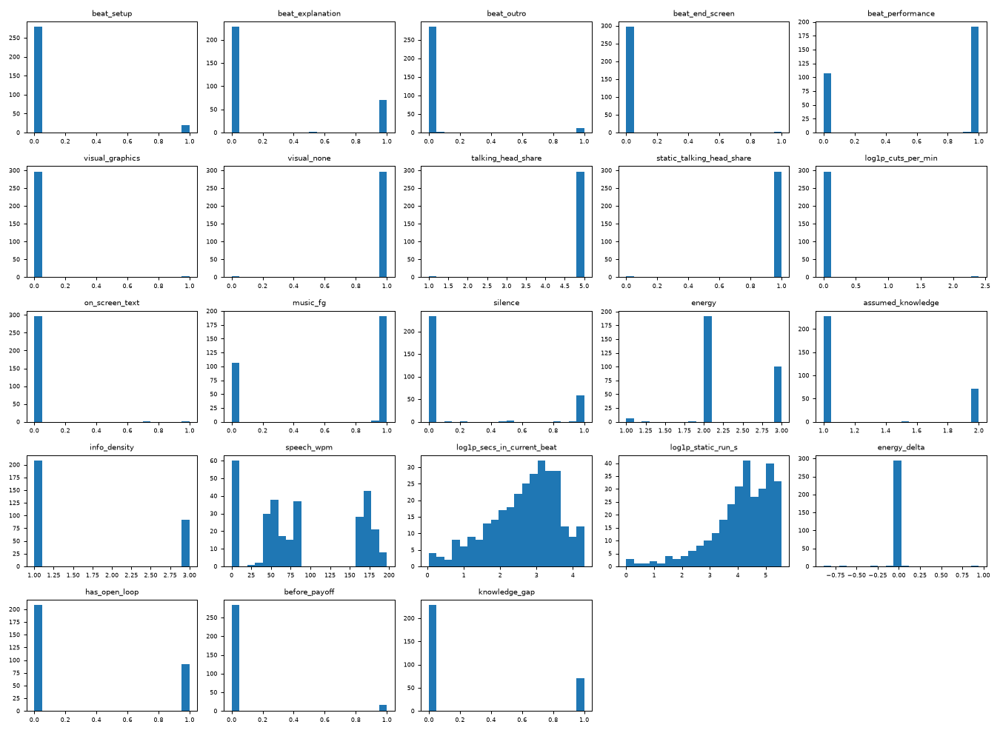

# Training table: exploratory analysis

Feature version `feat-bf1e3064fa6f` · 900 rows · 1 channel(s) · generated 2026-10-10 12:49 UTC by `soundcheck-modeling eda`

> **Too few videos to read much into.** The smallest channel has 3 videos; the data gate asks for 40. With this few, a correlation mostly says which video a bin belongs to, and video-level features (format, target level) cannot be told apart from the video itself.

## Rows

| Channel | Audience | Videos | Rows |
| --- | --- | --- | --- |
| UC-BHlgFbFh3V76yth-XCmlw | all | 3 | 300 |
| UC-BHlgFbFh3V76yth-XCmlw | subscribed | 3 | 300 |
| UC-BHlgFbFh3V76yth-XCmlw | unsubscribed | 3 | 300 |

## Missing data

- Non-finite feature values: 0.
- Videos without a curve for every audience: none.
- Features that never vary in this data (37 of 86), so carry no information yet: `beat_cold_open`, `beat_hook`, `beat_intro_branding`, `beat_context`, `beat_demonstration`, `beat_example`, `beat_story`, `beat_opinion`, `beat_tangent`, `beat_sponsor`, `beat_self_promo`, `beat_cta`, `beat_recap`, `beat_payoff`, `beat_transition`, `beat_other`, `visual_screen_recording`, `visual_b_roll`, `visual_gameplay`, `visual_other`, `music_bg`, `format_tutorial`, `format_explainer`, `format_review`, `format_vlog`, `format_commentary`, `format_story`, `format_interview`, `format_listicle`, `format_challenge`, `format_news`, `ix_beat_sponsor_search`, `ix_beat_sponsor_suggested`, `ix_beat_sponsor_browse`, `ix_beat_intro_branding_search`, `ix_beat_intro_branding_suggested`, `ix_beat_intro_branding_browse`.

## Correlation with hazard

Spearman's rank correlation over every bin of an audience; the weighted Pearson correlation weighs each bin by its viewers at risk. Content features describe what is on screen and said; the rest say where in the video a bin is, describe the video as a whole, or describe who arrived and how content interacts with it.

### all: content features

| Feature | Kind | Spearman | Weighted Pearson |
| --- | --- | --- | --- |
| `before_payoff` | narrative | 0.22 | 0.44 |
| `info_density` | delivery | -0.12 | -0.25 |
| `has_open_loop` | narrative | -0.12 | -0.25 |
| `beat_setup` | beat_type | -0.11 | -0.15 |
| `beat_end_screen` | beat_type | 0.09 | 0.19 |
| `visual_graphics` | picture | 0.09 | 0.19 |
| `visual_none` | picture | -0.09 | -0.19 |
| `talking_head_share` | picture | -0.09 | -0.19 |
| `static_talking_head_share` | picture | -0.09 | -0.19 |
| `log1p_cuts_per_min` | picture | 0.09 | 0.17 |

### all: other features

| Feature | Kind | Spearman | Weighted Pearson |
| --- | --- | --- | --- |
| `format_performance` | video | 0.09 | 0.24 |
| `format_other` | video | -0.09 | -0.24 |
| `target_level` | video | -0.09 | -0.24 |
| `pos_b4` | spline | -0.09 | -0.12 |
| `pos_b3` | spline | -0.07 | -0.14 |

### subscribed: content features

| Feature | Kind | Spearman | Weighted Pearson |
| --- | --- | --- | --- |
| `before_payoff` | narrative | 0.29 | 0.38 |
| `silence` | audio | 0.19 | 0.31 |
| `log1p_static_run_s` | dynamics | -0.16 | -0.20 |
| `log1p_secs_in_current_beat` | dynamics | -0.13 | -0.20 |
| `speech_wpm` | delivery | -0.13 | -0.23 |
| `beat_setup` | beat_type | -0.10 | -0.15 |
| `info_density` | delivery | -0.08 | -0.16 |
| `has_open_loop` | narrative | -0.08 | -0.16 |
| `beat_outro` | beat_type | 0.08 | 0.11 |
| `energy` | delivery | -0.06 | -0.15 |

### subscribed: other features

| Feature | Kind | Spearman | Weighted Pearson |
| --- | --- | --- | --- |
| `pos_b4` | spline | -0.20 | -0.13 |
| `pos_b3` | spline | -0.19 | -0.24 |
| `pos_b1` | spline | 0.17 | 0.10 |
| `pos_b5` | spline | -0.11 | 0.00 |
| `log_bin_seconds` | position | 0.10 | 0.14 |

### unsubscribed: content features

| Feature | Kind | Spearman | Weighted Pearson |
| --- | --- | --- | --- |
| `before_payoff` | narrative | 0.17 | 0.42 |
| `info_density` | delivery | -0.10 | -0.24 |
| `beat_end_screen` | beat_type | 0.10 | 0.18 |
| `visual_graphics` | picture | 0.10 | 0.18 |
| `visual_none` | picture | -0.10 | -0.18 |
| `talking_head_share` | picture | -0.10 | -0.18 |
| `static_talking_head_share` | picture | -0.10 | -0.18 |
| `log1p_cuts_per_min` | picture | 0.10 | 0.17 |
| `on_screen_text` | picture | 0.10 | 0.18 |
| `has_open_loop` | narrative | -0.09 | -0.24 |

### unsubscribed: other features

| Feature | Kind | Spearman | Weighted Pearson |
| --- | --- | --- | --- |
| `ix_before_payoff_suggested` | interaction | -0.17 | -0.41 |
| `ix_before_payoff_browse` | interaction | 0.17 | 0.37 |
| `ix_before_payoff_search` | interaction | -0.17 | -0.42 |
| `ix_info_density_suggested` | interaction | -0.12 | -0.24 |
| `ix_info_density_browse` | interaction | 0.12 | 0.23 |

## Distributions

Over the `all` audience's rows (the other audiences share their content features).

| Feature | Kind | Mean | SD | Min | Max | Non-zero |
| --- | --- | --- | --- | --- | --- | --- |
| `beat_cold_open` | beat_type | 0.000 | 0.000 | 0.000 | 0.000 | 0% |
| `beat_hook` | beat_type | 0.000 | 0.000 | 0.000 | 0.000 | 0% |
| `beat_intro_branding` | beat_type | 0.000 | 0.000 | 0.000 | 0.000 | 0% |
| `beat_setup` | beat_type | 0.068 | 0.250 | 0.000 | 1.000 | 7% |
| `beat_context` | beat_type | 0.000 | 0.000 | 0.000 | 0.000 | 0% |
| `beat_explanation` | beat_type | 0.239 | 0.425 | 0.000 | 1.000 | 24% |
| `beat_demonstration` | beat_type | 0.000 | 0.000 | 0.000 | 0.000 | 0% |
| `beat_example` | beat_type | 0.000 | 0.000 | 0.000 | 0.000 | 0% |
| `beat_story` | beat_type | 0.000 | 0.000 | 0.000 | 0.000 | 0% |
| `beat_opinion` | beat_type | 0.000 | 0.000 | 0.000 | 0.000 | 0% |
| `beat_tangent` | beat_type | 0.000 | 0.000 | 0.000 | 0.000 | 0% |
| `beat_sponsor` | beat_type | 0.000 | 0.000 | 0.000 | 0.000 | 0% |
| `beat_self_promo` | beat_type | 0.000 | 0.000 | 0.000 | 0.000 | 0% |
| `beat_cta` | beat_type | 0.000 | 0.000 | 0.000 | 0.000 | 0% |
| `beat_recap` | beat_type | 0.000 | 0.000 | 0.000 | 0.000 | 0% |
| `beat_payoff` | beat_type | 0.000 | 0.000 | 0.000 | 0.000 | 0% |
| `beat_transition` | beat_type | 0.000 | 0.000 | 0.000 | 0.000 | 0% |
| `beat_outro` | beat_type | 0.041 | 0.196 | 0.000 | 1.000 | 5% |
| `beat_end_screen` | beat_type | 0.009 | 0.091 | 0.000 | 1.000 | 1% |
| `beat_performance` | beat_type | 0.643 | 0.479 | 0.000 | 1.000 | 64% |
| `beat_other` | beat_type | 0.000 | 0.000 | 0.000 | 0.000 | 0% |
| `visual_screen_recording` | picture | 0.000 | 0.000 | 0.000 | 0.000 | 0% |
| `visual_b_roll` | picture | 0.000 | 0.000 | 0.000 | 0.000 | 0% |
| `visual_graphics` | picture | 0.009 | 0.091 | 0.000 | 1.000 | 1% |
| `visual_gameplay` | picture | 0.000 | 0.000 | 0.000 | 0.000 | 0% |
| `visual_other` | picture | 0.000 | 0.000 | 0.000 | 0.000 | 0% |
| `visual_none` | picture | 0.991 | 0.091 | 0.000 | 1.000 | 99% |
| `talking_head_share` | picture | 4.964 | 0.363 | 1.000 | 5.000 | 100% |
| `static_talking_head_share` | picture | 0.991 | 0.091 | 0.000 | 1.000 | 99% |
| `log1p_cuts_per_min` | picture | 0.023 | 0.229 | 0.000 | 2.398 | 1% |
| `on_screen_text` | picture | 0.009 | 0.091 | 0.000 | 1.000 | 1% |
| `music_bg` | audio | 0.000 | 0.000 | 0.000 | 0.000 | 0% |
| `music_fg` | audio | 0.643 | 0.479 | 0.000 | 1.000 | 64% |
| `silence` | audio | 0.207 | 0.399 | 0.000 | 1.000 | 22% |
| `energy` | delivery | 2.311 | 0.508 | 1.000 | 3.000 | 100% |
| `assumed_knowledge` | delivery | 1.239 | 0.425 | 1.000 | 2.000 | 100% |
| `info_density` | delivery | 1.614 | 0.922 | 1.000 | 3.000 | 100% |
| `speech_wpm` | delivery | 88.362 | 66.607 | 0.000 | 197.143 | 81% |
| `log1p_secs_in_current_beat` | dynamics | 2.659 | 0.938 | 0.039 | 4.311 | 100% |
| `log1p_static_run_s` | dynamics | 4.135 | 1.098 | 0.000 | 5.567 | 99% |
| `energy_delta` | dynamics | -0.003 | 0.087 | -0.892 | 0.946 | 2% |
| `has_open_loop` | narrative | 0.307 | 0.461 | 0.000 | 1.000 | 31% |
| `before_payoff` | narrative | 0.057 | 0.231 | 0.000 | 1.000 | 6% |
| `knowledge_gap` | narrative | 0.239 | 0.425 | 0.000 | 1.000 | 24% |
| `is_first_bin` | position | 0.010 | 0.099 | 0.000 | 1.000 | 1% |
| `log_bin_seconds` | position | 0.544 | 0.480 | -0.128 | 0.963 | 100% |
| `pos_b1` | spline | 0.125 | 0.199 | 0.000 | 0.598 | 50% |
| `pos_b2` | spline | 0.188 | 0.216 | 0.000 | 0.596 | 75% |
| `pos_b3` | spline | 0.250 | 0.239 | 0.000 | 0.666 | 100% |
| `pos_b4` | spline | 0.188 | 0.216 | 0.000 | 0.596 | 75% |
| `pos_b5` | spline | 0.125 | 0.199 | 0.000 | 0.598 | 50% |
| `pos_b6` | spline | 0.062 | 0.178 | 0.000 | 0.941 | 25% |
| `format_tutorial` | video | 0.000 | 0.000 | 0.000 | 0.000 | 0% |
| `format_explainer` | video | 0.000 | 0.000 | 0.000 | 0.000 | 0% |
| `format_review` | video | 0.000 | 0.000 | 0.000 | 0.000 | 0% |
| `format_vlog` | video | 0.000 | 0.000 | 0.000 | 0.000 | 0% |
| `format_commentary` | video | 0.000 | 0.000 | 0.000 | 0.000 | 0% |
| `format_story` | video | 0.000 | 0.000 | 0.000 | 0.000 | 0% |
| `format_interview` | video | 0.000 | 0.000 | 0.000 | 0.000 | 0% |
| `format_listicle` | video | 0.000 | 0.000 | 0.000 | 0.000 | 0% |
| `format_challenge` | video | 0.000 | 0.000 | 0.000 | 0.000 | 0% |
| `format_news` | video | 0.000 | 0.000 | 0.000 | 0.000 | 0% |
| `format_performance` | video | 0.667 | 0.471 | 0.000 | 1.000 | 67% |
| `format_other` | video | 0.333 | 0.471 | 0.000 | 1.000 | 33% |
| `target_level` | video | 1.333 | 0.471 | 1.000 | 2.000 | 100% |
| `mix_search` | mix | 0.000 | 0.000 | 0.000 | 0.000 | 0% |
| `mix_suggested` | mix | 0.000 | 0.000 | 0.000 | 0.000 | 0% |
| `mix_browse` | mix | 0.000 | 0.000 | 0.000 | 0.000 | 0% |
| `ix_beat_sponsor_search` | interaction | 0.000 | 0.000 | 0.000 | 0.000 | 0% |
| `ix_beat_sponsor_suggested` | interaction | 0.000 | 0.000 | 0.000 | 0.000 | 0% |
| `ix_beat_sponsor_browse` | interaction | 0.000 | 0.000 | 0.000 | 0.000 | 0% |
| `ix_beat_intro_branding_search` | interaction | 0.000 | 0.000 | 0.000 | 0.000 | 0% |
| `ix_beat_intro_branding_suggested` | interaction | 0.000 | 0.000 | 0.000 | 0.000 | 0% |
| `ix_beat_intro_branding_browse` | interaction | 0.000 | 0.000 | 0.000 | 0.000 | 0% |
| `ix_knowledge_gap_search` | interaction | 0.000 | 0.000 | 0.000 | 0.000 | 0% |
| `ix_knowledge_gap_suggested` | interaction | 0.000 | 0.000 | 0.000 | 0.000 | 0% |
| `ix_knowledge_gap_browse` | interaction | 0.000 | 0.000 | 0.000 | 0.000 | 0% |
| `ix_log1p_static_run_s_search` | interaction | 0.000 | 0.000 | 0.000 | 0.000 | 0% |
| `ix_log1p_static_run_s_suggested` | interaction | 0.000 | 0.000 | 0.000 | 0.000 | 0% |
| `ix_log1p_static_run_s_browse` | interaction | 0.000 | 0.000 | 0.000 | 0.000 | 0% |
| `ix_info_density_search` | interaction | 0.000 | 0.000 | 0.000 | 0.000 | 0% |
| `ix_info_density_suggested` | interaction | 0.000 | 0.000 | 0.000 | 0.000 | 0% |
| `ix_info_density_browse` | interaction | 0.000 | 0.000 | 0.000 | 0.000 | 0% |
| `ix_before_payoff_search` | interaction | 0.000 | 0.000 | 0.000 | 0.000 | 0% |
| `ix_before_payoff_suggested` | interaction | 0.000 | 0.000 | 0.000 | 0.000 | 0% |
| `ix_before_payoff_browse` | interaction | 0.000 | 0.000 | 0.000 | 0.000 | 0% |

## Plots

