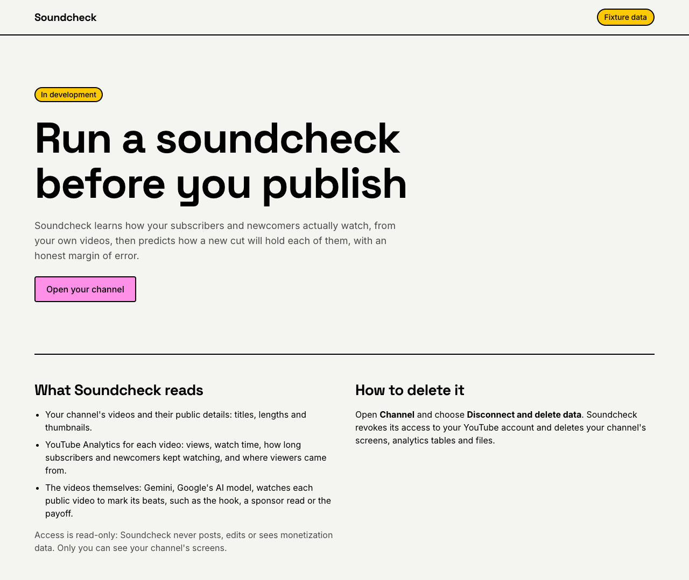
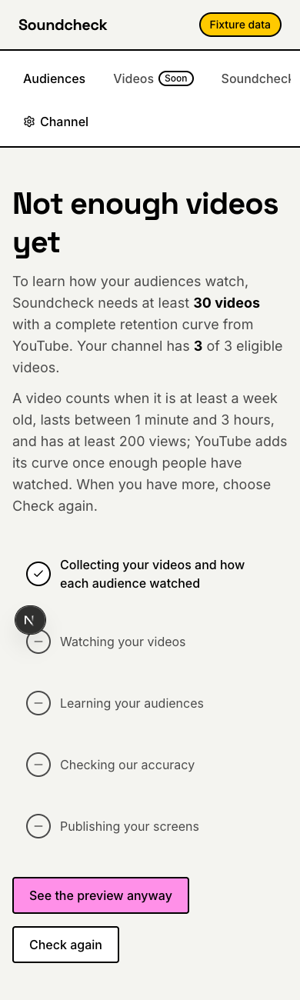
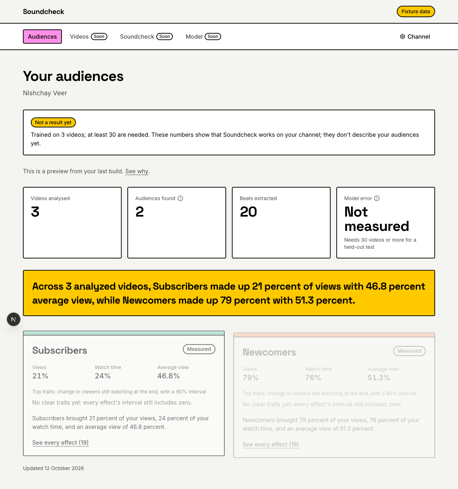
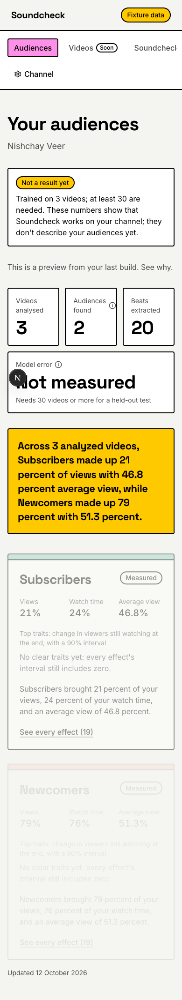
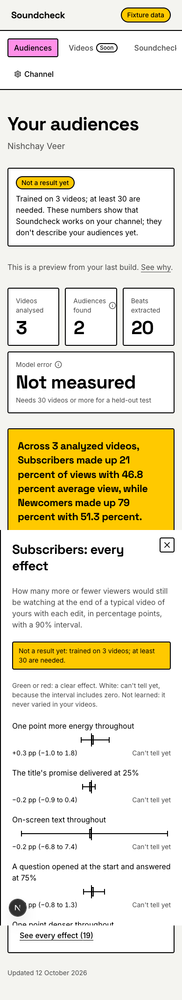

# Phase 12: Onboarding and audiences screen

Oct 12, 2026

The first screens, live on the deployed app:

- a landing page that says what Soundcheck reads and how to delete it;
- `/app`, which sends a creator to the right screen for their build;
- the building screen, with the build's live progress and what to do when it fails or finds too few videos;
- the audiences screen: the key numbers, the headline, one card per audience, and a sheet with every simulated effect and its interval.

All of it follows `docs/plan/design-system.md`, reviewed once on `/styleguide`. The test channel's models are not usable (3 videos), so every screen that shows model numbers says "Not a result yet", by Nishchay's decision to build the screens before the model gate passes.

**Built in six reviewed commits:**

1. `Restyle the components and add the style guide`
2. `Publish every effect for the audience sheet`
3. `Add the landing page and app shell`
4. `Show the build progress`
5. `Show the audiences screen`
6. `Verify Phase 12 and write the notes`

## Done when

| Item                                                         | Status                     | Evidence                                                                                                                                                                                                                                                                                                                                                                                           |
| ------------------------------------------------------------ | -------------------------- | -------------------------------------------------------------------------------------------------------------------------------------------------------------------------------------------------------------------------------------------------------------------------------------------------------------------------------------------------------------------------------------------------- |
| Full flow works on the deployed web app against the real API | Done                       | On the deployed app (image `web:e7f71ff-20261012090822`), Nishchay signed in and saw the building screen's "Not enough videos yet", opened the preview, the audiences and a sheet, and pressed Check again: build `b158c66a` ran live (03:49 to 03:51 UTC) and stopped as `insufficient_data` after collecting. Connect itself was not exercised: the channel is already connected, as in Phase 10 |
| Fixtures mode works offline                                  | Done, without Google Cloud | The smoke test runs the app in fixtures mode with no sign-in settings and no Google credentials. The network was not cut: `next/font` still fetches the fonts on a first compile                                                                                                                                                                                                                   |
| Lighthouse accessibility score 90 or above                   | Done                       | 100 on `/`, `/app/building`, `/app/audiences` and `/styleguide` (Lighthouse 13.5.0, mobile). The audiences screen first scored 98 for a skipped heading level; fixed in the last commit, which reaches the deployed app with the next `deploy-web.sh`                                                                                                                                              |
| Checked at 390 px wide                                       | Done                       | The smoke test checks every screen at 390 and 1280 px for anything wider than the screen; the screenshots below                                                                                                                                                                                                                                                                                    |
| `docs/notes/phase-12.md` written with screenshots            | Done                       | This file                                                                                                                                                                                                                                                                                                                                                                                          |

**Also verified:**

- **The smoke test:** `pnpm --filter @soundcheck/web test:e2e`, landing to building to preview to audiences to a sheet to channel settings, on a phone and a desktop: 2 passed in 7 s.
- **The Monday refresh ran on its own for the first time:** `weekly_refresh` at 03:00 IST on Oct 12 started `channel_build` for the ready test channel, which then stopped as `insufficient_data`: the refresh runs without `allow_small`.
- **`pnpm check`** passes all 20 tasks: core 523 tests, pipeline 172, web 63, ui 7, modeling 63.

## Screenshots

From the smoke test, on the test channel's saved documents (fixtures mode).

The landing page, on a desktop:

The building screen for a channel with too few videos, on a phone:

The audiences screen (a preview), on a desktop and on a phone:

An audience's sheet with every effect, on a phone:

## Decisions

By Nishchay:

1. **Build the screens before the model gate passes,** overriding Phase 09's rule, with a "Not a result yet" note wherever model numbers show; the model error reads "Not measured" until a held-out test exists.
2. **A channel with too few videos** lands on the building screen, which explains what is needed and offers **See the preview anyway** when documents exist.
3. **Publish every simulated effect** for the sheet, not only the clear ones.
4. **The rest of the plan:**
   - five build steps;
   - "Soon" for the screens not built yet, and the demo button hidden until Phase 17;
   - disconnecting moves to a Channel settings page;
   - a switcher for several channels;
   - the dependencies, jsdom included.

## Changes from the spec

All are recorded in `docs/plan/phase-12.md`.

- **Next.js 16,** not 15.
- **Five build steps, not six:** collecting the videos and measuring each audience are one pipeline stage. Each step shows its job's progress ("12 of 40", a bar, the time left); polling every 3 s stops once the build ends.
- **The building screen covers every state:** not started (Start), running, failed (the step, the technical detail, Try again), not enough videos (the numbers and the eligibility rule, the preview link, Check again), and ready.
- **The audience card's contract gains `effects`,** every simulated effect, and `PUBLISH_VERSION` becomes `serving-v2`.
- **Navigation:** Audiences, then Videos, Soundcheck and Model marked "Soon"; Channel settings. The channel switcher keeps its choice in a cookie checked against the user's channels.
- **"Not a result yet"** is a white note with a yellow badge, so the yellow stays the headline banner's.
- **Two beat colors** were added to the design system: `--beat-opening` (sky) and `--beat-promotion` (sand); other beats are white.
- **The retention chart and beat strip** are plain SVG and markup, no D3; the chart draws a narrower plot on phones so its labels stay readable. Phase 13 builds on them.
- **No new route handlers:** Phase 11's serve these screens.
- **Tests:**
  - components render in jsdom (per file) with Testing Library, and Vitest compiles JSX itself (Next keeps it as "preserve");
  - the smoke test drives the installed Chrome, so there is no browser download.
- **Dependencies added:** `radix-ui` 1.7.0, `lucide-react` 1.49.0 (now in the web app too), `swr` 2.5.1, `motion` 14.1.0, `jsdom` 30.1.2, `@testing-library/react` 16.3.3, `@testing-library/dom` 10.4.2, `@testing-library/user-event` 14.6.7, `@playwright/test` 1.64.0.

## Incidents

- **A false overflow:** headless Chrome would not make a window narrower than about 500 px, so a 390 px screenshot looked cut off. Playwright with a true 390 px viewport showed no overflow; every later check used it.
- **Real overflows, fixed:**
  - "Not measured" in 40 px type was wider than half a phone, which made the audiences page 17 px too wide; on a phone the three counts now sit in a row with the model error below;
  - the chart's labels shrank to about 6 px on a phone.
- **Wrong copy, caught before committing:**
  - "New videos are picked up every Monday": false, because the weekly refresh skips channels with too few videos; it now says to choose Check again;
  - the eligibility rule lacked "at least a week old".
- **Rule 4:** the channel cookie and the smoke test read the environment directly; both now go through `env.ts` or no longer need it.
- **Tooling:**
  - `lucide-react` was missing from the web app;
  - SWR does not poll a hidden page, which is how jsdom reports itself, so the test turns that on;
  - Playwright did not stop its dev server, and one interrupted run left an orphaned server on port 3100.

## Notes for later phases

- **Deletion gap:** disconnecting does not delete the model-training logs in Vertex AI Experiments (since Phase 08), which hold the channel ID and its models' scores. The landing page lists only what is deleted; the disconnect confirmation still says "delete all of its data". Fix the deletion, or the wording.
- **`MIN_VIEWS=200`** is the Phase 03 testing override; restore 500 before real creators connect. The building screen shows whatever is set.
- **The weekly refresh skips channels with too few videos,** so a creator presses Check again once they have more. Consider refreshing them too, without `allow_small`.
- **Narration** writes the audience labels with capitals mid-sentence and American spelling ("analyzed"); a prompt fix bumps `NARRATION_PROMPT_VERSION`.
- **Phase 13** has `RetentionChart` and `BeatStrip` to build the video screen on, and the Videos item to switch on.
- **Deploy order:** when a document contract changes, deploy the pipeline before the web app, so the cloud publish writes what the screens expect.
- **Fixtures:** the test channel is now `insufficient_data`, so fixtures mode shows the preview path. Re-run `export-fixtures` after any document change.
- **The smoke test** (`pnpm --filter @soundcheck/web test:e2e`) is not part of `pnpm check`; run it before deploying the web app.
