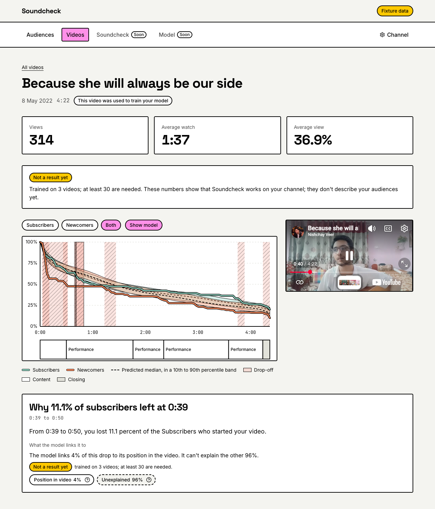
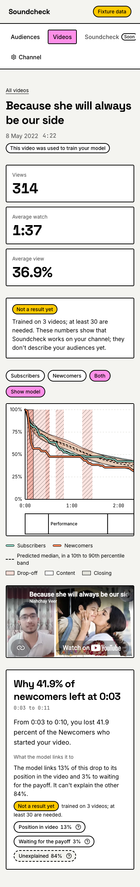
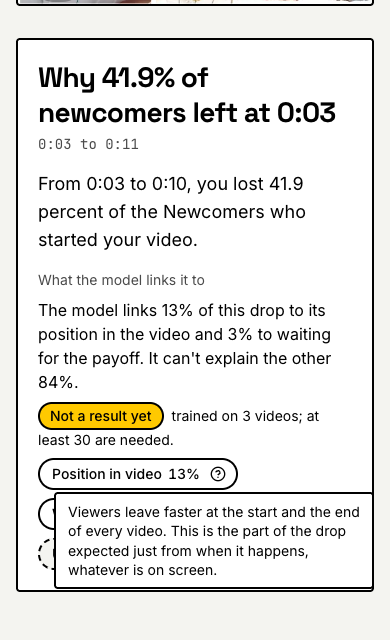
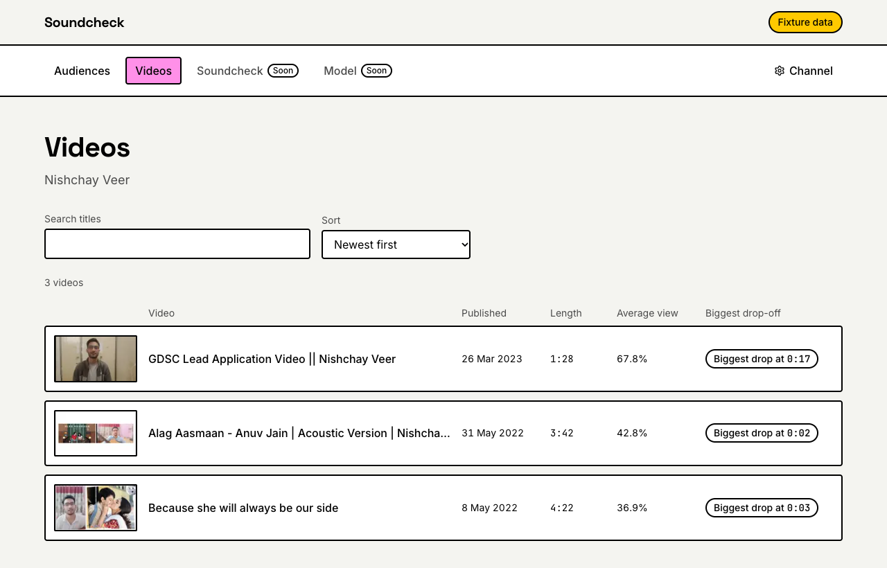
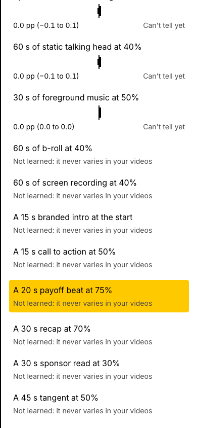

# Phase 13: Video autopsy screen

Oct 12, 2026

Two new screens, live on the deployed app:

- **`/app/videos`:** every analysed video, with search, five sorts and each video's biggest drop-off.
- **`/app/videos/[videoId]`, the autopsy:**
  - each audience's retention curve over the video's beats, on one time axis;
  - the embedded YouTube player;
  - a panel that says why viewers left at each drop-off: a sentence, the causes as chips with a "?" note each, and the unexplained rest.

Clicking a drop-off, or anywhere on the chart or beat strip, moves the player to that moment. A cause links to its effect on the audiences screen. The test channel's models are not usable (3 videos), so the page says "Not a result yet" and most of each drop-off is unexplained.

**Built in six reviewed commits:**

1. `Publish beat transcript snippets and beat groups`
2. `Rebuild the retention chart on D3 scales`
3. `Add the videos list`
4. `Add the video autopsy screen`
5. `Check the video page in the smoke test`
6. `Verify Phase 13 and write the notes`

## Done when

| Item                                                | Status | Evidence                                                                                                                                                                                                                                         |
| --------------------------------------------------- | ------ | ------------------------------------------------------------------------------------------------------------------------------------------------------------------------------------------------------------------------------------------------ |
| The autopsy works for every video of a real channel | Done   | On the deployed app (image `web:1d019a0-20261012103847`, revision `soundcheck-web-00003-459`), Nishchay opened all 3 videos of the test channel: curves, drop-offs, the panel, seeking and the notes all worked                                  |
| Clicking a drop seeks the player correctly          | Done   | In Chrome with the real YouTube player, the smoke test clicks the 0:39 drop-off and reads the player's time back through the YouTube API: 39.3 s. The left arrow then selects the 0:26 drop-off and the player follows. On a phone and a desktop |
| Fixtures mode matches the real API rendering        | Done   | `export-fixtures` run again saved 7 documents byte-for-byte equal to the committed fixtures. Nishchay compared the deployed app and fixtures mode side by side for all 3 videos: identical                                                       |
| Usable at 390 px                                    | Done   | The smoke test checks the video list, the video page and the linked sheet at 390 px for anything wider than the screen. The chart and beat strip scroll sideways together inside their box; the player sits below the chart                      |
| `docs/notes/phase-13.md` written with screenshots   | Done   | This file                                                                                                                                                                                                                                        |

**Also verified:**

- **Lighthouse accessibility** (13.5.0, mobile): 100 with no failed audit on `/app/videos`, `/app/videos/lgxOjPdCGkw` and the audiences screen opened by a cause's link.
- **The smoke test** (`pnpm --filter @soundcheck/web test:e2e`): its new journey runs from the video list to a video, a cause's note, a drop-off click, the arrow keys and a cause's link. 4 passed (two journeys, phone and desktop) in 13 s.
- **Deployed in order:** the pipeline first (`pipeline:1d019a0-20261012103148` on every job), then the web app. Firestore already held `serving-v3` documents: part 1 republished the test channel from this machine ("publish: 3 videos, 22 drop-offs (written)") before re-exporting the fixtures.
- **`pnpm check`** passes all 20 tasks: core 523 tests, pipeline 174, web 82, ui 8, modeling 63.

## Screenshots

From fixtures mode, which shows the test channel's saved documents.

A video on a desktop, with the 0:39 drop-off selected and the player moved there:

The same video on a phone, opened on its largest drop-off:

A cause's note, opened by a tap:

The video list:

A cause's link: the newcomers' sheet, open at the payoff effect:

## Decisions

By Nishchay:

1. **The plan:**
   - a "Both" chip instead of "all", since there is no all-viewers curve;
   - five beat groups, with closing a light grey (`--beat-closing`, `#E2E2DA`) and tangents white with a dashed outline;
   - 140-character transcript snippets in the video documents;
   - the youtube-nocookie player through the IFrame API;
   - sideways scrolling below 640 px;
   - `d3-scale`, `d3-shape` and `d3-array`;
   - causes linking to the audiences screen;
   - the fixtures check and the player check in a real browser.
2. **Say why in words:** the panel's first answer is a sentence built from the chips' own numbers (not Gemini, so it is always there): "The model links 13% of this drop to its position in the video and 3% to waiting for the payoff. It can't explain the other 84%." Nishchay asked for it after the chips alone did not answer "why".
3. **A "?" on every chip,** "Unexplained" included, with a one-line note on what the cause means. "Position in video" was unclear to Nishchay, so it would be to creators. The notes open on a tap, so they work on phones.
4. **The end-time mismatch** (below) is left for later.

## Changes from the spec

All are recorded in `docs/plan/phase-13.md`.

- **The beat strip's snippets** need a new document field: `transcriptExcerpt` on each beat (at most 140 characters, cut at a word), so `PUBLISH_VERSION` becomes `serving-v3`. 11 of the test channel's 20 beats have speech.
- **"Both", not "all":** the documents hold one curve per audience, so the third chip shows both.
- **The video list** shows a thumbnail and a "Held out" badge as well, and sorts five ways (newest, oldest, most watched through, biggest drop-off, longest).
- **The header** has three numbers (views, average watch, average view), stacked on a phone, and the "Not a result yet" note.
- **The drop panel:** a sentence before the chips, a "?" note on each chip, and "Position in video" with no link, since there is nothing to edit. "Unexplained" always shows.
- **Selecting a drop-off** by click or arrow key also moves the player to its start. From a stopped player YouTube then plays, which is the spec's "Clicking a drop plays that moment".
- **A Popover primitive** in `packages/ui` (the tooltip's box, opened by a click or tap), added to the design system's list.
- **Performance:** each curve has 101 points and each band 202, well under 600. Scales and paths are memoized.
- **Dependencies added:** `d3-scale` 4.0.2, `d3-shape` 3.2.0, `d3-array` 3.2.4, `@types/d3-scale` 4.0.9, `@types/d3-shape` 3.2.0, `@types/d3-array` 3.2.2. Nothing imports `d3-array` directly (`d3-scale` depends on it), so it can go.

## Incidents

- **Too wide on a phone, caught in the browser check:**
  - the chart's 640 px minimum stretched the page to 660 px, because a grid column will not shrink below its content; the column can now shrink, and the chart scrolls inside its box;
  - "36.9%" was wider than a third of a phone, so the three number cards stack there.
- **YouTube replaces the element it is given** with its iframe, which broke React's ownership of it; the player now gets a mount element React does not manage.
- **Lint:** the player wrote a ref during render; it now uses React's `useEffectEvent`.
- **Lighthouse "label in name":** a cause link's spoken name did not start with its visible text, which voice control needs. Its name is now the visible text plus "(see this effect on the audiences screen)". Chrome and jsdom put spaces between flex items differently, so the spaces are separate text, and both compute the same name.
- **A one-off "1 Issue"** in Next's dev overlay appeared in the phone screenshots of one smoke run. It did not come back in three fresh runs; the only console messages are YouTube's own `postMessage` warnings.
- **Tooling:** jsdom has no `scrollIntoView` and no file URL for `import.meta.url`; the tests stub the first and read fixtures from the working directory.

## Notes for later phases

- **End times can differ by a second:** the panel's sentence is narrated from the drop-off's exact end, but the page shows it rounded to 0.1 s first. On the 4:22 video, 2 of 7 drop-offs read "0:03 to 0:11" above "From 0:03 to 0:10…". Fix in publish by narrating from the rounded times; the captions are then re-narrated once.
- **The stat cards' notes** on the audiences screen (Phase 12's `InfoTip`) are hover tooltips, so a tap on a phone does nothing. Switch them to the Popover.
- **"Video not found" returns status 200,** because the page streams behind its loading skeleton before the lookup fails. Visitors see the not-found page, and Next marks it `noindex`.
- **The held-out badge** has not been seen on real data: all 3 test videos trained the model.
- **"Position in video"** is the top named cause on most drop-offs while a channel has few videos, so its note matters until models are usable.
- **Narration** still capitalises the audience labels mid-sentence (Phase 12's note).
- **Phase 14** (the soundcheck of a draft) can reuse `AutopsyChart` and `BeatStrip` for a draft's predicted curves and beats, and `YouTubePlayer` is the pattern for seeking a player from the chart.
