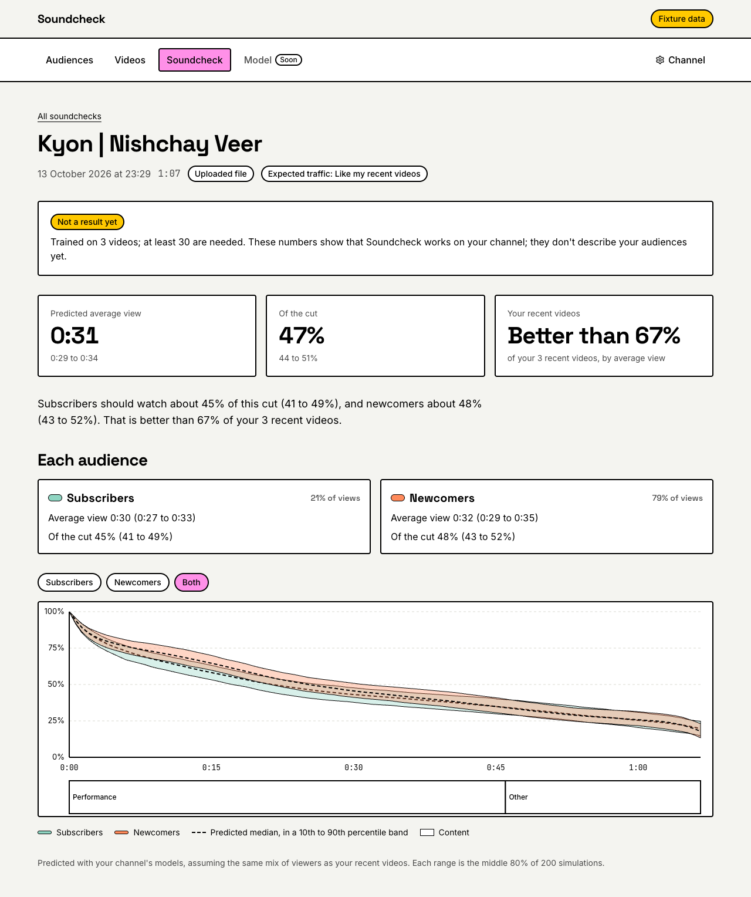
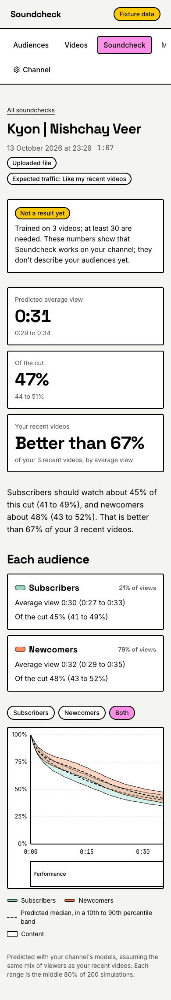
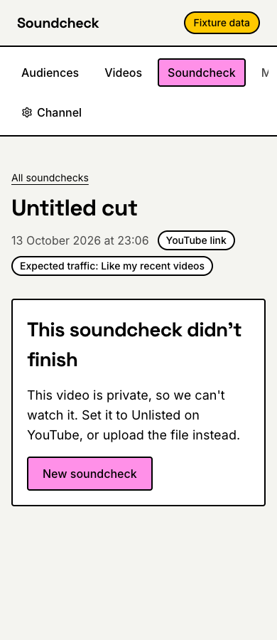
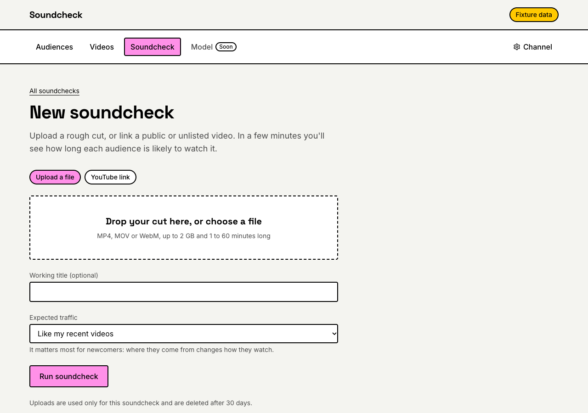
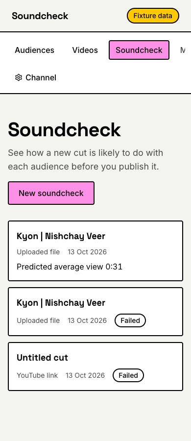

# Phase 14: Soundcheck upload and prediction

Oct 13, 2026

A creator can now soundcheck a new cut before publishing it: upload the file, or link a public or unlisted YouTube video, choose the traffic they expect, and a few minutes later see how long each audience is predicted to watch, with ranges. It is live on the deployed app.

- **`/app/soundcheck`:** the channel's soundchecks, newest first, and **New soundcheck**.
- **`/app/soundcheck/new`:** a file (dropped or chosen, up to 2 GB, uploaded in 8 MB chunks with progress) or a link; a working title; **Expected traffic**.
- **`/app/soundcheck/[id]`:** the job's progress while it runs, polled every 2 s, then the prediction: average view and percentage of the cut with ranges, each audience's numbers, "better than N% of your recent videos", a summary sentence, and the predicted curves over the beat strip (with the video beside them for a link). A failure says what to do.

Behind it: `job-soundcheck` checks the cut (ffprobe straight from Cloud Storage, or YouTube's data for a link), has Gemini watch it with the Phase 05 extractor, and predicts each audience with the channel's models. An upload's arrival starts it through Eventarc; a link starts it from the API.

Script mode is **left out**, by Nishchay's decision, so a soundcheck is a file or a link. The test channel's models are not usable (3 videos), so results say "Not a result yet".

**Built in eight reviewed commits:**

1. `Probe Gemini with unlisted links and large files`
2. `Define the soundcheck contracts`
3. `Leave scripts out of soundchecks for now`
4. `Predict a new cut`
5. `Run soundchecks as a job`
6. `Start soundchecks from uploads and links`
7. `Add the soundcheck screens`
8. `Verify Phase 14 and write the notes`

## Done when

| Item                                                                                      | Status                          | Evidence                                                                                                                                                                                                                                                                                                                                                                                        |
| ----------------------------------------------------------------------------------------- | ------------------------------- | ----------------------------------------------------------------------------------------------------------------------------------------------------------------------------------------------------------------------------------------------------------------------------------------------------------------------------------------------------------------------------------------------- |
| Every input kind produces results on the deployed stack (file and link; scripts left out) | **Partly; one run to do**       | **File:** "Kyon \| Nishchay Veer", 67 s, 22 MB, uploaded on the deployed app in 3 chunks, started by Eventarc, ready (soundcheck `513fa928`). **Link:** a private link was refused as it should be (`643b8a9b`). **To do:** a ready result from an unlisted link of at least a minute, which also proves the cloud job can watch unlisted videos (the probe showed it for a non-owner, locally) |
| A 10-minute rough cut completes in under 6 minutes end to end                             | **To do**                       | Not yet run. The 67 s cut took 2 min 38 s from the upload finishing to the result (job execution `job-soundcheck-l6gvg`, 17:59:44 to 18:02:21 UTC), most of it the job starting; the job now logs "soundcheck started" and "checked", so the next run can be split into start-up, Gemini and the rest                                                                                           |
| Progress text visible throughout                                                          | Done                            | The job writes a plain message at each step ("Checking your video", "Watching your video", "Found 2 beats. Predicting how your audiences will watch", "Done") and the page polls every 2 s until it ends; Nishchay watched the live runs. The polling is tested in jsdom up to "ready" and no further                                                                                           |
| Failure states handled: private link, oversized file, validation failure after retry      | Done; two of them in tests only | **Live:** the private link ended with "This video is private, so we can't watch it. Set it to Unlisted on YouTube, or upload the file instead"; an 8 MB clip under a minute ended as `too_short`. **Tests only:** a file over 2 GB is refused in the browser before any upload and by the API (413); Gemini answers that fail validation twice end as `unreadable` with a message               |
| `docs/notes/phase-14.md` written                                                          | Done                            | This file                                                                                                                                                                                                                                                                                                                                                                                       |

**Also verified:**

- **The probe (part 1),** as a Google account that does not own the channel: a public link watched in 8.0 s; the same 47 s video watched when **unlisted** (7.7 s) and refused when **private** (HTTP 403 in 0.5 s, before any retry); a one-minute file read from the uploads bucket with `video/*` and `video/mp4` in 10 to 37 s. Google documents a **2 GB** limit for Cloud Storage files.
- **Average view percentage** is the area under the curve: on the test channel's measured curves it matches YouTube's own figure within 0.6 points on all 3 videos.
- **Deployed** at `2951b87`: `web:2951b87-20261013225941` (revision `soundcheck-web-00006-qkx`), `job-soundcheck` on `pipeline:2951b87-20261013224944`, the `soundcheck` workflow, and the Eventarc trigger `soundcheck-upload`; the uploads bucket's CORS lets the deployed app and localhost send chunks and read `Range`.
- **Cost:** Gemini watched the 67 s cut for $0.014.
- **`pnpm check`** passes all 20 tasks: core 559 tests, pipeline 197, web 116, ui 8, modeling 63.

## Screenshots

From fixtures mode, with the test channel's real soundchecks copied in for the shots (they are not committed).

The result of the 67 s upload, on a desktop and on a phone:

A private link, refused with what to do:

A new soundcheck, and the list:

## What the live runs said

All on Oct 13, 2026 (UTC), for the test channel.

| Soundcheck | Input                | Outcome         | Job execution          | Job ran                           |
| ---------- | -------------------- | --------------- | ---------------------- | --------------------------------- |
| `643b8a9b` | private YouTube link | `private_video` | `job-soundcheck-wks4p` | 17:36:22 to 17:37:46 (1 min 24 s) |
| `2db27b6d` | 8 MB file            | `too_short`     | `job-soundcheck-kx7tq` | 17:38:52 to 17:41:48 (2 min 56 s) |
| `513fa928` | 22 MB file, 67 s     | ready           | `job-soundcheck-l6gvg` | 17:59:44 to 18:02:21 (2 min 38 s) |

The ready one: Gemini found 2 beats (a 46 s performance and a 21 s ending); predicted average view **0:31** (0:29 to 0:34), **47%** of the cut (44 to 51%); subscribers 45% (41 to 49%), newcomers 48% (43 to 52%), weighted 21% and 79% like the recent videos; better than 67% of the 3 recent videos. With two beats and a 3-video model, the curve is a smooth slope: nothing for the model to react to.

## Decisions

By Nishchay:

1. **The plan's recommendations,** approved together:
   - test unlisted links and file limits before building on them;
   - the server opens each upload session instead of signing a URL;
   - Eventarc events filtered in the workflow, since Eventarc cannot filter by prefix;
   - soundchecks stored under the channel, so disconnecting deletes them;
   - Gemini's answers for soundchecks kept in the uploads bucket, deleted after 30 days;
   - a second document with the cut as the model reads it, for Phase 15;
   - no Video Intelligence markers and no EDL export;
   - a list page;
   - Phases 14 and 15 built back to back.
2. **Scripts left out** for now: file and link only.
3. **Private links are refused,** with "set it to Unlisted, or upload the file", after the probe showed a private video cannot be watched by anyone but its owner and there is no API to download one.
4. **Notes now,** with the unlisted link and the 10-minute timing recorded as to do.

## Changes from the spec

All are recorded in `docs/plan/phase-14.md`.

- **File and link only;** the contract has no script kind, no "planning" step and no assumed visuals.
- **2 GB, not 4 GB:** Gemini reads Cloud Storage files up to 2 GB. Cuts must be **1 to 60 minutes**; shorter ones would be Shorts, which the models leave out.
- **Links:** public and unlisted; a private one ends as `private_video` before Gemini is asked.
- **Uploads:** `createSoundcheck` opens a resumable session for exactly that object, type and byte size (and only if the object does not exist yet), so no signing permission is needed. The session URL is the credential and lasts up to a week, not 15 minutes.
- **Routes** are `POST /api/v1/channels/[id]/soundchecks` and `GET …/soundchecks/[soundcheckId]`, so the channel's ownership check covers them. Each refusal has its own code: 415 type, 413 size, 400 link, 409 no build yet, 503 not configured or fixtures mode.
- **Documents:** `channels/{id}/soundchecks/{id}` (status, progress message, failure code and message, prediction with per-audience totals and model stamps) and `…/inputs/current` (every beat's features without transcript text, the video fields, the channel numbers, the scenario's mix and weights, each model's artifact and calibration, the seed).
- **Expected traffic:** "Like my recent videos" is the mean newcomer mix and subscribers' share of views over the newest 20 videos; "Mostly search" and "Mostly suggested" give that source at least 70% of newcomer views; "Mostly subscribers" gives subscribers at least 70% of views.
- **"Better than N%"** compares the predicted average view percentage with YouTube's own figure for the newest 20 videos, ties counting half.
- **The summary sentence** is built from the numbers, not narrated by Gemini: the narration prompt would need a new kind, which re-narrates every channel's captions.
- **The page:** four steps instead of a free-form step; the chart's new predicted-only mode (bands always shown, no "Show model"); the YouTube player beside it for a link.
- **The workflow** marks a soundcheck the job left "running" as failed when the job itself fails, so its page stops waiting.

## Incidents

- **Machine load:** `pnpm check` runs about 20 tasks at once, and three existing tests timed out under it (load average 46). Each passes alone in under a second; the heaviest now has a longer timeout, and the others passed on a re-run.
- **A test generator,** not the code: the converter's property test failed on random cuts with a zero-length beat, which extraction never produces; the generator now drops them.
- **A staged change:** deleting the old command stub with `git rm` staged it before review; it was unstaged.
- **YAML:** the workflow's `return: ${"ignored: " + object}` read as a new key; expressions with `": "` are now quoted, as `channel_build.yaml` does.
- **A redacted log field:** the job logged its Gemini token count as `tokens`, which the logger hides like a secret (any key ending in "token(s)"); it is now `prompt_token_count`, with a test.
- **Copy:** the result's footer read "for like my recent videos traffic"; each scenario now has its own phrase.

## Notes for later phases

- **To do for Phase 14:**
  - a ready soundcheck of an **unlisted link** at least a minute long;
  - a **10-minute rough cut**, timed end to end against the 6 minutes, using the new log lines.

  The code changes since `2951b87` (log lines and copy) reach the cloud with the next `deploy-pipeline.sh` and `deploy-web.sh`.

- **Start-up dominates:** the job takes 1.5 to 2.5 minutes before its first line of work, even to refuse a short file (Phase 10 found the same). If the 6-minute target is missed, a smaller image or running soundchecks in a service with a warm instance are the options.
- **Cost guard:** there is no limit yet on soundchecks per channel per day; each costs cents of Gemini.
- **Resuming an upload** after a dropped connection is tested with fakes, not live.
- **`MaxListenersExceededWarning`** appears in the job's logs while it reads the channel; harmless, worth a look.
- **Model stamps** still say "at least 30 are needed" until the channel is rebuilt with the minimum of 20.
- **Predicted drop-offs:** Nishchay asked why the page shows no drop-offs. Phase 13's come from measured curves; a soundcheck could mark the steepest stretches of the predicted curve and the beats the model blames, if Phase 15's edits do not already answer "what's wrong".
- **Phase 15** reads `inputs/current` and the seed (1) to simulate edits on the same 200 draws, and adds the "suggesting" step.
- **Fixtures** do not include soundchecks; `export-fixtures` could export them.
