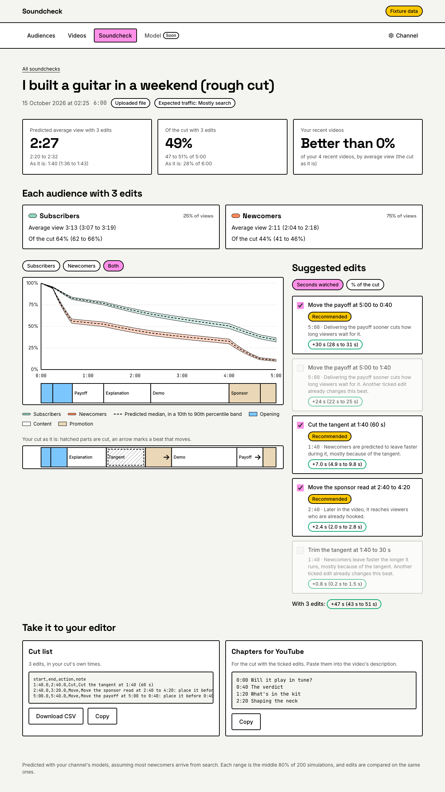
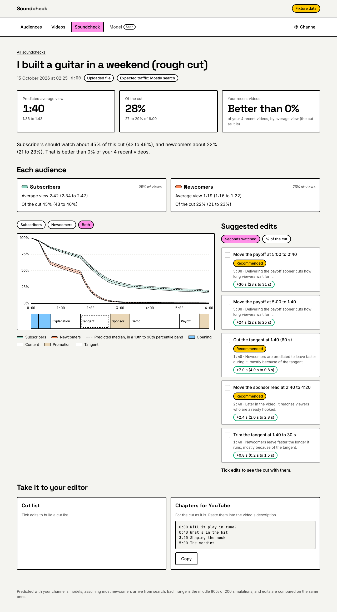
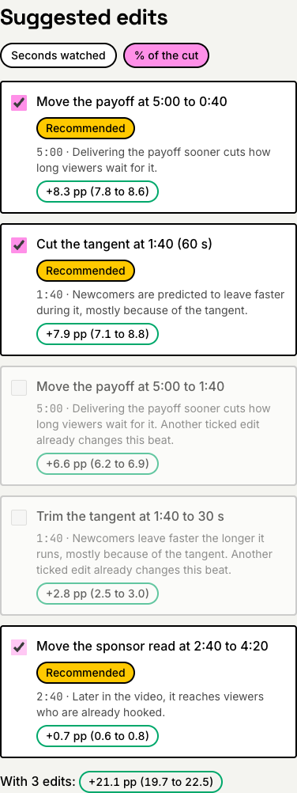
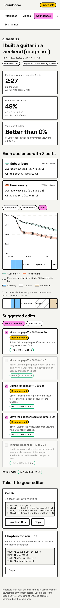

# Phase 15: Edit list and counterfactuals

Oct 15, 2026

A soundcheck now suggests edits. Under the prediction, a panel lists edits that could keep viewers longer: cut a beat, trim it, or move it. Each edit shows its time, a reason, and its own effect with a range, in seconds watched (the default) or in percentage points of the cut. Ticking edits simulates them together: the totals, each audience, the curves and the chapters then describe the edited cut, and a strip of the cut as it is shows what is cut (hatched) and what moves (an arrow). The ticked edits export as a CSV cut list, and the edited cut's chapters copy straight into a YouTube description.

- **Recommended** edits are ticked when the page opens. An edit is recommended only when its whole range is above zero on its own, and it adds a gain above zero on top of the edits already taken (at most 5). Edits whose range crosses zero are shown grey as "uncertain", never recommended.
- **Nothing is recommended while the channel's models are not usable**, as on the test channel (3 videos): edits are still listed and can be tried, under "Not a result yet".
- **Ticking is fast:** the page waits 250 ms after the last click, then the server simulates the cut on the soundcheck's own 200 draws, with no Gemini and no BigQuery. Switching between seconds and percentage asks for nothing new.

Behind it, `job-soundcheck` has a "suggesting" step: it tries every single edit, takes the recommended ones, and asks Gemini (the flash model) for chapter titles once. The reasons come from templates and the model's own numbers.

**Built in eight reviewed commits:**

1. `Simulate edits on a cut`
2. `Search for the best edits`
3. `Suggest edits and chapters in the job`
4. `Add the simulate route`
5. `Recommend only edits sure on their own`
6. `Add the edit panel and exports`
7. `Drop the unused objective from simulate requests`
8. `Verify Phase 15 and write the notes`

## Done when

| Item | Status | Evidence |
| ---- | ------ | -------- |
| Recommendations appear for real rough cuts | **PENDING the live run** | |
| Toggling edits updates the curve in under 400 ms round trip | **PENDING the live run** | Locally (fixtures mode, `next dev`): 315 to 333 ms from click to new numbers over 6 toggles, measured in the page with a MutationObserver; 250 ms of it is the debounce, and the route answered in 34 to 60 ms |
| CSV and chapter exports work | Done | In Chrome (fixtures mode, desktop and phone): **Download CSV** saved `i-built-a-guitar-in-a-weekend-rough-cut-cut-list.csv` with the 3 ticked edits; **Copy** put the cut list and the chapters on the clipboard and said so; chapters follow the edited cut. Tested in jsdom too, with YouTube's rules (first at 0:00, at least 3, each at least 10 s) |
| At least one demo cut where the recommended edits are intuitively sensible, recorded in the notes | Done, on a synthetic model | The demo below: show the result first, cut the off-topic story, move the sponsor read after the build. The real job code on a made-up 6-minute cut, with made-up "usable" models, since the test channel has 3 videos |
| `docs/notes/phase-15.md` written | Done | This file |

**Also verified:**

- **The search** on a 30-beat, 15-minute cut (61 single edits): every single edit in **293 ms** once warm (424 ms on the first run), the whole search with the greedy step in about **390 ms**. The spec's target is 300 ms for 30 beats; the search runs in the job, never on a click.
- **Common random numbers:** two cuts compared on the same draws give a range about 3 times narrower than independent draws (1.6 against 5.0 in the test).
- **The same edits give the same numbers** on every call (seed 1, 200 draws); removing a beat shortens the cut by exactly its length; removing a beat the model blames raises predicted retention. All tested.
- **The page on a phone** (390 px) has no sideways scroll.
- **Deployed** at `7882b5e`: `web:7882b5e-20261015002132` (revision `soundcheck-web-00008-5dh`, min instances 0, max 3) and `job-soundcheck` on `pipeline:7882b5e-20261015001406`. `552dac5` only drops a request field the page no longer sends; it reaches the cloud with the next `deploy-web.sh`.
- **`pnpm check`** passes all 20 tasks: core 594 tests, pipeline 198, web 148, ui 8, modeling 63.

## The demo

The cut: **"I built a guitar in a weekend (rough cut)"**, 6:00, "Mostly search".

| Beat | Time | What it is |
| ---- | ---- | ---------- |
| Hook | 0:00 to 0:15 | The finished guitar, and whether it will stay in tune |
| Branded intro | 0:15 to 0:40 | The channel's animated intro |
| Explanation | 0:40 to 1:40 | What comes in the kit |
| Tangent | 1:40 to 2:40 | A story about his first guitar; a talking head, no visuals, low energy |
| Sponsor read | 2:40 to 3:20 | A string brand |
| Demonstration | 3:20 to 5:00 | Shaping the neck and setting the frets |
| Payoff | 5:00 to 5:40 | Tuning it and playing a full song |
| Call to action | 5:40 to 6:00 | Subscribe for the amp build |

The models: the parity fixture's newcomer model with made-up effects that match common sense (sponsor reads, branded intros, tangents, calls to action, long static shots and waiting for the payoff make viewers leave faster; the payoff and energy keep them), its covariance quartered, and marked usable. Subscribers get the same model at 60% strength. They are not fitted to anything.

What the job suggested, in seconds watched:

| Edit | Own effect | Recommended |
| ---- | ---------- | ----------- |
| Move the payoff at 5:00 to 0:40 | +30 s (28 to 31 s) | Yes |
| Cut the tangent at 1:40 (60 s) | +7.0 s (4.9 to 9.8 s) | Yes |
| Move the sponsor read at 2:40 to 4:20 | +2.4 s (2.0 to 2.8 s) | Yes |
| Move the payoff at 5:00 to 1:40 | +24 s (22 to 25 s) | No: the same beat as the first |
| Trim the tangent at 1:40 to 30 s | +0.8 s (0.2 to 1.5 s) | No: the same beat as the second |

Together: **+47 s (43 to 51 s)**. The average view goes from **1:40** (1:36 to 1:43) to **2:27** (2:20 to 2:32), and the share watched from 28% of 6:00 to 49% of 5:00. In percentage points the order changes: cutting the tangent (+7.9 pp) almost ties moving the payoff (+8.3 pp), since cutting a minute also shortens the cut.

These are the edits an editor would suggest: show the result first, cut the off-topic story, and put the sponsor read after the build. Moving the payoff all the way to 0:40 wins because the made-up model charges a lot for waiting for it; a real channel's model will say how much its viewers mind.

**Cutting the branded intro** is not listed: on its own it lowers seconds watched (−0.9 s, −2.4 to +0.5 s), because subscribers watch those 25 s. Before `Recommend only edits sure on their own`, the greedy step took it on top of the payoff move, so the page showed a "Recommended" edit with a grey "uncertain" effect.

The exports with the 3 recommended edits:

```
start,end,action,note
1:40.0,2:40.0,Cut,Cut the tangent at 1:40 (60 s)
2:40.0,3:20.0,Move,Move the sponsor read at 2:40 to 4:20: place it before 5:00.0
5:00.0,5:40.0,Move,Move the payoff at 5:00 to 0:40: place it before 0:40.0
```

```
0:00 Will it play in tune?
0:40 The verdict
1:20 What's in the kit
2:20 Shaping the neck
```

As it is, the chapters were 0:00, 0:40 "What's in the kit", 3:20 "Shaping the neck" and 5:00 "The verdict". The verdict follows the payoff to 0:40, and the moved sponsor read starts no chapter.

## Screenshots

From fixtures mode with the demo (not committed; the script that made it is not committed either).

The demo with its 3 recommended edits ticked:



The same cut as it is, nothing ticked:



Judged by the share watched instead; edits on a beat that is already changed are muted:



On a phone:



## What the live run said

**PENDING:** Nishchay's rough cut on the deployed app.

## Decisions

By Nishchay:

1. **The plan's recommendations,** approved together:
   - recommend only edits whose whole range is above zero, shown green; others grey as "uncertain"; nothing recommended while the models are not usable;
   - re-time the payoff and open loops after an edit; a cut payoff counts as waiting to the end;
   - a recap moves to before the outro;
   - reasons from templates; Gemini writes only chapter titles, at job time;
   - chapters by YouTube's rules: the first at 0:00, at least 3, each at least 10 s;
   - min instances decided after measuring;
   - no EDL export and no predicted drop-offs;
   - `lru-cache` added;
   - a demo on a channel with 20 or more videos, otherwise on a synthetic model.
2. **Min instances:** PENDING the live measurement.

## Changes from the spec

All are recorded in `docs/plan/phase-15.md`.

- **The route** is `POST /api/v1/channels/[id]/soundchecks/[soundcheckId]/simulate` with `{edits}`, so the channel's ownership check covers it. The answer has the change in both seconds and percentage points, so the objective is not sent. A 400 for edits that cannot go together, 409 before the prediction, 404 for anyone else's.
- **Recommended:** sure on its own and on top of the edits already taken (10th percentile above zero both times), not "median above zero and 10th percentile above −0.5 points", which would recommend uncertain edits against the spec's own "Do not".
- **Moves:** calls to action and recaps go to before the outro (or the end); the payoff never goes before the hook.
- **No Gemini polish** of the reasons: they come from templates and the model's numbers ("Newcomers are predicted to leave faster during it, mostly because of the tangent."). Gemini only titles the chapters, once per soundcheck.
- **The header** reads "Predicted average view with 3 edits: 2:27 (2:20 to 2:32), as it is: 1:40 (1:36 to 1:43)", in the stat cards, instead of one line.
- **Draws:** the job and the route both use seed 1 and 200 draws, so the page's numbers match the job's. Each web instance keeps up to 32 model artifacts and 64 soundchecks' prepared draws in memory.

## Incidents

- **An uncertain edit marked recommended:** the greedy step judged each edit on top of the ones already taken, so an edit that hurts on its own could join. Found on the demo; the search now takes only edits that are sure on their own, which also cut the whole search from about 1.3 s to 390 ms.
- **Chapters after a move:** moving the payoff left "The verdict" pointing at the call to action. A moved beat now carries its chapter when it opens it.
- **The phone page scrolled sideways** (656 px): the long CSV lines widened the exports' one-column grid. It now uses `minmax(0, 1fr)`, like the main layout.
- **A timing that was not real:** one toggle looked like 830 ms. Playwright checks for text with growing pauses (up to 500 ms), so it saw the change late; timing in the page with a MutationObserver gave 322 ms.
- **The search's first speed** was 380 to 530 ms for the singles; building bins once per channel context and a flat loop brought it under 300 ms.
- **Tests, not code:** a property generator made zero-length beats; a cut payoff was first mapped to the previous beat's end; the CRN test compared against the wrong width. Each was fixed in its test or before its commit.
- **Machine load:** the Phase 14 form test timed out under `pnpm check`'s 20 parallel tasks; it now pastes instead of typing.

## Notes for later phases

- **A channel with 20 or more videos** is the real test: the demo's models are made up, and the test channel recommends nothing.
- **Phase 14's to-dos:** PENDING the live run.
- **`recommendedEffect`** (the recommended edits together) is stored on each soundcheck but not shown yet; the soundcheck list could say "+47 s with the recommended edits".
- **The cut list** gives every time in the cut as it is, so an editor moving beats one by one must not re-read the times after each move.
- **Chapter titles** are written once at job time; ticking edits only re-times and drops them.
- **Fixtures** still do not include soundchecks, their inputs or model artifacts; `export-fixtures` could export them, and the demo could become a committed script.
